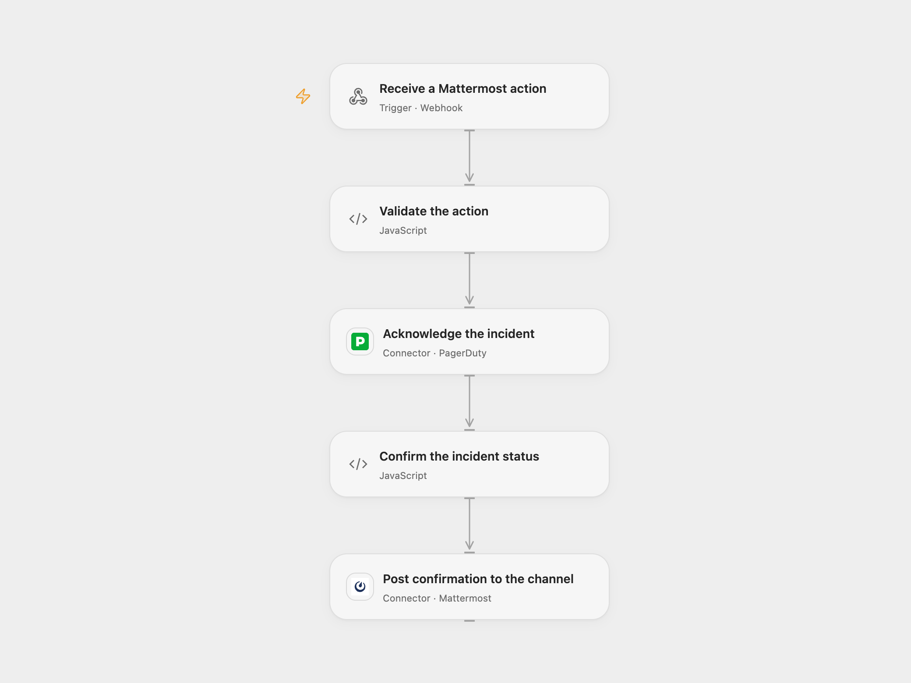

# Acknowledge a PagerDuty Incident from Mattermost

Acknowledge a PagerDuty incident from a Mattermost action and post a confirmation in its channel.

<picture>
  <source media="(prefers-color-scheme: dark)" srcset="preview-dark.png">
  
</picture>

[Open Flow JSON](templates/acknowledge-pagerduty-incident-from-mattermost.openflow.json) · [n8n JSON](templates/acknowledge-pagerduty-incident-from-mattermost.n8n.json)

## Setup

Connect PagerDuty in **Acknowledge the incident** and Mattermost in **Post confirmation to the channel**. Enter the email of a PagerDuty user authorized to acknowledge incidents in **Validate the action**. Create a secret Variable named MATTERMOST_ACTION_SECRET containing at least 24 unpredictable characters and bind it to that node.

Configure a Mattermost interactive message button with the webhook URL and a context containing pagerduty_incident and action_secret. The action_secret must equal the secret Variable. Mattermost forwards the context and channel ID when the button is clicked. Open Flow’s webhook body fields cover the Mattermost v11.11.1 button request; add any extra fields sent by your server to the webhook definition. Anyone able to read the button’s integration context can obtain the shared secret, so restrict who can read or create the post, the webhook URL and workflow history. Use HTTPS and restrict network access where possible.

In n8n, connect PagerDuty and Mattermost, set the PagerDuty email in **Validate the action**, and configure MATTERMOST_ACTION_SECRET as an environment variable accessible to the Code node. Self-hosted n8n may require enabling environment access for nodes. Configure the button with that same secret and the n8n webhook URL. Enable only one format.

## Behavior

A button click returns HTTP 200 with an empty JSON object as an immediate receipt. The workflow then validates the shared secret and required incident and channel IDs, acknowledges the PagerDuty incident, checks the returned ID and acknowledged status, and posts a confirmation in the action’s channel. The immediate receipt confirms receipt only; it does not mean PagerDuty has completed the update.

A failed or uncertain PagerDuty update can still have taken effect. A later Mattermost post may fail after acknowledgement. Inspect PagerDuty and the channel before retrying. This shared secret is a bearer capability and does not identify individual users; repeated requests are not deduplicated.

## Changes to the source

- Replace the original PagerDuty email with configuration and require a shared action secret before writing.
- Return valid JSON to the Mattermost action immediately, and confirm PagerDuty’s returned incident ID and status before posting success.

Source and license

Adapted from [Acknowledge a PagerDuty incident from Mattermost](https://github.com/Zie619/n8n-workflows/blob/ae8cf6dc5b873cbb4f74587aa9180ed3a9f70682/workflows/Mattermost/0855_Mattermost_Pagerduty_Automate_Webhook.json) in [Zie619/n8n-workflows](https://github.com/Zie619/n8n-workflows). The source export does not identify a separate template author or license.

The collection’s [MIT notice](https://github.com/Zie619/n8n-workflows/blob/94007c1445d9258a7da116646b79473e7c7c3282/LICENSE) is pinned at a later revision. This is the collection notice at that revision; it does not establish a separate original template author's license. Our changes are listed above; see [repository licensing](../../README.md#licensing).

> MIT License
>
> Copyright (c) 2025 Zie619
>
> Permission is hereby granted, free of charge, to any person obtaining a copy
> of this software and associated documentation files (the "Software"), to deal
> in the Software without restriction, including without limitation the rights
> to use, copy, modify, merge, publish, distribute, sublicense, and/or sell
> copies of the Software, and to permit persons to whom the Software is
> furnished to do so, subject to the following conditions:
>
> The above copyright notice and this permission notice shall be included in all
> copies or substantial portions of the Software.
>
> THE SOFTWARE IS PROVIDED "AS IS", WITHOUT WARRANTY OF ANY KIND, EXPRESS OR
> IMPLIED, INCLUDING BUT NOT LIMITED TO THE WARRANTIES OF MERCHANTABILITY,
> FITNESS FOR A PARTICULAR PURPOSE AND NONINFRINGEMENT. IN NO EVENT SHALL THE
> AUTHORS OR COPYRIGHT HOLDERS BE LIABLE FOR ANY CLAIM, DAMAGES OR OTHER
> LIABILITY, WHETHER IN AN ACTION OF CONTRACT, TORT OR OTHERWISE, ARISING FROM,
> OUT OF OR IN CONNECTION WITH THE SOFTWARE OR THE USE OR OTHER DEALINGS IN THE
> SOFTWARE.

