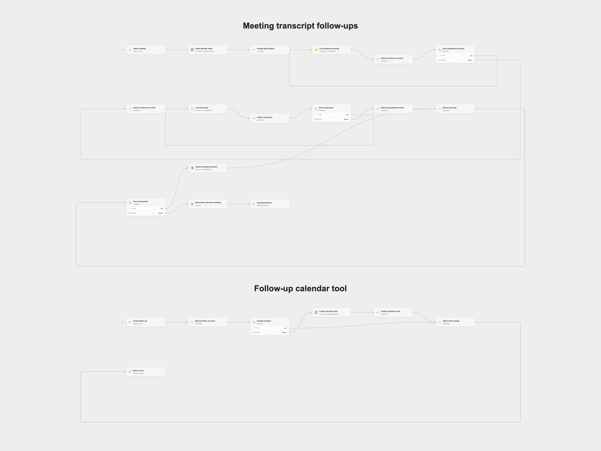

# Action Meeting Transcript Follow-ups

Summarize a Google Meet transcript and schedule agreed follow-up meetings.

<!-- template-actions:start -->
[](https://openflow.run/templates/action-meeting-transcript-follow-ups/) [](templates/action-meeting-transcript-follow-ups.n8n.json)
<!-- template-actions:end -->

<picture>
  <source media="(prefers-color-scheme: dark)" srcset="preview-dark.png">
  
</picture>

## Setup

Configure Google Calendar, Meet and Docs connections, a tool-capable model and persistent State. Import Meeting transcript follow-ups and Follow-up calendar tool, publish Follow-up calendar tool and refresh its interface in the main workflow. Set the same calendar ID in the calendar tool and supply it with the event ID when starting. Activate the workflow so its self-referencing calendar tool can run; use the same calendar ID for both Calendar nodes.

## Behavior

The workflow matches the timed Calendar event to a single overlapping Meet conference, reads all generated transcript documents, summarizes the discussion and may create agreed follow-up meetings with attendees. The model can make mistakes; review the summary and calendar. The transcript is sent to the model. Avoid overlapping runs. Inspect the calendar before clearing pending checkpoints after an uncertain event creation. The calendar tool requires RFC3339 timestamps with explicit timezone offsets; invitations are sent to the supplied attendees. Transcripts must have FILE_GENERATED status and accessible Docs files.

<details>
<summary>In n8n</summary>

In n8n configure Google OAuth credentials with Calendar, Meet and Drive access, calendar and event IDs, and a Data Table with item_key, status and response text columns.

</details>

<details>
<summary>Inspiration &amp; credits</summary>

Adapted from [Actioning Your Meeting Next Steps using Transcripts and AI](https://github.com/enescingoz/awesome-n8n-templates/blob/827110332c21cbe000ab13f6d292d5adb1f1f8db/OpenAI_and_LLMs/Actioning%20Your%20Meeting%20Next%20Steps%20using%20Transcripts%20and%20AI.json) in [enescingoz/awesome-n8n-templates](https://github.com/enescingoz/awesome-n8n-templates).

Source collection notice: © 2024–2026 Enes Cingoz, [CC BY 4.0](https://github.com/enescingoz/awesome-n8n-templates/blob/827110332c21cbe000ab13f6d292d5adb1f1f8db/LICENSE). The source export does not identify a separate template author or license. See [repository licensing](../../README.md#licensing) for the scope of OOMOL contributions and third-party material.


Changes from source: Match conference records by event time, paginate transcript lookup, repair the tool input and create all attendees together, use a current model and add event-write checkpoints.

Collection license notice:

```text
Creative Commons Attribution 4.0 International License

Copyright (c) 2024-2026 Enes Cingoz

You are free to:

  Share - copy and redistribute the material in any medium or format
  Adapt - remix, transform, and build upon the material for any purpose,
  even commercially.

Under the following terms:

  Attribution - You must give appropriate credit, provide a link to the
  license, and indicate if changes were made. You may do so in any
  reasonable manner, but not in any way that suggests the licensor
  endorses you or your use.

  No additional restrictions - You may not apply legal terms or
  technological measures that legally restrict others from doing
  anything the license permits.

Notices:

  You do not have to comply with the license for elements of the
  material in the public domain or where your use is permitted by an
  applicable exception or limitation.

  No warranties are given. The license may not give you all of the
  permissions necessary for your intended use. For example, other rights
  such as publicity, privacy, or moral rights may limit how you use the
  material.

For the full license text, see:
https://creativecommons.org/licenses/by/4.0/legalcode
```

</details>
