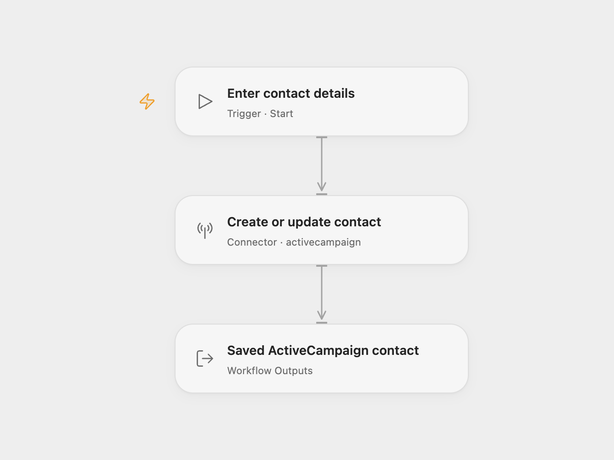

# ActiveCampaign Contact Upsert

Create an ActiveCampaign contact or update the contact with the same email address. Each run writes its first and last name.

<picture>
  <source media="(prefers-color-scheme: dark)" srcset="preview-dark.png">
  
</picture>

[Open Flow JSON](templates/activecampaign-contact-upsert.openflow.json) · [n8n JSON](templates/activecampaign-contact-upsert.n8n.json)

## Setup

Select your ActiveCampaign account in **Create or update contact**. The connection needs your account API URL and API token, with permission to add and edit contacts. Run with **Email**, **First Name** and **Last Name**. All three values are required in this template. In n8n, choose ActiveCampaign credentials, set the email and both names, and keep **Update if Exists** enabled.

Each run makes one contact sync request. An existing email updates that contact; a new email creates a contact. Other contact fields remain unchanged. The template does not subscribe the contact to a list or add tags. Existing account automations may respond to the contact change.

Open Flow returns the normalized contact and its complete raw record. n8n returns the saved contact from the API response. A failed request stops the run; no workflow retry or rollback is configured. Check the contact before repeating a request with an uncertain result.

## Changes to the source

- Replace blank email and name fields with user configuration.
- Require email, first name and last name as Open Flow run inputs.
- Expose the saved contact as an Open Flow output.

Source and license

Adapted from [ActiveCampaign contact sync workflow](https://github.com/Zie619/n8n-workflows/blob/ae8cf6dc5b873cbb4f74587aa9180ed3a9f70682/workflows/Manual/0951_Manual_Activecampaign_Automation_Triggered.json) in [Zie619/n8n-workflows](https://github.com/Zie619/n8n-workflows). The source export does not identify a separate template author or license.

The collection’s [MIT notice](https://github.com/Zie619/n8n-workflows/blob/94007c1445d9258a7da116646b79473e7c7c3282/LICENSE) is pinned at a later revision. This is the collection notice at that revision; it does not establish a separate original template author's license. Our changes are listed above; see [repository licensing](../../README.md#licensing).

> MIT License
>
> Copyright (c) 2025 Zie619
>
> Permission is hereby granted, free of charge, to any person obtaining a copy
> of this software and associated documentation files (the "Software"), to deal
> in the Software without restriction, including without limitation the rights
> to use, copy, modify, merge, publish, distribute, sublicense, and/or sell
> copies of the Software, and to permit persons to whom the Software is
> furnished to do so, subject to the following conditions:
>
> The above copyright notice and this permission notice shall be included in all
> copies or substantial portions of the Software.
>
> THE SOFTWARE IS PROVIDED "AS IS", WITHOUT WARRANTY OF ANY KIND, EXPRESS OR
> IMPLIED, INCLUDING BUT NOT LIMITED TO THE WARRANTIES OF MERCHANTABILITY,
> FITNESS FOR A PARTICULAR PURPOSE AND NONINFRINGEMENT. IN NO EVENT SHALL THE
> AUTHORS OR COPYRIGHT HOLDERS BE LIABLE FOR ANY CLAIM, DAMAGES OR OTHER
> LIABILITY, WHETHER IN AN ACTION OF CONTRACT, TORT OR OTHERWISE, ARISING FROM,
> OUT OF OR IN CONNECTION WITH THE SOFTWARE OR THE USE OR OTHER DEALINGS IN THE
> SOFTWARE.

