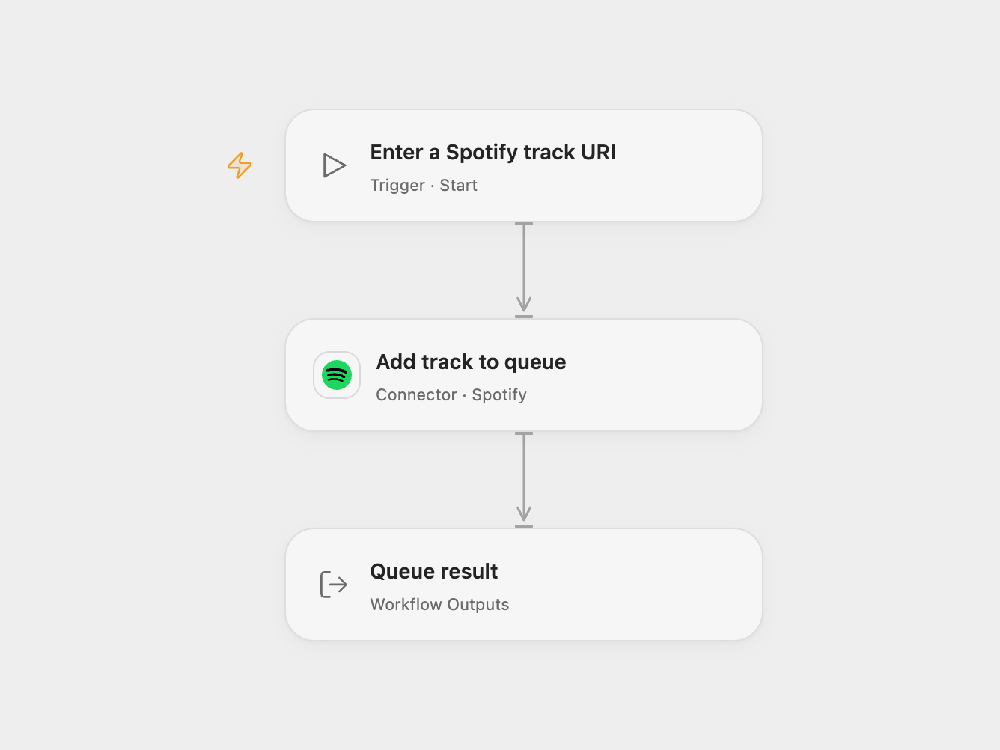

# Add a Track to the Spotify Queue

Add a Spotify track to the current playback queue.

<picture>
  <source media="(prefers-color-scheme: dark)" srcset="preview-dark.png">
  
</picture>

[Open Flow JSON](templates/add-a-track-to-spotify-queue.openflow.json) · [n8n JSON](templates/add-a-track-to-spotify-queue.n8n.json)

## Setup

Use a Spotify Premium account with an active playback device and grant `user-modify-playback-state` access. Connect Spotify in Open Flow and run with a track URI such as `spotify:track:YOUR_TRACK_ID`. In n8n connect Spotify and enter the track URI in **Spotify**. Run one format.

## Behavior

A manual run adds one track to the active device's playback queue. Spotify acknowledges the command, but execution order relative to other player commands is not guaranteed. If the request fails or its result is uncertain, inspect the queue before retrying; repeating the request can add the track again.

Inspiration &amp; credits

## Changes to the source

- Replace the fixed track URI with a run input or configuration placeholder.

Adapted from [Sample Spotify](https://github.com/Zie619/n8n-workflows/blob/ae8cf6dc5b873cbb4f74587aa9180ed3a9f70682/workflows/Manual/1181_Manual_Spotify_Automation_Triggered.json) in [Zie619/n8n-workflows](https://github.com/Zie619/n8n-workflows). The source export does not identify a separate template author or license.

The collection’s [MIT notice](https://github.com/Zie619/n8n-workflows/blob/94007c1445d9258a7da116646b79473e7c7c3282/LICENSE) is pinned at a later revision. This is the collection notice at that revision; it does not establish a separate original template author's license. Our changes are listed above; see [repository licensing](../../README.md#licensing).

> MIT License
>
> Copyright (c) 2025 Zie619
>
> Permission is hereby granted, free of charge, to any person obtaining a copy
> of this software and associated documentation files (the "Software"), to deal
> in the Software without restriction, including without limitation the rights
> to use, copy, modify, merge, publish, distribute, sublicense, and/or sell
> copies of the Software, and to permit persons to whom the Software is
> furnished to do so, subject to the following conditions:
>
> The above copyright notice and this permission notice shall be included in all
> copies or substantial portions of the Software.
>
> THE SOFTWARE IS PROVIDED "AS IS", WITHOUT WARRANTY OF ANY KIND, EXPRESS OR
> IMPLIED, INCLUDING BUT NOT LIMITED TO THE WARRANTIES OF MERCHANTABILITY,
> FITNESS FOR A PARTICULAR PURPOSE AND NONINFRINGEMENT. IN NO EVENT SHALL THE
> AUTHORS OR COPYRIGHT HOLDERS BE LIABLE FOR ANY CLAIM, DAMAGES OR OTHER
> LIABILITY, WHETHER IN AN ACTION OF CONTRACT, TORT OR OTHERWISE, ARISING FROM,
> OUT OF OR IN CONNECTION WITH THE SOFTWARE OR THE USE OR OTHER DEALINGS IN THE
> SOFTWARE.

