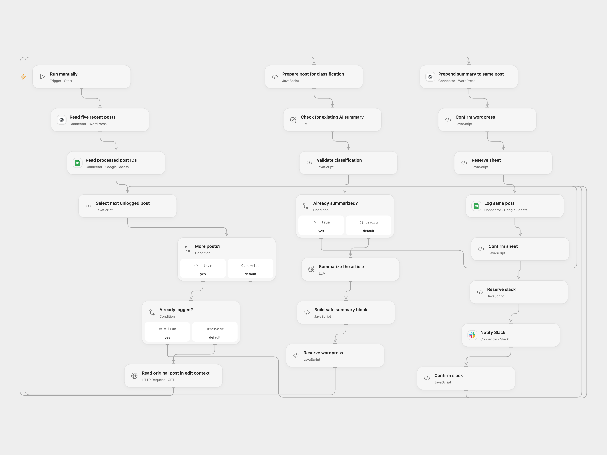

# Add AI Summaries to WordPress Posts

Add an AI summary to recent WordPress posts, log each update and notify Slack.

<!-- template-actions:start -->
 
<!-- template-actions:end -->

<picture>
  <source media="(prefers-color-scheme: dark)" srcset="preview-dark.png">
  
</picture>

## Setup

Connect WordPress, Google Sheets and Slack. Supply the same public HTTPS WordPress site URL and credentials with edit permission to the WordPress connection and the edit-context HTTP node. Set the sheet ID and Slack channel. Use a sheet with columns post_id, summary, post_link, edit_link, summarized_date in that order. Enable persistent State and avoid overlapping runs. In n8n configure the WordPress, Sheets, OpenAI and Slack credentials and a Data Table with item_key and status columns. Use only one format.

## Behavior

A manual run reads the five most recent posts. A post already logged by ID or judged to contain an AI Summary is skipped. For each remaining post, the model prepares four points in its language. A Gutenberg HTML block is prepended to the original raw content, and the rendered excerpt is preserved. The workflow then appends the matching audit row and sends a Slack notification. HTML is reduced to text for Open Flow model input; n8n uses the original Markdown conversion. Model output is escaped and should be reviewed. The original disabled schedule and webhook paths are disconnected and do not run.

Each WordPress update, sheet append and Slack message is reserved independently. An interrupted or uncertain step requires inspection of the corresponding destination before resolving its pending checkpoint; do not blindly replay it. In Open Flow inspect persistent State keys wp-summary:POST_ID:PHASE. In n8n the Data Table retains each reservation as an attempt record, including successful attempts. Check the destination and complete any remaining actions manually; remove a record for retry only after confirming that its action did not occur.

Inspiration &amp; credits

Adapted from [AI-Generated Summary Block for WordPress Posts](https://github.com/enescingoz/awesome-n8n-templates/blob/827110332c21cbe000ab13f6d292d5adb1f1f8db/OpenAI_and_LLMs/AI-Generated%20Summary%20Block%20for%20WordPress%20Posts.json) in [enescingoz/awesome-n8n-templates](https://github.com/enescingoz/awesome-n8n-templates).

Source collection notice: © 2024–2026 Enes Cingoz, [CC BY 4.0](https://github.com/enescingoz/awesome-n8n-templates/blob/827110332c21cbe000ab13f6d292d5adb1f1f8db/LICENSE). The source export does not identify a separate template author or license. See [repository licensing](../../README.md#licensing) for the scope of OOMOL contributions and third-party material.

