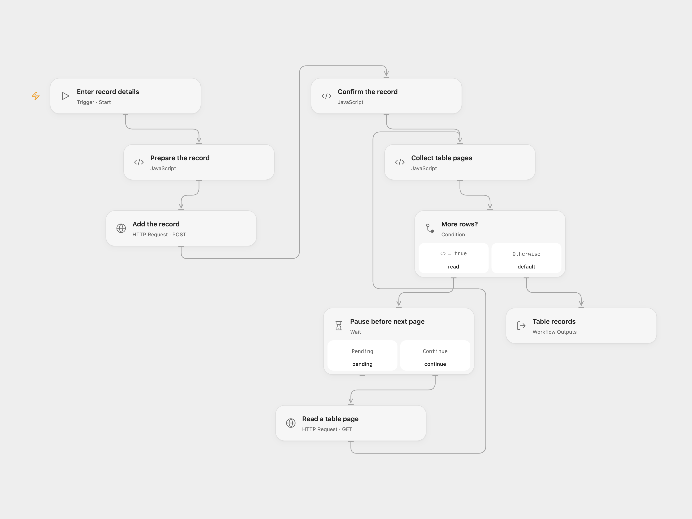

# Add and List Stackby Records

Add an ID and name to a Stackby table and list its records.

<picture>
  <source media="(prefers-color-scheme: dark)" srcset="preview-dark.png">
  
</picture>

[Open Flow JSON](templates/add-and-list-stackby-records.openflow.json) · [n8n JSON](templates/add-and-list-stackby-records.n8n.json)

## Setup

Use a Stackby API key and a table with positive numeric **ID** and text **Name** columns. In Open Flow, create a secret Variable for the API key and bind **Auth Token** on **Add the record** and **Read a table page**. Run with the stack ID, table name, positive numeric ID and name. Table names may contain letters, digits, spaces, underscores and hyphens. In n8n, create an HTTP Header Auth credential with header name `api-key` and your Stackby API key as its value, connect it to both HTTP nodes, and edit **Set record details**.

## Behavior

Each run inserts one record and reads the table in pages of 100 until Stackby returns an empty page. Open Flow pauses 300 ms before each page to reduce request rate; n8n pauses 250 ms between pages. The table may change during paging, so the list is not a snapshot. Open Flow returns an array of records and stops with an error if 100 nonempty pages are reached; n8n returns individual records and has no equivalent page limit. An error stops the run. No retry, rollback or duplicate check is performed; after an uncertain insert, inspect the table before retrying.

## Changes to the source

- Replace the example stack, table and row with inputs, validate the insert and return the complete list.
- Use the Stackby HTTP API in both formats and limit Open Flow paging to prevent an unbounded run. The source Stackby node returns raw row fields without n8n item wrappers; HTTP nodes return valid items.

Source and license

Adapted from [Insert and retrieve data from a table in Stackby](https://github.com/Zie619/n8n-workflows/blob/ae8cf6dc5b873cbb4f74587aa9180ed3a9f70682/workflows/Manual/1203_Manual_Stackby_Automate_Triggered.json) in [Zie619/n8n-workflows](https://github.com/Zie619/n8n-workflows). The matching [n8n community listing](https://n8n.io/workflows/934-insert-and-retrieve-data-from-a-table-in-stackby/) credits Harshil Agrawal. The original template does not state a separate license.

The collection’s [MIT notice](https://github.com/Zie619/n8n-workflows/blob/94007c1445d9258a7da116646b79473e7c7c3282/LICENSE) is pinned at a later revision. This is the collection notice at that revision; it does not establish a separate original template author's license. Our changes are listed above; see [repository licensing](../../README.md#licensing).

> MIT License
>
> Copyright (c) 2025 Zie619
>
> Permission is hereby granted, free of charge, to any person obtaining a copy
> of this software and associated documentation files (the "Software"), to deal
> in the Software without restriction, including without limitation the rights
> to use, copy, modify, merge, publish, distribute, sublicense, and/or sell
> copies of the Software, and to permit persons to whom the Software is
> furnished to do so, subject to the following conditions:
>
> The above copyright notice and this permission notice shall be included in all
> copies or substantial portions of the Software.
>
> THE SOFTWARE IS PROVIDED "AS IS", WITHOUT WARRANTY OF ANY KIND, EXPRESS OR
> IMPLIED, INCLUDING BUT NOT LIMITED TO THE WARRANTIES OF MERCHANTABILITY,
> FITNESS FOR A PARTICULAR PURPOSE AND NONINFRINGEMENT. IN NO EVENT SHALL THE
> AUTHORS OR COPYRIGHT HOLDERS BE LIABLE FOR ANY CLAIM, DAMAGES OR OTHER
> LIABILITY, WHETHER IN AN ACTION OF CONTRACT, TORT OR OTHERWISE, ARISING FROM,
> OUT OF OR IN CONNECTION WITH THE SOFTWARE OR THE USE OR OTHER DEALINGS IN THE
> SOFTWARE.

