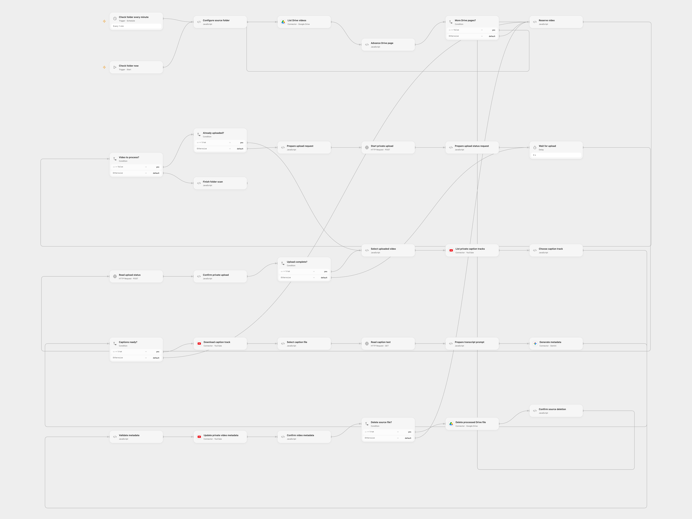

# Add Metadata to Private YouTube Videos

Upload Drive videos privately and use captions to generate YouTube metadata.

<!-- template-actions:start -->
 
<!-- template-actions:end -->

<picture>
  <source media="(prefers-color-scheme: dark)" srcset="preview-dark.png">
  
</picture>

## Setup

Connect Google Drive, YouTube and Gemini. The YouTube connection must include youtube.force-ssl and belong to an account able to edit the uploaded videos. Enable persistent State. In Open Flow set the Drive folder ID and a UTC start time in Configure source folder, then set the authenticated n8n upload and status URLs and bind PRIVATE_VIDEO_RELAY_TOKEN. Only files created at or after that time are considered. Activate the n8n workflow and configure its Drive folder and credentials, YouTube OAuth, Gemini Header Auth, a shared Data Table with item_key, status, video_id and file_id text columns, and Header Auth on all three webhooks. Use either the n8n Drive trigger or Open Flow scheduling for a folder, not both.

## Use

The workflow uploads each video privately and associates its Drive ID with the YouTube ID. It checks available caption tracks, generates a title, description and tags, and updates the same private video. Open Flow checks again on a later scheduled run if captions are not ready. The n8n workflow waits and checks again. Caption generation and availability depend on YouTube; videos without a usable track remain pending. Set the preferred caption language in Choose caption track. Transcript content is sent to Gemini. Review the generated metadata before making a video public.

An uncertain upload remains pending to prevent another upload. Inspect YouTube and the n8n Data Table before retrying. In Open Flow, enter the pending key as ack and use confirmed only after completing the intended effects manually; use absent only after verifying no upload remains. Clear the recovery fields after use. In n8n set deleteSource to true in Configure source deletion to move the file to trash after its metadata succeeds. If the Data Table status is delete_pending, inspect that file and reconcile the checkpoint before resuming. Inspect an uncertain upload and only remove its checkpoint when a retry is safe. To resume metadata for an already confirmed upload, POST its requestId to the authenticated Resume metadata webhook. Avoid overlapping runs or moving and editing files while a scan is in progress. By default the original Drive file remains. To move it to Drive trash after its own metadata update succeeds, set deleteSource to true in Confirm video metadata. A delete_pending checkpoint means the outcome is unknown; inspect that exact Drive file before reconciling.

Inspiration &amp; credits

Use authorized YouTube captions for private videos instead of a public-only transcript actor, wait for captions, preserve upload association and make the source-file deletion optional and checkpoint its outcome.

Adapted from [YT New Video Upload](https://github.com/Zie619/n8n-workflows/blob/ae8cf6dc5b873cbb4f74587aa9180ed3a9f70682/workflows/Code/1865_Code_HTTP_Create_Webhook.json) in [Zie619/n8n-workflows](https://github.com/Zie619/n8n-workflows). Attribution: Zie619 / n8n-workflows.

The collection’s [MIT notice](https://github.com/Zie619/n8n-workflows/blob/94007c1445d9258a7da116646b79473e7c7c3282/LICENSE) is pinned at a later revision. This is the collection notice at that revision; it does not establish a separate original template author's license. Our changes are listed above; see [repository licensing](../../README.md#licensing).

> MIT License
>
> Copyright (c) 2025 Zie619
>
> Permission is hereby granted, free of charge, to any person obtaining a copy
> of this software and associated documentation files (the "Software"), to deal
> in the Software without restriction, including without limitation the rights
> to use, copy, modify, merge, publish, distribute, sublicense, and/or sell
> copies of the Software, and to permit persons to whom the Software is
> furnished to do so, subject to the following conditions:
>
> The above copyright notice and this permission notice shall be included in all
> copies or substantial portions of the Software.
>
> THE SOFTWARE IS PROVIDED "AS IS", WITHOUT WARRANTY OF ANY KIND, EXPRESS OR
> IMPLIED, INCLUDING BUT NOT LIMITED TO THE WARRANTIES OF MERCHANTABILITY,
> FITNESS FOR A PARTICULAR PURPOSE AND NONINFRINGEMENT. IN NO EVENT SHALL THE
> AUTHORS OR COPYRIGHT HOLDERS BE LIABLE FOR ANY CLAIM, DAMAGES OR OTHER
> LIABILITY, WHETHER IN AN ACTION OF CONTRACT, TORT OR OTHERWISE, ARISING FROM,
> OUT OF OR IN CONNECTION WITH THE SOFTWARE OR THE USE OR OTHER DEALINGS IN THE
> SOFTWARE.

