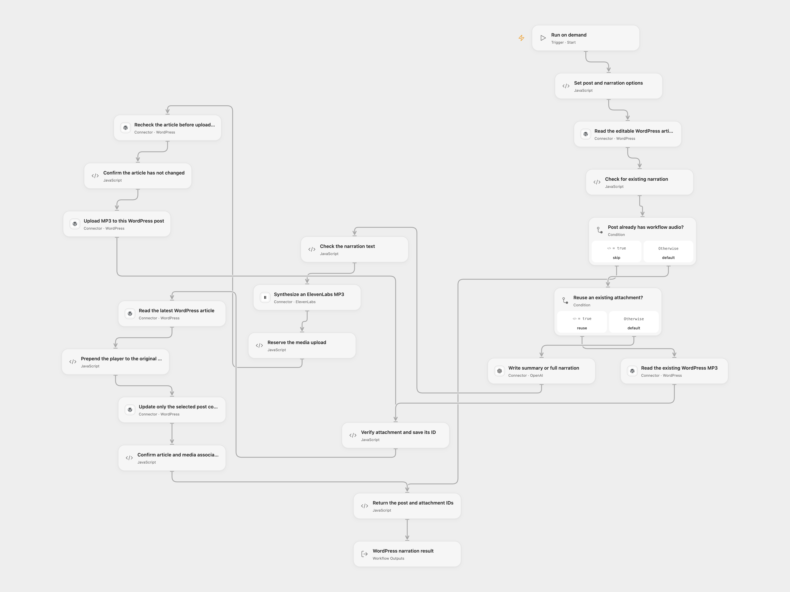

# Add Audio Narration to WordPress Articles

Turn a WordPress article or its summary into MP3 audio and place the player above the existing post.

<!-- template-actions:start -->
 
<!-- template-actions:end -->

<picture>
  <source media="(prefers-color-scheme: dark)" srcset="preview-dark.png">
  
</picture>

## Setup

1. Connect a WordPress site over HTTPS using an application password. The account needs permission to edit the post and upload attachments. Allow **Provider API Request** on the three WordPress read nodes and use the same WordPress connection throughout.
2. In **Set post and narration options**, enter the post ID, choose `summary` or `transcript`, and enter an ElevenLabs voice ID. Connect OpenAI and ElevenLabs. The ElevenLabs connection needs file transit for MP3 delivery.
3. Run manually and view the post. The player is inserted above the existing editor content. A workflow-generated audio block already on the post is reused as the result.

## Behavior

The workflow sends the rendered article to OpenAI and the narration text to ElevenLabs. It preserves the original editable WordPress content. The ElevenLabs model supports narration up to 10,000 characters per request. Choose a summary if a full transcription exceeds that limit. Finish any edits before running the workflow. WordPress can accept an edit between the workflow’s final read and update.

If a media upload or post update was uncertain, check the post and its Media Library before starting another run. To finish with an existing upload, set **Reuse Media ID** to the MP3 attachment for this post and narration mode. The file name starts with `article-<post-id>-<mode>`. Keep other runs for that post stopped while recovering. If WordPress confirms no file was created, clear only the corresponding `wp-article-audio:<post-id>` State entry for the run’s scope before starting over. After a successful recovery, reset **Reuse Media ID** to zero.

In n8n

Set the HTTPS site URL, post ID, narration mode and voice in **Set post and narration options**. Use WordPress **Basic Auth** with the application password, OpenAI **Bearer Auth**, and ElevenLabs **Header Auth** with header name `xi-api-key`.

Choose one Data Table with text columns `post_key`, `status`, and `media_id` in the checkpoint nodes. Run only one manual execution at a time per post. To recover, check WordPress and set the media ID in **Set post and narration options**. Replay from the manual trigger so the workflow checks the article and checkpoint. If WordPress confirms there was no upload, remove only the matching pending checkpoint before retrying from the trigger.

Inspiration &amp; credits

Adapted from [Generate and upload an audio summary of a WordPress article](https://github.com/Zie619/n8n-workflows/blob/ae8cf6dc5b873cbb4f74587aa9180ed3a9f70682/workflows/Manual/0757_Manual_Wordpress_Create_Webhook.json) in [Zie619/n8n-workflows](https://github.com/Zie619/n8n-workflows). Attribution: phil (original workflow) / Zie619 (collection). See the [original n8n gallery template](https://n8n.io/workflows/3028-generate-and-upload-an-audio-summary-of-a-wordpress-or-woocommerce-article/).

The collection’s [MIT notice](https://github.com/Zie619/n8n-workflows/blob/94007c1445d9258a7da116646b79473e7c7c3282/LICENSE) is pinned at a later revision. This is the collection notice at that revision; it does not establish a separate original template author's license. Our changes are listed above; see [repository licensing](../../README.md#licensing).

> MIT License
>
> Copyright (c) 2025 Zie619
>
> Permission is hereby granted, free of charge, to any person obtaining a copy
> of this software and associated documentation files (the "Software"), to deal
> in the Software without restriction, including without limitation the rights
> to use, copy, modify, merge, publish, distribute, sublicense, and/or sell
> copies of the Software, and to permit persons to whom the Software is
> furnished to do so, subject to the following conditions:
>
> The above copyright notice and this permission notice shall be included in all
> copies or substantial portions of the Software.
>
> THE SOFTWARE IS PROVIDED "AS IS", WITHOUT WARRANTY OF ANY KIND, EXPRESS OR
> IMPLIED, INCLUDING BUT NOT LIMITED TO THE WARRANTIES OF MERCHANTABILITY,
> FITNESS FOR A PARTICULAR PURPOSE AND NONINFRINGEMENT. IN NO EVENT SHALL THE
> AUTHORS OR COPYRIGHT HOLDERS BE LIABLE FOR ANY CLAIM, DAMAGES OR OTHER
> LIABILITY, WHETHER IN AN ACTION OF CONTRACT, TORT OR OTHERWISE, ARISING FROM,
> OUT OF OR IN CONNECTION WITH THE SOFTWARE OR THE USE OR OTHER DEALINGS IN THE
> SOFTWARE.

