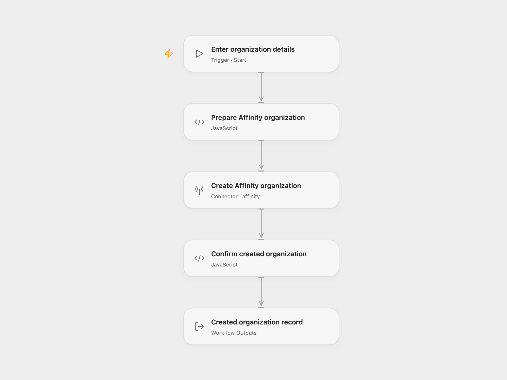

# Affinity Organization Creator

Create one Affinity organization with a name and domain.

<picture>
  <source media="(prefers-color-scheme: dark)" srcset="preview-dark.png">
  
</picture>

[Open Flow JSON](templates/affinity-organization-creator.openflow.json) · [n8n JSON](templates/affinity-organization-creator.n8n.json)

## Setup

Select your Affinity API-key account in **Create Affinity organization** and allow **Provider API** access. This permission is separate from individual Action permissions. The account must be allowed to create organizations. Run with the organization **Name** and **Domain**, such as `example.com`. In n8n, configure the same two fields and Affinity credentials in **Affinity**.

Each run sends one creation request and returns the complete organization record. No people are associated and the organization is not added to a list by this workflow. Affinity’s API attributes the change to the user who owns the key.

Open Flow uses the managed Affinity Provider API with Bearer authentication. n8n’s native client uses Basic authentication. Affinity’s V1 API supports both methods.

Errors and unexpected responses stop the run without retry or rollback. A repeated run can submit another organization creation request. The workflow has no lookup, upsert or duplicate detection; check Affinity before retrying an uncertain write.

## Changes to the source

- Require the name and domain as Open Flow run inputs.
- Use the Affinity Provider API for organization creation, which has no equivalent current Action.
- Validate the completed organization response and expose its full record.

## Source and license

Adapted from [Create an organization in Affinity](https://github.com/Zie619/n8n-workflows/blob/ae8cf6dc5b873cbb4f74587aa9180ed3a9f70682/workflows/Manual/1210_Manual_Affinity_Create_Triggered.json) in [Zie619/n8n-workflows](https://github.com/Zie619/n8n-workflows). The source export does not identify a separate template author or license.

The collection’s [MIT notice](https://github.com/Zie619/n8n-workflows/blob/94007c1445d9258a7da116646b79473e7c7c3282/LICENSE) is pinned at a later revision. This is the collection notice at that revision; it does not establish a separate original template author's license. Our changes are listed above; see [repository licensing](../../README.md#licensing).

> MIT License
>
> Copyright (c) 2025 Zie619
>
> Permission is hereby granted, free of charge, to any person obtaining a copy
> of this software and associated documentation files (the "Software"), to deal
> in the Software without restriction, including without limitation the rights
> to use, copy, modify, merge, publish, distribute, sublicense, and/or sell
> copies of the Software, and to permit persons to whom the Software is
> furnished to do so, subject to the following conditions:
>
> The above copyright notice and this permission notice shall be included in all
> copies or substantial portions of the Software.
>
> THE SOFTWARE IS PROVIDED "AS IS", WITHOUT WARRANTY OF ANY KIND, EXPRESS OR
> IMPLIED, INCLUDING BUT NOT LIMITED TO THE WARRANTIES OF MERCHANTABILITY,
> FITNESS FOR A PARTICULAR PURPOSE AND NONINFRINGEMENT. IN NO EVENT SHALL THE
> AUTHORS OR COPYRIGHT HOLDERS BE LIABLE FOR ANY CLAIM, DAMAGES OR OTHER
> LIABILITY, WHETHER IN AN ACTION OF CONTRACT, TORT OR OTHERWISE, ARISING FROM,
> OUT OF OR IN CONNECTION WITH THE SOFTWARE OR THE USE OR OTHER DEALINGS IN THE
> SOFTWARE.
