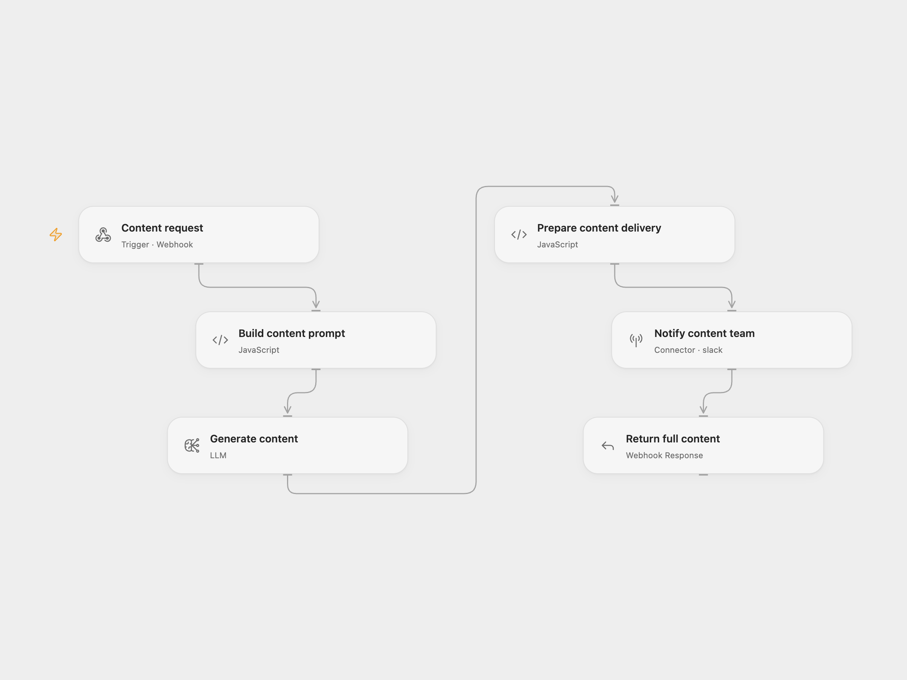

# AI Content to Slack

Send a topic to a webhook and receive an AI draft as JSON. The workflow also posts the topic, content type, and a 500-character excerpt to Slack.

<picture>
  <source media="(prefers-color-scheme: dark)" srcset="preview-dark.png">
  
</picture>

[Open Flow JSON](templates/ai-content-to-slack.openflow.json) · [n8n JSON](templates/ai-content-to-slack.n8n.json)

## Setup

For Open Flow, import the JSON, select a configured Claude Sonnet 4.6 model in **Generate content**, and connect Slack in **Notify content team**. Replace `YOUR_SLACK_CHANNEL_ID` and invite the connected bot to that channel.

For n8n, select an Anthropic credential in **Generate Content**, connect Slack in **Notify via Slack**, and replace its channel ID.

Publish and enable the workflow. Send a JSON POST request to its webhook URL:

```json
{
  "topic": "How our support team uses automation",
  "type": "newsletter",
  "language": "English",
  "tone": "clear and practical"
}
```

All four fields are optional strings. The content types are `blog`, `newsletter`, and `social`; missing or unknown types use `blog`. Defaults are the topic “AI automation trends”, English, and a professional but approachable tone. A successful response contains `status`, `topic`, `contentType`, and the full `content`.

The workflow sends one Slack message before returning success. A model or Slack failure prevents a success response. Open Flow waits up to 60 seconds for the HTTP response; timing out does not cancel the run. Check the run before retrying because a retry can create another Slack message. Review generated facts and wording before publishing.

<details>
<summary>Inspiration &amp; credits</summary>

## Changes to the source

- Read topic settings from the webhook body.
- Build API and response JSON safely when the topic or generated text contains quotes or line breaks.
- Use the Slack connector with a selected channel in both formats.
- Make Slack delivery and the success response sequential, and bind the returned content to the generation step.
- Normalize unknown content types to the blog prompt, escape Slack link and mention markup, and reject empty model results.

Adapted from [Claude AI Content Generator](https://github.com/enescingoz/awesome-n8n-templates/blob/827110332c21cbe000ab13f6d292d5adb1f1f8db/OpenAI_and_LLMs/Claude%20AI%20Content%20Generator.json) in [enescingoz/awesome-n8n-templates](https://github.com/enescingoz/awesome-n8n-templates).

Source collection notice: © 2024–2026 Enes Cingoz, [CC BY 4.0](https://github.com/enescingoz/awesome-n8n-templates/blob/827110332c21cbe000ab13f6d292d5adb1f1f8db/LICENSE). The source export does not identify a separate template author or license. This adaptation includes the changes listed above; see [repository licensing](../../README.md#licensing) for the scope of OOMOL contributions and third-party material.

</details>
