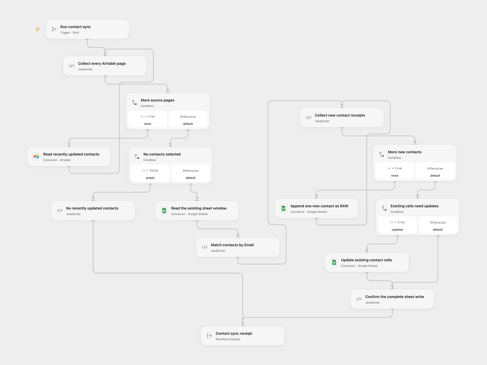

# Airtable Contacts to Google Sheets

Update an existing Google Sheet with recently changed Airtable contacts. Match rows by Email and insert new contacts without interpreting cell text as formulas.

<picture>
  <source media="(prefers-color-scheme: dark)" srcset="preview-dark.png">
  
</picture>

[Open Flow JSON](templates/airtable-contacts-to-google-sheets.openflow.json) · [n8n JSON](templates/airtable-contacts-to-google-sheets.n8n.json)

## Setup and run

Connect Airtable and Google Sheets. In **Read recently updated contacts**, set the source base and table. The `LastUpdated` date field uses the source formula `{LastUpdated} >= DATEADD(TODAY(), -1, 'days')`. Airtable evaluates that calendar-day boundary; it is not a rolling24-hour comparison. All matching pages are read.

Set the same spreadsheet ID on **Read the existing sheet window**, **Append one new contact as RAW** and **Update existing contact cells**. The `A1:E1000` lookup selects the first worksheet. Row1 must contain contiguous, unique field-name headers including `Email`, with at most five columns. Create the headers before running. Airtable field names and Email keys match exactly, with no case folding or trimming. Existing nonempty keys in the lookup window must be unique text; incoming keys must be unique nonempty text.

In n8n, select an **Airtable Personal Access Token** on the source node. Set the same spreadsheet ID in all three HTTP Request URLs and choose a **Google Sheets OAuth2 API** credential with read/write access on each. The append URL is an expression; replace only its spreadsheet ID. Run manually after configuration. The source has no scheduled trigger; none is added.

## Sync behavior

All Airtable pages and the existing sheet window are read and validated before any write. Each new Email is appended separately, in source order. After every new-contact append completes, one [Sheets values batch update](https://developers.google.com/workspace/sheets/api/reference/rest/v4/spreadsheets.values/batchUpdate) updates the provided non-key cells of existing contacts. A matched record containing no such values remains unchanged. The Email key itself is not rewritten.

Both operations use `RAW`, so text beginning with `=` stays text. The legacy source helper converts new-row values to text, including numbers and booleans; this behavior is retained. Existing-row updates keep provided primitive values. Null or absent fields leave an existing cell untouched, including a formula; they are blank in a new row. Extra source fields outside the headers are ignored. Mapped attachment/link/object values must be converted to ordinary cell values before using this template.

`A1:E1000` limits **lookup**, rather than the number of contacts that can be appended. Google chooses the append location and can return a row beyond1,000. Such rows will not be matched by a later run using the unchanged lookup window and can be appended again. Use a table suited to that fixed window, or adapt its range and validation together for larger datasets. No row is deleted and no header or column is added.

Missing or duplicate keys, blank/duplicate headers, malformed records or invalid mapped cells fail before writing. An empty Airtable selection performs no Sheets operation; Open Flow returns zeros and n8n ends without a result. Completed runs report updated, inserted, unchanged and total record counts, with record/email/row associations. Append and cell-update receipts are checked before completion.

There is no workflow retry or cross-service transaction. A failed new-contact append stops later appends and all existing-row updates. A later update failure leaves earlier appends in place. A lost or incomplete response may already have changed the sheet; inspect it before repeating the run. Receipt validation does not roll back remote changes. Avoid concurrent syncs or sheet edits between the read and write. Open Flow's per-invocation Code limits still apply, including1 MiB for input and result in the inspected host. Each Airtable page and new-contact append runs as a separate native execution; large accumulated data fails rather than being truncated.

## Changes to the source

Airtable version1 does not accept the source’s `search`/`baseId` parameters. Both formats use its real list/pagination contract and record `fields`. Sheets version1 supports `upsert`, but its actual match parameter is `key`, defaulting to `id`; the source’s `options.compareColumn: Email` is ignored. Its top-level `valueInputMode` and `columnHeaderRow` are also ignored, while RAW is already the native default.

The old Sheets append helper additionally builds the wrong header range, `A11:E10001`, from the source’s numeric `A1:E1000` range. The repaired n8n format uses visible authenticated HTTP operations and a one-row append feedback loop. Open Flow uses native Sheets range-read, append and batch-update Actions. Its generic upsert Action forces `USER_ENTERED` and can expand columns/read the whole sheet, so it cannot preserve these settings.

The original helper’s new-appends-before-existing-updates order, null skipping and new-cell text conversion are retained. Both formats validate the complete source/target mapping, reject ambiguous duplicate keys and check receipts. No atomic success or original partial-write rollback is claimed. Tests execute actual Provider/native implementations and the published SDK host with deterministic account/transport fixtures; live permissions, append placement, formula evaluation, concurrent edits and cloud persistence remain unverified.

Source and license

Adapted from [Airtable to Google Sheets Auto-Sync](https://github.com/enescingoz/awesome-n8n-templates/blob/827110332c21cbe000ab13f6d292d5adb1f1f8db/Google_Drive_and_Google_Sheets/Airtable%20to%20Google%20Sheets%20Auto-Sync.json) in [enescingoz/awesome-n8n-templates](https://github.com/enescingoz/awesome-n8n-templates).

Source collection notice: © 2024–2026 Enes Cingoz, [CC BY 4.0](https://github.com/enescingoz/awesome-n8n-templates/blob/827110332c21cbe000ab13f6d292d5adb1f1f8db/LICENSE). The source export does not identify a separate template author or license. See [repository licensing](../../README.md#licensing) for the scope of OOMOL contributions and third-party material.

