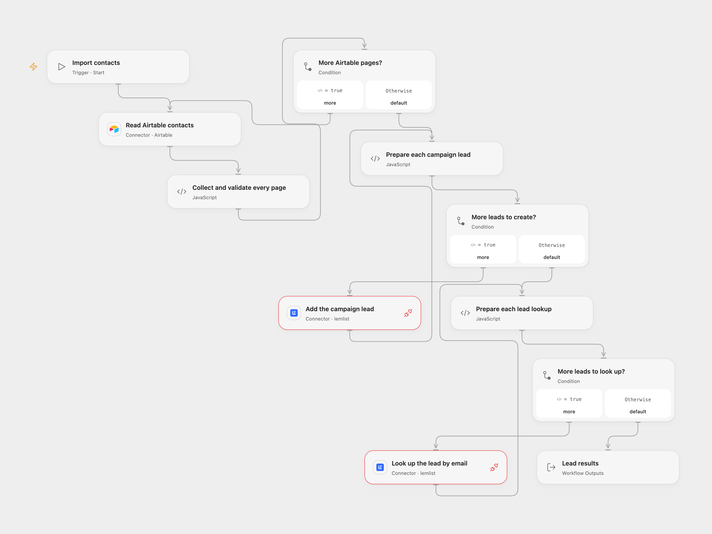

# Import Airtable Contacts into a Lemlist Campaign

Add Airtable contacts to one Lemlist campaign and look up each email.

<picture>
  <source media="(prefers-color-scheme: dark)" srcset="preview-dark.png">
  
</picture>

[Open Flow JSON](templates/airtable-contacts-to-lemlist-campaign.openflow.json) · [n8n JSON](templates/airtable-contacts-to-lemlist-campaign.n8n.json)

## Setup

Connect Airtable in **Read Airtable contacts** and set the base and table. Supply text fields named `Email` and `Name`. Connect Lemlist to both API request nodes and allow Provider API Request. Set the campaign ID in **Prepare each campaign lead**. The API key's user needs permission to create leads and any associated contacts or companies. Verify the campaign settings: enrolling contacts may begin outreach. Use contacts who have agreed to receive it.

In n8n select Airtable personal access token and Lemlist API credentials. Configure the same base, table and campaign in the Airtable and Lemlist nodes. Run one format for each import.

## Behavior

Run manually. The workflow reads all Airtable pages and validates every Email and Name before writing. It creates campaign leads in row order, passing Name as firstName, then looks up each email in the same order. Lookups can return leads from multiple campaigns. An empty table makes no Lemlist requests. Existing campaign leads are rejected by Lemlist rather than updated.

A read or validation error stops before creation. A failed or uncertain creation stops subsequent requests; earlier leads may already exist. A lookup failure can occur after all creations succeeded. Check the campaign before rerunning, as the workflow has no rollback, automatic retry or import history. Pages are not a snapshot and large result sets must fit runtime limits.

Inspiration &amp; credits

## Changes to the source

- Add a manual entry to the source's untriggered graph and replace private campaign and credential details with setup.
- Validate contacts before creation, encode path segments, preserve all pages and expose lookup results. Use the Lemlist Provider API Request for the two operations.

Adapted from [Airtable contacts to Lemlist campaign](https://github.com/Zie619/n8n-workflows/blob/ae8cf6dc5b873cbb4f74587aa9180ed3a9f70682/workflows/Airtable/1220_Airtable_Lemlist_Automate.json) in [Zie619/n8n-workflows](https://github.com/Zie619/n8n-workflows). The matching [n8n community listing](https://n8n.io/workflows/983-add-new-leads-in-lemlist-from-airtable/) credits Harshil Agrawal. The original template does not state a separate license.

The collection’s [MIT notice](https://github.com/Zie619/n8n-workflows/blob/94007c1445d9258a7da116646b79473e7c7c3282/LICENSE) is pinned at a later revision. This is the collection notice at that revision; it does not establish a separate original template author's license. Our changes are listed above; see [repository licensing](../../README.md#licensing).

> MIT License
>
> Copyright (c) 2025 Zie619
>
> Permission is hereby granted, free of charge, to any person obtaining a copy
> of this software and associated documentation files (the "Software"), to deal
> in the Software without restriction, including without limitation the rights
> to use, copy, modify, merge, publish, distribute, sublicense, and/or sell
> copies of the Software, and to permit persons to whom the Software is
> furnished to do so, subject to the following conditions:
>
> The above copyright notice and this permission notice shall be included in all
> copies or substantial portions of the Software.
>
> THE SOFTWARE IS PROVIDED "AS IS", WITHOUT WARRANTY OF ANY KIND, EXPRESS OR
> IMPLIED, INCLUDING BUT NOT LIMITED TO THE WARRANTIES OF MERCHANTABILITY,
> FITNESS FOR A PARTICULAR PURPOSE AND NONINFRINGEMENT. IN NO EVENT SHALL THE
> AUTHORS OR COPYRIGHT HOLDERS BE LIABLE FOR ANY CLAIM, DAMAGES OR OTHER
> LIABILITY, WHETHER IN AN ACTION OF CONTRACT, TORT OR OTHERWISE, ARISING FROM,
> OUT OF OR IN CONNECTION WITH THE SOFTWARE OR THE USE OR OTHER DEALINGS IN THE
> SOFTWARE.

