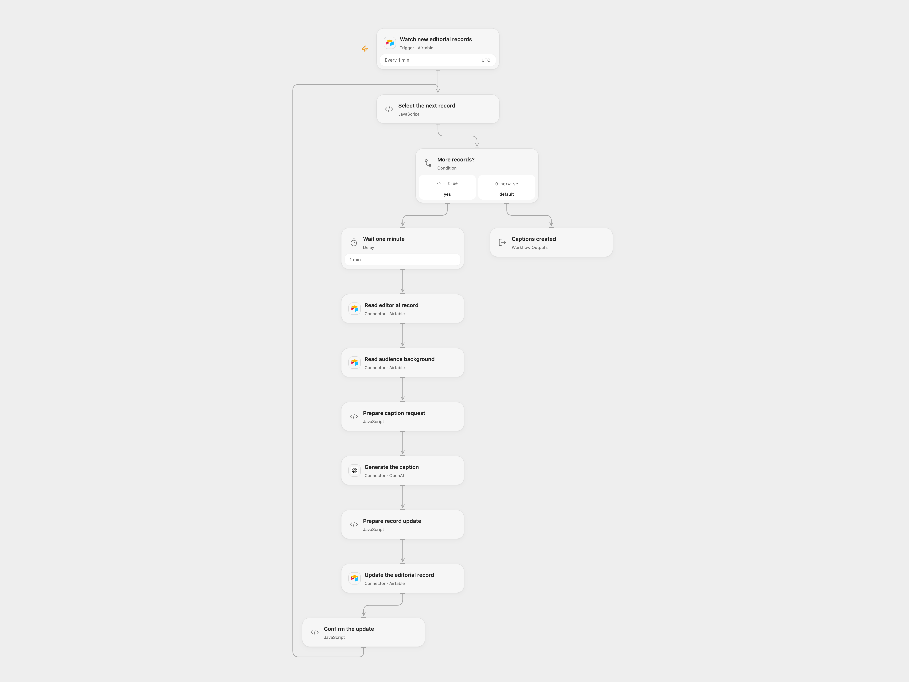

# Create Instagram Captions for New Airtable Records

Create Instagram captions for new Airtable editorial records using audience background.

<picture>
  <source media="(prefers-color-scheme: dark)" srcset="preview-dark.png">
  
</picture>

[Open Flow JSON](templates/airtable-new-record-instagram-caption.openflow.json) · [n8n JSON](templates/airtable-new-record-instagram-caption.n8n.json)

## Setup

Connect Airtable to the trigger and all Airtable nodes. Set the same base and editorial table in the trigger, read and update nodes; set the background table and record ID in **Read audience background**. The editorial table needs a created-time field named `created_at`, a text field `Briefing`, a caption field `SoMe_Text_KI`, and checkbox fields `Posten` and `Werbeanzeige`. Put target-audience and tone details in the background record. Connect OpenAI. Configure the same base, tables and background record in n8n and connect Airtable and OpenAI.

Activate one format. Open Flow establishes a baseline during its initial Airtable query; create new records after that query completes. Records created during the initial query can be absorbed into the baseline. n8n retains its original trigger behavior.

## Behavior

Each minute, new editorial records are processed. The workflow waits at least one minute before reading the briefing, obtains the audience background, generates a caption, and updates the same record with the caption while setting both checkboxes to false. In Open Flow records in one poll batch are processed sequentially, so later records wait longer. Background and briefing are sent to OpenAI and may be retained in run history. Review generated captions before publication.

Errors stop the run. If an update has an unknown outcome, inspect the record before replaying. Prior successful updates are not rolled back.

Inspiration &amp; credits

## Changes to the source

- Replace instance-specific Airtable IDs and use the same editorial table for trigger, read and update.
- Read background before generating the caption in Open Flow; n8n retains the source agent and its background tool. Open Flow uses Responses with a configurable model.

Adapted from [AI social media caption creator](https://github.com/Zie619/n8n-workflows/blob/ae8cf6dc5b873cbb4f74587aa9180ed3a9f70682/workflows/Airtabletool/1723_Airtabletool_Stickynote_Automation_Triggered.json) in [Zie619/n8n-workflows](https://github.com/Zie619/n8n-workflows). The source identifies Friedemann Schuetz as the template author. The original template does not state a separate license.

The collection’s [MIT notice](https://github.com/Zie619/n8n-workflows/blob/94007c1445d9258a7da116646b79473e7c7c3282/LICENSE) is pinned at a later revision. This is the collection notice at that revision; it does not establish a separate original template author's license. Our changes are listed above; see [repository licensing](../../README.md#licensing).

> MIT License
>
> Copyright (c) 2025 Zie619
>
> Permission is hereby granted, free of charge, to any person obtaining a copy
> of this software and associated documentation files (the "Software"), to deal
> in the Software without restriction, including without limitation the rights
> to use, copy, modify, merge, publish, distribute, sublicense, and/or sell
> copies of the Software, and to permit persons to whom the Software is
> furnished to do so, subject to the following conditions:
>
> The above copyright notice and this permission notice shall be included in all
> copies or substantial portions of the Software.
>
> THE SOFTWARE IS PROVIDED "AS IS", WITHOUT WARRANTY OF ANY KIND, EXPRESS OR
> IMPLIED, INCLUDING BUT NOT LIMITED TO THE WARRANTIES OF MERCHANTABILITY,
> FITNESS FOR A PARTICULAR PURPOSE AND NONINFRINGEMENT. IN NO EVENT SHALL THE
> AUTHORS OR COPYRIGHT HOLDERS BE LIABLE FOR ANY CLAIM, DAMAGES OR OTHER
> LIABILITY, WHETHER IN AN ACTION OF CONTRACT, TORT OR OTHERWISE, ARISING FROM,
> OUT OF OR IN CONNECTION WITH THE SOFTWARE OR THE USE OR OTHER DEALINGS IN THE
> SOFTWARE.

