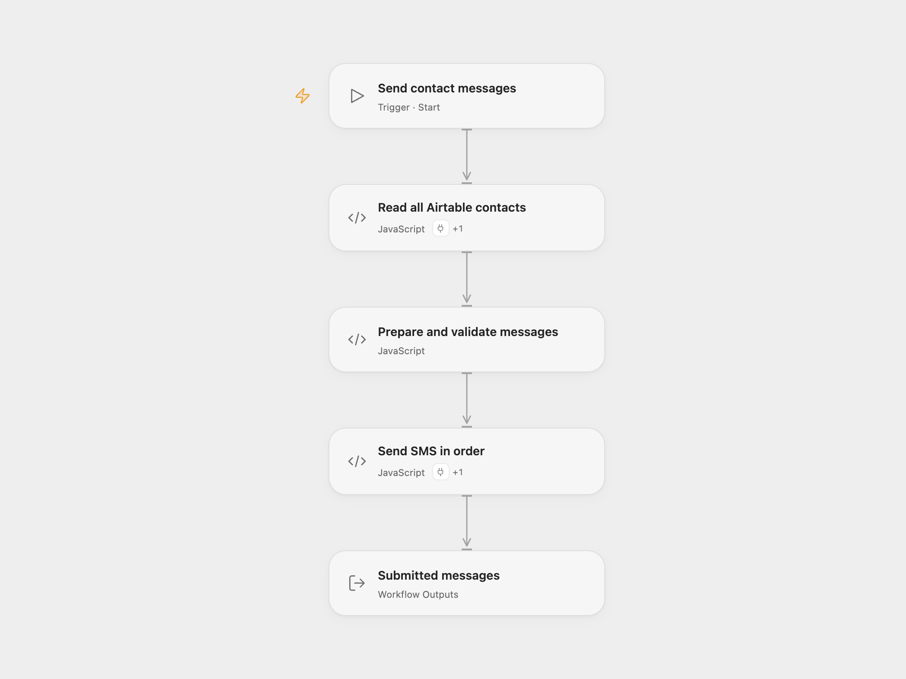

# Airtable SMS Broadcast

Read every record from an Airtable table and send a personalized SMS to each contact through Twilio.

<picture>
  <source media="(prefers-color-scheme: dark)" srcset="preview-dark.png">
  
</picture>

[Open Flow JSON](templates/airtable-sms-broadcast.openflow.json) · [n8n JSON](templates/airtable-sms-broadcast.n8n.json)

## Setup

Use an Airtable table with **Number** and **Name** fields. Store Number as text in E.164 format, such as `+12025550123`. Name may be empty.

In Open Flow, connect Airtable in the **Actions** settings of **Read all Airtable contacts** and set the base and table IDs. Connect Twilio in **Send SMS in order** and replace `YOUR_TWILIO_NUMBER` with an SMS-capable sender number in E.164 format.

In n8n, select an Airtable Access Token connection, base, and table in **Airtable**. Keep Return All enabled. Connect Twilio and set From in **Twilio**. The template sends SMS rather than WhatsApp messages.

The default message is:

> Hello, &lt;Name&gt;!
> Sending this SMS from n8n!

Edit **Prepare and validate messages** to change the text. Run manually. The workflow finishes reading all Airtable pages, trims and validates every destination number, then submits messages in record order. Invalid destination data stops the batch before any SMS is submitted. An empty table sends nothing; duplicate numbers receive one message per record.

Twilio returns submission IDs and statuses. These confirm submission, not delivery to the recipient. A service failure stops later submissions without replaying earlier ones. Check Twilio’s message log before rerunning an uncertain batch; rerunning sends the records again.

## Changes to the source

- Replace Airtable identifiers and the empty sender with setup placeholders.
- Configure the n8n Airtable node for Access Token authentication.
- Validate all destination numbers before sending and treat a missing name as empty text.
- Expose Twilio submission results and the completed count in Open Flow.

## Source and license

Adapted from [Send SMS to numbers stored in Airtable with Twilio](https://github.com/Zie619/n8n-workflows/blob/ae8cf6dc5b873cbb4f74587aa9180ed3a9f70682/workflows/Manual/0353_Manual_Twilio_Send_Triggered.json) in [Zie619/n8n-workflows](https://github.com/Zie619/n8n-workflows). The source export does not identify a separate template author or license.

The collection’s [MIT notice](https://github.com/Zie619/n8n-workflows/blob/94007c1445d9258a7da116646b79473e7c7c3282/LICENSE) is pinned at a later revision. This is the collection notice at that revision; it does not establish a separate original template author's license. Our changes are listed above; see [repository licensing](../../README.md#licensing).

> MIT License
>
> Copyright (c) 2025 Zie619
>
> Permission is hereby granted, free of charge, to any person obtaining a copy
> of this software and associated documentation files (the "Software"), to deal
> in the Software without restriction, including without limitation the rights
> to use, copy, modify, merge, publish, distribute, sublicense, and/or sell
> copies of the Software, and to permit persons to whom the Software is
> furnished to do so, subject to the following conditions:
>
> The above copyright notice and this permission notice shall be included in all
> copies or substantial portions of the Software.
>
> THE SOFTWARE IS PROVIDED "AS IS", WITHOUT WARRANTY OF ANY KIND, EXPRESS OR
> IMPLIED, INCLUDING BUT NOT LIMITED TO THE WARRANTIES OF MERCHANTABILITY,
> FITNESS FOR A PARTICULAR PURPOSE AND NONINFRINGEMENT. IN NO EVENT SHALL THE
> AUTHORS OR COPYRIGHT HOLDERS BE LIABLE FOR ANY CLAIM, DAMAGES OR OTHER
> LIABILITY, WHETHER IN AN ACTION OF CONTRACT, TORT OR OTHERWISE, ARISING FROM,
> OUT OF OR IN CONNECTION WITH THE SOFTWARE OR THE USE OR OTHER DEALINGS IN THE
> SOFTWARE.
