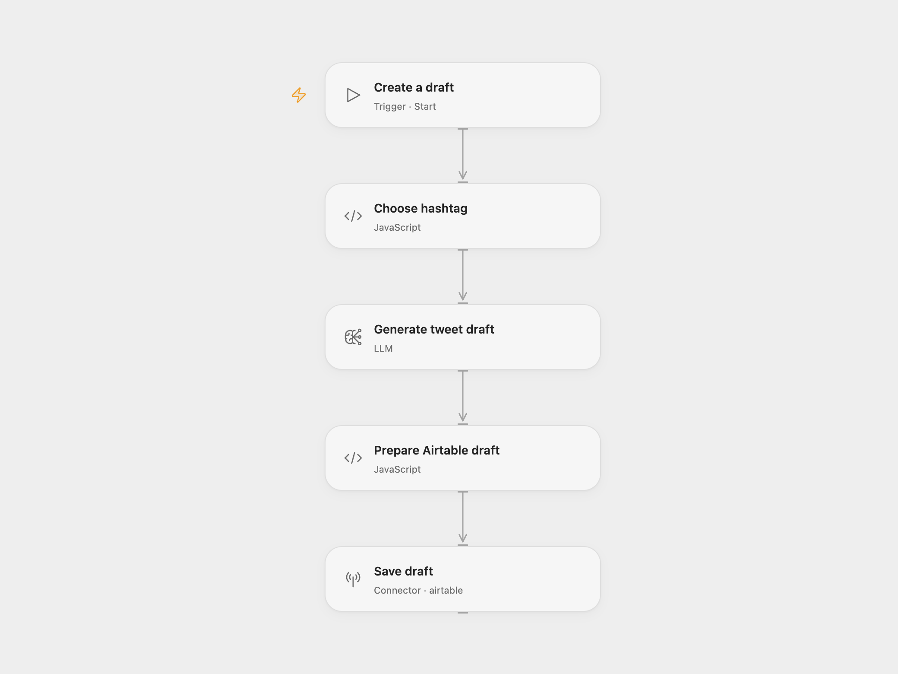

# Airtable Tweet Drafts

Generate a short tweet draft and save it with its hashtag in Airtable. Run it manually when you want a draft to review.

<picture>
  <source media="(prefers-color-scheme: dark)" srcset="preview-dark.png">
  
</picture>

[Open Flow JSON](templates/airtable-tweet-drafts.openflow.json) · [n8n JSON](templates/airtable-tweet-drafts.n8n.json)

## Setup

Create an Airtable table with text fields named `Hashtag` and `Content`.

For Open Flow, import the JSON, edit the hashtag list in **Choose hashtag**, select a configured `gpt-4o-mini` model in **Generate tweet draft**, and connect Airtable in **Save draft**. Replace the base and table IDs.

For n8n, edit the list in **FunctionItem**, connect OpenAI in **HTTP Request**, and select an Airtable access-token credential, base, and table in **Airtable**. The OpenAI node keeps its original source name.

Run the workflow manually. One run selects one hashtag and creates one Airtable record. It does not publish to X. Review facts, tone, hashtag choice, and length before using the draft. The prompt asks for fewer than 100 characters; that length is not enforced. Repeating a run creates another record.

## Changes to the source

- Replace the retired text-davinci-001 completion request with the OpenAI message node and `gpt-4o-mini` in both formats. Generated wording will differ from the original model.
- Configure Airtable access-token authentication and replace the source base ID with a setup placeholder.
- Stop without creating a record when the model returns an empty draft.

Source and license

Adapted from [OpenAI-powered tweet generator](https://github.com/enescingoz/awesome-n8n-templates/blob/827110332c21cbe000ab13f6d292d5adb1f1f8db/Instagram_Twitter_Social_Media/OpenAI-powered%20tweet%20generator.json) in [enescingoz/awesome-n8n-templates](https://github.com/enescingoz/awesome-n8n-templates).

Source collection notice: © 2024–2026 Enes Cingoz, [CC BY 4.0](https://github.com/enescingoz/awesome-n8n-templates/blob/827110332c21cbe000ab13f6d292d5adb1f1f8db/LICENSE). The source export does not identify a separate template author or license. This adaptation includes the changes listed above; see [repository licensing](../../README.md#licensing) for the scope of OOMOL contributions and third-party material.

