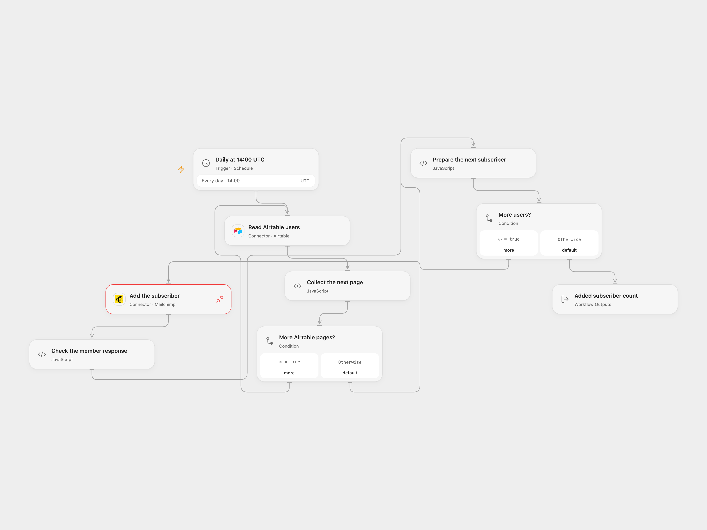

# Airtable Users to Mailchimp Subscribers

Add Airtable users to a Mailchimp audience as subscribed contacts.

<picture>
  <source media="(prefers-color-scheme: dark)" srcset="preview-dark.png">
  
</picture>

[Open Flow JSON](templates/airtable-users-to-mailchimp-subscribers.openflow.json) · [n8n JSON](templates/airtable-users-to-mailchimp-subscribers.n8n.json)

## Setup

Connect Airtable in **Read Airtable users**, set the base ID and table name, and provide text fields named `Name` and `Email` and a field named `Interest`. Connect Mailchimp in **Add the subscriber** and grant Provider API permission. Enter your audience ID in **Prepare the next subscriber**. The audience needs an `FNAME` merge field. In n8n configure the same Airtable base and table, an Airtable personal access token, Mailchimp audience and OAuth2 credentials. Enable one format only.

Only use contacts who have agreed to receive marketing. This workflow directly sets `subscribed` and does not run a confirmation signup flow.

## Behavior

Every day, the workflow reads all Airtable pages and adds each user to Mailchimp in order. It sends Email, Name as `FNAME`, and the literal tag `Interest`. The source reads an Airtable field with that name but does not use its value as the tag. A user already in the audience causes an error rather than an update. Since source rows remain in Airtable, a later run can stop on a previously added user before reaching later rows. Use a view or adjust the table selection to supply only new users. An empty table makes no Mailchimp requests.

The source schedule used the n8n instance timezone. Both templates start at 14:00 UTC; review the timezone and schedule. n8n Cron V1 uses a fixed randomized second, while Open Flow runs on the minute boundary.

A read error or a record without text Name and Email stops before writes. A later error stops the run; earlier subscribers remain added. Check Mailchimp before rerunning after a failed or uncertain request. No automatic retries or rollback are configured. Results must fit execution state limits.

## Changes to the source

- Remove the private base, audience and credentials; use Airtable personal access token and Mailchimp OAuth2 credentials, and validate all subscribers before writing.
- Open Flow explicitly follows all Airtable pages and writes one member at a time. Use UTC as the starting timezone.

Source and license

Adapted from [Create entry in Mailchimp from Airtable](https://github.com/Zie619/n8n-workflows/blob/ae8cf6dc5b873cbb4f74587aa9180ed3a9f70682/workflows/Mailchimp/0345_Mailchimp_Cron_Create_Scheduled.json) in [Zie619/n8n-workflows](https://github.com/Zie619/n8n-workflows). The source export does not identify a separate template author or license.

The collection’s [MIT notice](https://github.com/Zie619/n8n-workflows/blob/94007c1445d9258a7da116646b79473e7c7c3282/LICENSE) is pinned at a later revision. This is the collection notice at that revision; it does not establish a separate original template author's license. Our changes are listed above; see [repository licensing](../../README.md#licensing).

> MIT License
>
> Copyright (c) 2025 Zie619
>
> Permission is hereby granted, free of charge, to any person obtaining a copy
> of this software and associated documentation files (the "Software"), to deal
> in the Software without restriction, including without limitation the rights
> to use, copy, modify, merge, publish, distribute, sublicense, and/or sell
> copies of the Software, and to permit persons to whom the Software is
> furnished to do so, subject to the following conditions:
>
> The above copyright notice and this permission notice shall be included in all
> copies or substantial portions of the Software.
>
> THE SOFTWARE IS PROVIDED "AS IS", WITHOUT WARRANTY OF ANY KIND, EXPRESS OR
> IMPLIED, INCLUDING BUT NOT LIMITED TO THE WARRANTIES OF MERCHANTABILITY,
> FITNESS FOR A PARTICULAR PURPOSE AND NONINFRINGEMENT. IN NO EVENT SHALL THE
> AUTHORS OR COPYRIGHT HOLDERS BE LIABLE FOR ANY CLAIM, DAMAGES OR OTHER
> LIABILITY, WHETHER IN AN ACTION OF CONTRACT, TORT OR OTHERWISE, ARISING FROM,
> OUT OF OR IN CONNECTION WITH THE SOFTWARE OR THE USE OR OTHER DEALINGS IN THE
> SOFTWARE.

