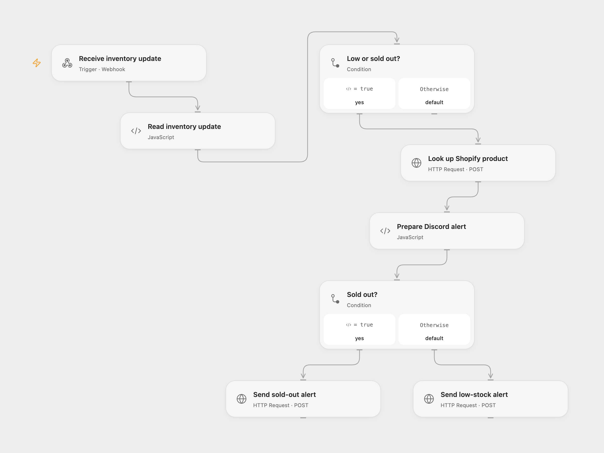

# Alert Discord on Shopify Inventory Changes

Send a Discord alert for low or sold-out Shopify inventory.

<picture>
  <source media="(prefers-color-scheme: dark)" srcset="preview-dark.png">
  
</picture>

[Open Flow JSON](templates/alert-discord-on-shopify-inventory.openflow.json) · [n8n JSON](templates/alert-discord-on-shopify-inventory.n8n.json)

## Setup

Create Shopify inventory and product read credentials and subscribe to inventory level updates at the deployed webhook URL. Configure SHOPIFY_SHOP as your myshopify.com hostname and the secret Variables SHOPIFY_TOKEN, DISCORD_LOW_WEBHOOK and DISCORD_OUT_WEBHOOK with the Admin API token and respective Discord incoming webhook URLs. In n8n set the Shopify endpoint and header credentials, and configure the two Discord HTTP nodes with your destination URLs and authentication.

## Behavior

An update with available stock between one and three sends a low-stock alert; zero sends a sold-out alert. Other quantities produce no alert. Shopify supplies the product title, variant, current total sellable quantity and optional product image. The webhook does not authenticate the sender; restrict access appropriately. Delivery may be duplicated if Shopify retries or a send has an unknown outcome; inspect Discord before retrying. The webhook acknowledges receipt before the external requests complete.

Inspiration &amp; credits

## Changes to the source

- Use current Shopify GraphQL fields and Discord incoming webhook URLs. Open Flow extracts the exact inventory item ID from Shopify's string GraphQL ID to avoid precision loss in large numeric IDs.

Adapted from [Low Stock & Sold Out Watcher for Shopify](https://github.com/Zie619/n8n-workflows/blob/ae8cf6dc5b873cbb4f74587aa9180ed3a9f70682/workflows/Code/0373_Code_Webhook_Automation_Webhook.json) in [Zie619/n8n-workflows](https://github.com/Zie619/n8n-workflows). The source export does not identify a separate template author or license.

The collection’s [MIT notice](https://github.com/Zie619/n8n-workflows/blob/94007c1445d9258a7da116646b79473e7c7c3282/LICENSE) is pinned at a later revision. This is the collection notice at that revision; it does not establish a separate original template author's license. Our changes are listed above; see [repository licensing](../../README.md#licensing).

> MIT License
>
> Copyright (c) 2025 Zie619
>
> Permission is hereby granted, free of charge, to any person obtaining a copy
> of this software and associated documentation files (the "Software"), to deal
> in the Software without restriction, including without limitation the rights
> to use, copy, modify, merge, publish, distribute, sublicense, and/or sell
> copies of the Software, and to permit persons to whom the Software is
> furnished to do so, subject to the following conditions:
>
> The above copyright notice and this permission notice shall be included in all
> copies or substantial portions of the Software.
>
> THE SOFTWARE IS PROVIDED "AS IS", WITHOUT WARRANTY OF ANY KIND, EXPRESS OR
> IMPLIED, INCLUDING BUT NOT LIMITED TO THE WARRANTIES OF MERCHANTABILITY,
> FITNESS FOR A PARTICULAR PURPOSE AND NONINFRINGEMENT. IN NO EVENT SHALL THE
> AUTHORS OR COPYRIGHT HOLDERS BE LIABLE FOR ANY CLAIM, DAMAGES OR OTHER
> LIABILITY, WHETHER IN AN ACTION OF CONTRACT, TORT OR OTHERWISE, ARISING FROM,
> OUT OF OR IN CONNECTION WITH THE SOFTWARE OR THE USE OR OTHER DEALINGS IN THE
> SOFTWARE.

