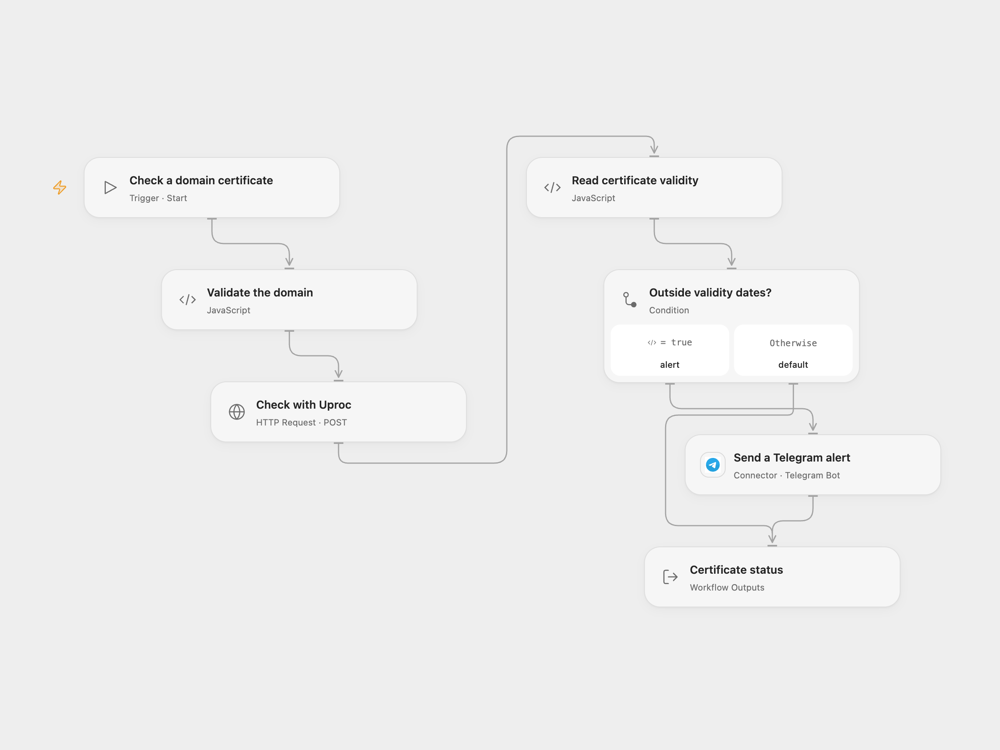

# Alert on an Invalid Domain Certificate

Check a domain certificate with Uproc and alert a Telegram chat when it is outside its validity dates.

<picture>
  <source media="(prefers-color-scheme: dark)" srcset="preview-dark.png">
  
</picture>

[Open Flow JSON](templates/alert-invalid-domain-certificate.openflow.json) · [n8n JSON](templates/alert-invalid-domain-certificate.n8n.json)

## Setup

The workflow uses Uproc’s legacy v2 process API with email and API key authentication. In Open Flow, create secret Variables for your Uproc account email and API key and bind them to **Auth Username** and **Auth Password** on **Check with Uproc**. Connect your Telegram bot and set its destination chat ID in **Send a Telegram alert**. Run with a domain name such as `example.com`.

In n8n, set the domain in **Set domain**, connect a Uproc API credential and a Telegram credential, and enter the Telegram chat ID. Run one format at a time.

## Behavior

A manual run asks Uproc to inspect the domain's certificate on port 443. If its `valid` field is false, it sends one Telegram alert. A true value sends no message. A missing or unrecognized result or request failure stops the workflow without an alert; check the run if no message arrives. Uproc describes `valid` as whether the certificate is currently within its validity dates. This workflow does not independently verify the trust chain, hostname or revocation, and a false value can also mean the certificate is not yet valid.

A Telegram failure stops the run; an uncertain send may already have arrived, so check the chat before retrying. Open Flow applies a 30-second HTTP timeout and a 4 MiB response limit.

Inspiration &amp; credits

## Changes to the source

- Replace the example domain and private destination with configuration. Describe an invalid date range without assuming the certificate has expired.
- Validate the domain and require a recognized validity value before deciding whether to alert.

Adapted from [Get SSL Certificate](https://github.com/Zie619/n8n-workflows/blob/ae8cf6dc5b873cbb4f74587aa9180ed3a9f70682/workflows/Manual/0045_Manual_Telegram_Import_Triggered.json) in [Zie619/n8n-workflows](https://github.com/Zie619/n8n-workflows). The matching [n8n listing](https://n8n.io/workflows/861-monitor-ssl-certificate-of-any-domain-with-uproc/) credits Miquel Colomer. The original template does not state a separate license.

The collection’s [MIT notice](https://github.com/Zie619/n8n-workflows/blob/94007c1445d9258a7da116646b79473e7c7c3282/LICENSE) is pinned at a later revision. This is the collection notice at that revision; it does not establish a separate original template author's license. Our changes are listed above; see [repository licensing](../../README.md#licensing).

> MIT License
>
> Copyright (c) 2025 Zie619
>
> Permission is hereby granted, free of charge, to any person obtaining a copy
> of this software and associated documentation files (the "Software"), to deal
> in the Software without restriction, including without limitation the rights
> to use, copy, modify, merge, publish, distribute, sublicense, and/or sell
> copies of the Software, and to permit persons to whom the Software is
> furnished to do so, subject to the following conditions:
>
> The above copyright notice and this permission notice shall be included in all
> copies or substantial portions of the Software.
>
> THE SOFTWARE IS PROVIDED "AS IS", WITHOUT WARRANTY OF ANY KIND, EXPRESS OR
> IMPLIED, INCLUDING BUT NOT LIMITED TO THE WARRANTIES OF MERCHANTABILITY,
> FITNESS FOR A PARTICULAR PURPOSE AND NONINFRINGEMENT. IN NO EVENT SHALL THE
> AUTHORS OR COPYRIGHT HOLDERS BE LIABLE FOR ANY CLAIM, DAMAGES OR OTHER
> LIABILITY, WHETHER IN AN ACTION OF CONTRACT, TORT OR OTHERWISE, ARISING FROM,
> OUT OF OR IN CONNECTION WITH THE SOFTWARE OR THE USE OR OTHER DEALINGS IN THE
> SOFTWARE.

