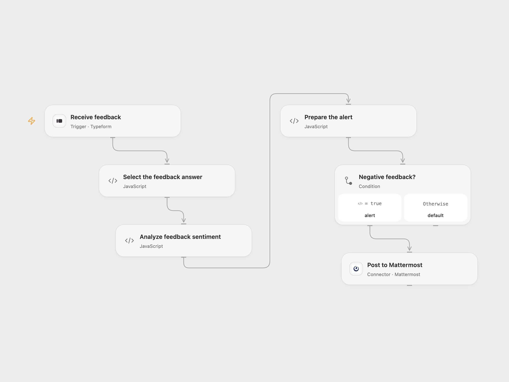

# Alert Negative Typeform Feedback to Mattermost

Analyze Typeform feedback and post negative responses to Mattermost.

<picture>
  <source media="(prefers-color-scheme: dark)" srcset="preview-dark.png">
  
</picture>

[Open Flow JSON](templates/alert-negative-typeform-feedback-to-mattermost.openflow.json) · [n8n JSON](templates/alert-negative-typeform-feedback-to-mattermost.n8n.json)

## Setup

Connect Typeform and select the form in **Receive feedback**. Set the exact title of its text feedback question in **Select the feedback answer**. Bind AWS access key ID and secret access key as secret Variables in **Analyze feedback sentiment**; bind a session token when using temporary credentials. Grant `comprehend:DetectSentiment`. The default region and allowed HTTP host are `us-east-1`; update both together for another region. Connect Mattermost and set the destination channel ID in **Post to Mattermost**.

In n8n select the form and credentials, set the exact question title in **Select the feedback answer**, connect AWS and Mattermost, and set the Mattermost channel. Activate one format.

## Behavior

Each form response is sent to Amazon Comprehend as English text. Only the exact `NEGATIVE` sentiment causes a Mattermost post, containing the negative score and original feedback. Other sentiments send no post. Feedback is shared with AWS and, for negative results, the configured Mattermost channel. AWS accepts up to 5 KB of UTF-8 feedback text. The hosted Mattermost Connector requires a public HTTPS instance with a public IPv4 address.

Missing answers, analysis errors and post errors stop the run. An uncertain post may already have succeeded; check the channel before retrying. Repeated form deliveries can produce repeated posts. The n8n Mattermost credential helper may repeat a request once after a 401 response.

Inspiration &amp; credits

## Changes to the source

- Replace personal form and channel IDs and select the configured text question. Open Flow signs the documented AWS request using secret Variables; n8n uses its native AWS credential.

Adapted from [Analyze feedback using AWS Comprehend and send it to a Mattermost channel](https://github.com/enescingoz/awesome-n8n-templates/blob/827110332c21cbe000ab13f6d292d5adb1f1f8db/Other_Integrations_and_Use_Cases/Analyze%20feedback%20using%20AWS%20Comprehend%20and%20send%20it%20to%20a%20Mattermost%20channel.json) in [enescingoz/awesome-n8n-templates](https://github.com/enescingoz/awesome-n8n-templates).

Source collection notice: © 2024–2026 Enes Cingoz, [CC BY 4.0](https://github.com/enescingoz/awesome-n8n-templates/blob/827110332c21cbe000ab13f6d292d5adb1f1f8db/LICENSE). The matching [n8n listing](https://n8n.io/workflows/965-analyze-feedback-using-aws-comprehend-and-send-it-to-a-mattermost-channel/) credits Harshil Agrawal. No separate original template license was found. See [repository licensing](../../README.md#licensing) for the scope of OOMOL contributions and third-party material.

