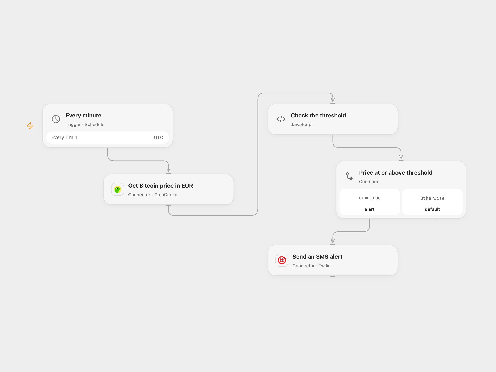

# Alert on Bitcoin Euro Price by SMS

Check Bitcoin’s price in euros every minute and send an SMS when it reaches a threshold.

<picture>
  <source media="(prefers-color-scheme: dark)" srcset="preview-dark.png">
  
</picture>

[Open Flow JSON](templates/alert-on-bitcoin-euro-price-by-sms.openflow.json) · [n8n JSON](templates/alert-on-bitcoin-euro-price-by-sms.n8n.json)

## Setup

Connect CoinGecko and Twilio. In Open Flow, set the EUR threshold and sender and recipient E.164 numbers in **Check the threshold**. In n8n configure **CoinGecko** HTTP Header Auth with header x-cg-demo-api-key and your Demo API key (for Pro, use the Pro host and x-cg-pro-api-key). Set the threshold in **IF** and the phone numbers in **Twilio**. Enable only one format. CoinGecko and Twilio account access and applicable request and messaging limits are required.

## Behavior

Every minute the workflow requests the Bitcoin/EUR price. If the price is greater than or equal to the threshold, it sends an SMS with the quoted price. Every qualifying run sends another SMS; there is no crossing detection or deduplication. CoinGecko quotes can be delayed and are not trading prices. A failed or uncertain SMS may already have been sent; check before retrying.

Inspiration &amp; credits

## Changes to the source

- Replace the legacy unauthenticated CoinGecko node with the current authenticated simple-price HTTP request in n8n, and replace placeholder phone numbers with configuration. The threshold starts at the source’s EUR 9000 and can be changed. Open Flow validates the quote, threshold and phone numbers before sending; n8n’s IF node treats a missing quote as zero, so use a positive threshold and inspect failed or empty price responses.
- Open Flow runs on UTC minute boundaries; n8n uses its interval schedule.

Adapted from [Get the price of BTC in EUR and send an SMS when the price is larger than EUR 9000](https://github.com/Zie619/n8n-workflows/blob/ae8cf6dc5b873cbb4f74587aa9180ed3a9f70682/workflows/Noop/1130_Noop_Twilio_Send_Scheduled.json) in [Zie619/n8n-workflows](https://github.com/Zie619/n8n-workflows). The source export does not identify a separate template author or license.

The collection’s [MIT notice](https://github.com/Zie619/n8n-workflows/blob/94007c1445d9258a7da116646b79473e7c7c3282/LICENSE) is pinned at a later revision. This is the collection notice at that revision; it does not establish a separate original template author's license. Our changes are listed above; see [repository licensing](../../README.md#licensing).

> MIT License
>
> Copyright (c) 2025 Zie619
>
> Permission is hereby granted, free of charge, to any person obtaining a copy
> of this software and associated documentation files (the "Software"), to deal
> in the Software without restriction, including without limitation the rights
> to use, copy, modify, merge, publish, distribute, sublicense, and/or sell
> copies of the Software, and to permit persons to whom the Software is
> furnished to do so, subject to the following conditions:
>
> The above copyright notice and this permission notice shall be included in all
> copies or substantial portions of the Software.
>
> THE SOFTWARE IS PROVIDED "AS IS", WITHOUT WARRANTY OF ANY KIND, EXPRESS OR
> IMPLIED, INCLUDING BUT NOT LIMITED TO THE WARRANTIES OF MERCHANTABILITY,
> FITNESS FOR A PARTICULAR PURPOSE AND NONINFRINGEMENT. IN NO EVENT SHALL THE
> AUTHORS OR COPYRIGHT HOLDERS BE LIABLE FOR ANY CLAIM, DAMAGES OR OTHER
> LIABILITY, WHETHER IN AN ACTION OF CONTRACT, TORT OR OTHERWISE, ARISING FROM,
> OUT OF OR IN CONNECTION WITH THE SOFTWARE OR THE USE OR OTHER DEALINGS IN THE
> SOFTWARE.

