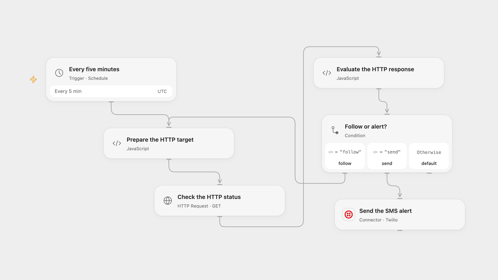

# Alert on HTTP Status by SMS

Check a website every five minutes and send an SMS when its HTTP status is not 200.

<picture>
  <source media="(prefers-color-scheme: dark)" srcset="preview-dark.png">
  
</picture>

[Open Flow JSON](templates/alert-on-http-status-by-sms.openflow.json) · [n8n JSON](templates/alert-on-http-status-by-sms.n8n.json)

## Setup

Set the HTTP or HTTPS URL in **Prepare the HTTP target** in Open Flow or **HTTP Request** in n8n. Use an endpoint you are authorized to monitor. Connect Twilio and set a valid sender and recipient in **Send the SMS alert** or **Twilio**. Enable one format.

## Behavior

Every five minutes, the workflow makes an HTTP GET, follows up to 21 redirects, and sends the text Service Down by SMS if the final response status is anything other than 200. A final 200 sends nothing. Open Flow runs on UTC minute boundaries; n8n chooses a fixed second when its schedule is registered. Both formats use UTC.

A network or DNS failure, invalid redirect, redirect limit or request timeout stops the run without an SMS. Open Flow stops without an SMS if the response exceeds 4 MiB. Each request has a 30-second timeout in Open Flow; n8n uses a 30-second request timeout. Repeated non-200 responses send repeated messages. A failed or uncertain SMS may already have been sent; check Twilio before retrying.

## Changes to the source

- Configure the URL and phone numbers. Allow non-2xx HTTP responses through to the status check so that 4xx and 5xx responses can trigger the source's intended alert; the original n8n HTTP node stopped before the check on those responses. Network failures still stop the run.
- Open Flow follows redirects explicitly to evaluate the final status, and both formats use UTC and a 30-second request timeout.

Source and license

Adapted from [Website status SMS alert](https://github.com/Zie619/n8n-workflows/blob/ae8cf6dc5b873cbb4f74587aa9180ed3a9f70682/workflows/Http/1959_HTTP_Schedule_Automate_Webhook.json) in [Zie619/n8n-workflows](https://github.com/Zie619/n8n-workflows). The source export does not identify a separate template author or license.

The collection’s [MIT notice](https://github.com/Zie619/n8n-workflows/blob/94007c1445d9258a7da116646b79473e7c7c3282/LICENSE) is pinned at a later revision. This is the collection notice at that revision; it does not establish a separate original template author's license. Our changes are listed above; see [repository licensing](../../README.md#licensing).

> MIT License
>
> Copyright (c) 2025 Zie619
>
> Permission is hereby granted, free of charge, to any person obtaining a copy
> of this software and associated documentation files (the "Software"), to deal
> in the Software without restriction, including without limitation the rights
> to use, copy, modify, merge, publish, distribute, sublicense, and/or sell
> copies of the Software, and to permit persons to whom the Software is
> furnished to do so, subject to the following conditions:
>
> The above copyright notice and this permission notice shall be included in all
> copies or substantial portions of the Software.
>
> THE SOFTWARE IS PROVIDED "AS IS", WITHOUT WARRANTY OF ANY KIND, EXPRESS OR
> IMPLIED, INCLUDING BUT NOT LIMITED TO THE WARRANTIES OF MERCHANTABILITY,
> FITNESS FOR A PARTICULAR PURPOSE AND NONINFRINGEMENT. IN NO EVENT SHALL THE
> AUTHORS OR COPYRIGHT HOLDERS BE LIABLE FOR ANY CLAIM, DAMAGES OR OTHER
> LIABILITY, WHETHER IN AN ACTION OF CONTRACT, TORT OR OTHERWISE, ARISING FROM,
> OUT OF OR IN CONNECTION WITH THE SOFTWARE OR THE USE OR OTHER DEALINGS IN THE
> SOFTWARE.

