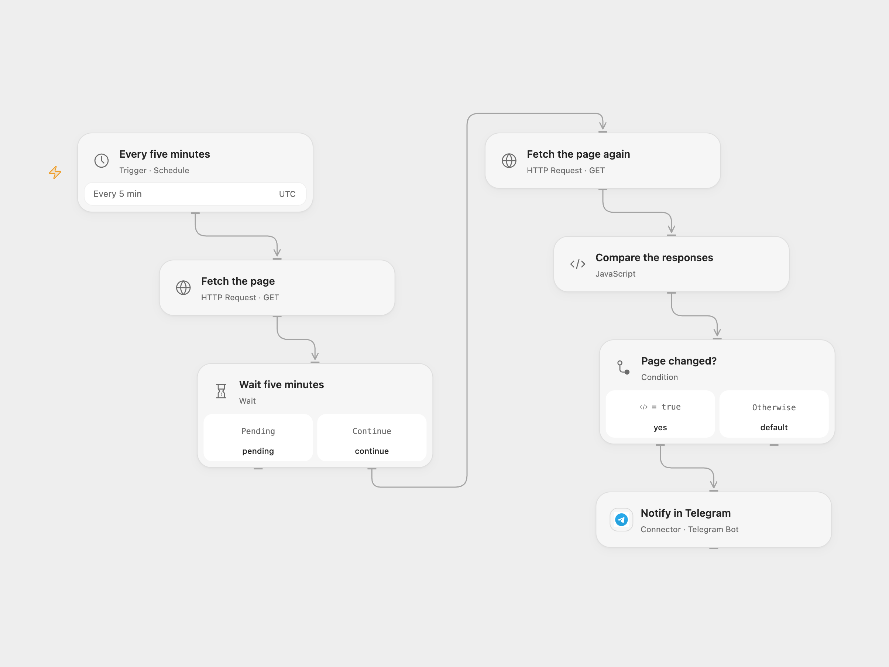

# Alert on Web Page Changes

Compare two page responses five minutes apart and notify a Telegram chat when the content changes.

<picture>
  <source media="(prefers-color-scheme: dark)" srcset="preview-dark.png">
  
</picture>

[Open Flow JSON](templates/alert-on-web-page-changes.openflow.json) · [n8n JSON](templates/alert-on-web-page-changes.n8n.json)

## Setup

Connect Telegram and set the destination chat ID in **Notify in Telegram**. Set the same public page URL in **Fetch the page** and **Fetch the page again**. In n8n configure the same URL in both HTTP nodes and the Telegram connection and chat ID. Enable one format.

## Behavior

Every five minutes, each run fetches the page, waits five minutes and fetches it again. It sends “Something got changed” when the two response texts differ; unchanged text sends nothing. Pages containing timestamps or other dynamic content can trigger frequent alerts. The schedule can start another run while the previous run is waiting. Open Flow starts at the minute boundary; n8n uses a fixed second within that minute. Requests must succeed. Open Flow does not follow redirects, so use the final page URL; n8n follows its HTTP node settings. A failed or uncertain Telegram send is not automatically repeated. Check the destination before rerunning.

Inspiration &amp; credits

## Changes to the source

- Compare the first response with the second response; the source condition mistakenly refers to the first response twice.
- Replace the sample Telegram chat ID with a configurable value and require successful page requests.

Adapted from [Monitor a web page for changes with Telegram](https://github.com/Zie619/n8n-workflows/blob/ae8cf6dc5b873cbb4f74587aa9180ed3a9f70682/workflows/Telegram/0170_Telegram_Wait_Automation_Scheduled.json) in [Zie619/n8n-workflows](https://github.com/Zie619/n8n-workflows). The source export does not identify a separate template author or license.

The collection’s [MIT notice](https://github.com/Zie619/n8n-workflows/blob/94007c1445d9258a7da116646b79473e7c7c3282/LICENSE) is pinned at a later revision. This is the collection notice at that revision; it does not establish a separate original template author's license. Our changes are listed above; see [repository licensing](../../README.md#licensing).

> MIT License
>
> Copyright (c) 2025 Zie619
>
> Permission is hereby granted, free of charge, to any person obtaining a copy
> of this software and associated documentation files (the "Software"), to deal
> in the Software without restriction, including without limitation the rights
> to use, copy, modify, merge, publish, distribute, sublicense, and/or sell
> copies of the Software, and to permit persons to whom the Software is
> furnished to do so, subject to the following conditions:
>
> The above copyright notice and this permission notice shall be included in all
> copies or substantial portions of the Software.
>
> THE SOFTWARE IS PROVIDED "AS IS", WITHOUT WARRANTY OF ANY KIND, EXPRESS OR
> IMPLIED, INCLUDING BUT NOT LIMITED TO THE WARRANTIES OF MERCHANTABILITY,
> FITNESS FOR A PARTICULAR PURPOSE AND NONINFRINGEMENT. IN NO EVENT SHALL THE
> AUTHORS OR COPYRIGHT HOLDERS BE LIABLE FOR ANY CLAIM, DAMAGES OR OTHER
> LIABILITY, WHETHER IN AN ACTION OF CONTRACT, TORT OR OTHERWISE, ARISING FROM,
> OUT OF OR IN CONNECTION WITH THE SOFTWARE OR THE USE OR OTHER DEALINGS IN THE
> SOFTWARE.

