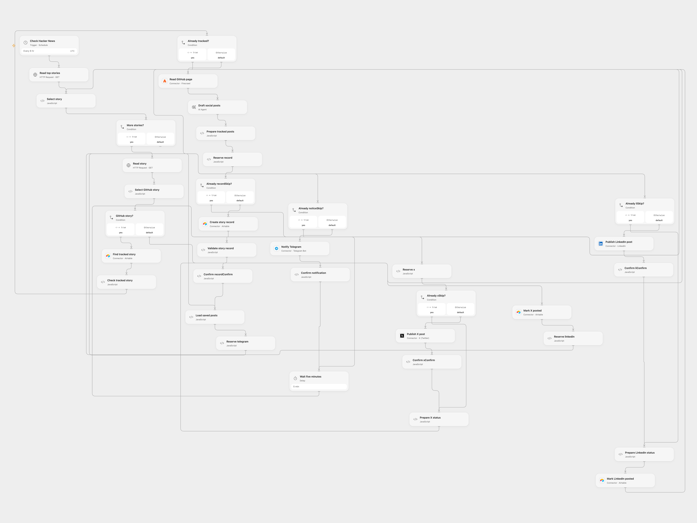

# Amplify Hacker News GitHub Projects

Discover GitHub links on Hacker News, draft social posts and publish them after a short delay.

<!-- template-actions:start -->
[](https://openflow.run/templates/amplify-hacker-news-github-projects/) [](templates/amplify-hacker-news-github-projects.n8n.json)
<!-- template-actions:end -->

<picture>
  <source media="(prefers-color-scheme: dark)" srcset="preview-dark.png">
  
</picture>

## Setup and use

Connect Airtable, Firecrawl, Telegram, X and LinkedIn. Configure the Airtable base and table fields Post, Title, Url, Tweet, LinkedIn, TDone and LDone, Telegram chat, LinkedIn person URN, model and persistent State. In n8n configure a Data Table with item_key and status columns. Prevent overlapping runs.

Every six hours the workflow reviews the first 30 top Hacker News stories, filters GitHub links, resumes recorded story IDs or drafts two posts for new stories, notifies Telegram, waits five minutes, publishes and marks each status. Content is sent to the AI provider. Review the notification promptly; the five-minute delay is not an approval gate. After uncertain writes inspect the relevant service before resolving pending checkpoints.

<details>
<summary>Inspiration &amp; credits</summary>

Adapted from [AI-Powered Social Media Amplifier](https://github.com/enescingoz/awesome-n8n-templates/blob/827110332c21cbe000ab13f6d292d5adb1f1f8db/OpenAI_and_LLMs/AI-Powered%20Social%20Media%20Amplifier.json) in [enescingoz/awesome-n8n-templates](https://github.com/enescingoz/awesome-n8n-templates).

Source collection notice: © 2024–2026 Enes Cingoz, [CC BY 4.0](https://github.com/enescingoz/awesome-n8n-templates/blob/827110332c21cbe000ab13f6d292d5adb1f1f8db/LICENSE). The source export does not identify a separate template author or license. See [repository licensing](../../README.md#licensing) for the scope of OOMOL contributions and third-party material.


Changes: use the Hacker News API, visible service Actions, input validation, write checkpoints and UTC scheduling.

Collection license notice:

```text
Creative Commons Attribution 4.0 International License

Copyright (c) 2024-2026 Enes Cingoz

You are free to:

  Share - copy and redistribute the material in any medium or format
  Adapt - remix, transform, and build upon the material for any purpose,
  even commercially.

Under the following terms:

  Attribution - You must give appropriate credit, provide a link to the
  license, and indicate if changes were made. You may do so in any
  reasonable manner, but not in any way that suggests the licensor
  endorses you or your use.

  No additional restrictions - You may not apply legal terms or
  technological measures that legally restrict others from doing
  anything the license permits.

Notices:

  You do not have to comply with the license for elements of the
  material in the public domain or where your use is permitted by an
  applicable exception or limitation.

  No warranties are given. The license may not give you all of the
  permissions necessary for your intended use. For example, other rights
  such as publicity, privacy, or moral rights may limit how you use the
  material.

For the full license text, see:
https://creativecommons.org/licenses/by/4.0/legalcode
```

</details>
