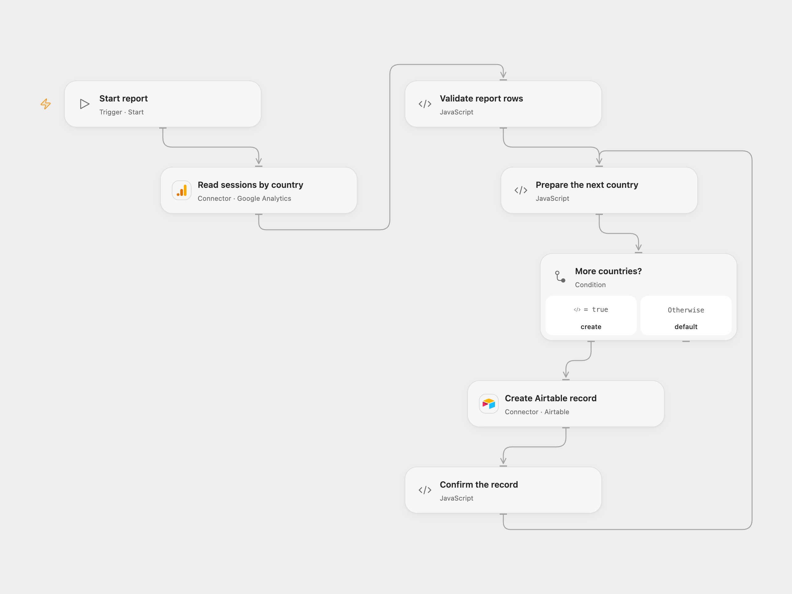

# Save Analytics Sessions by Country to Airtable

Read Google Analytics sessions by country and add the results to Airtable.

<picture>
  <source media="(prefers-color-scheme: dark)" srcset="preview-dark.png">
  
</picture>

[Open Flow JSON](templates/analytics-sessions-by-country-to-airtable.openflow.json) · [n8n JSON](templates/analytics-sessions-by-country-to-airtable.n8n.json)

## Setup

Connect Google Analytics and set a GA4 property ID and inclusive start and end dates in **Read sessions by country**. Replace the example January 2025 dates. Connect Airtable in **Create Airtable record** and set the base and table. Create a text field named **Country** and a number field named **Metric**.

In n8n, connect Google Analytics and an Airtable Personal Access Token, set the GA4 property and custom date range in **Google Analytics**, and select the Airtable base and table. Run one format.

## Behavior

Each run requests GA4 `sessions` grouped by `country` for the chosen dates and creates one Airtable record per country. No rows means no records. A report with more than 10,000 rows, an incomplete response or invalid values stops before any writes. Runs do not deduplicate records.

Open Flow creates records sequentially; a failure can leave earlier records in Airtable. An uncertain write may already have succeeded, so inspect the table before retrying. Google Analytics reporting can apply privacy thresholds or sampling; review the report in Analytics when accuracy matters.

## Changes to the source

- Replace the retired Universal Analytics report with GA4 and replace its fixed 2019–2020 dates with configurable example dates. GA4 session counts can differ from Universal Analytics and historical UA data is not carried over.
- Fix the source's `total` field reference to use the returned sessions metric, and validate report completeness before writing.

Source and license

Adapted from [Get analytics of a website and store it Airtable](https://github.com/Zie619/n8n-workflows/blob/ae8cf6dc5b873cbb4f74587aa9180ed3a9f70682/workflows/Manual/0389_Manual_Googleanalytics_Import_Triggered.json) in [Zie619/n8n-workflows](https://github.com/Zie619/n8n-workflows). The matching [n8n community listing](https://n8n.io/workflows/892-transfer-google-analytics-data-to-airtable-database/) credits Harshil Agrawal. The original template does not state a separate license.

The collection’s [MIT notice](https://github.com/Zie619/n8n-workflows/blob/94007c1445d9258a7da116646b79473e7c7c3282/LICENSE) is pinned at a later revision. This is the collection notice at that revision; it does not establish a separate original template author's license. Our changes are listed above; see [repository licensing](../../README.md#licensing).

> MIT License
>
> Copyright (c) 2025 Zie619
>
> Permission is hereby granted, free of charge, to any person obtaining a copy
> of this software and associated documentation files (the "Software"), to deal
> in the Software without restriction, including without limitation the rights
> to use, copy, modify, merge, publish, distribute, sublicense, and/or sell
> copies of the Software, and to permit persons to whom the Software is
> furnished to do so, subject to the following conditions:
>
> The above copyright notice and this permission notice shall be included in all
> copies or substantial portions of the Software.
>
> THE SOFTWARE IS PROVIDED "AS IS", WITHOUT WARRANTY OF ANY KIND, EXPRESS OR
> IMPLIED, INCLUDING BUT NOT LIMITED TO THE WARRANTIES OF MERCHANTABILITY,
> FITNESS FOR A PARTICULAR PURPOSE AND NONINFRINGEMENT. IN NO EVENT SHALL THE
> AUTHORS OR COPYRIGHT HOLDERS BE LIABLE FOR ANY CLAIM, DAMAGES OR OTHER
> LIABILITY, WHETHER IN AN ACTION OF CONTRACT, TORT OR OTHERWISE, ARISING FROM,
> OUT OF OR IN CONNECTION WITH THE SOFTWARE OR THE USE OR OTHER DEALINGS IN THE
> SOFTWARE.

