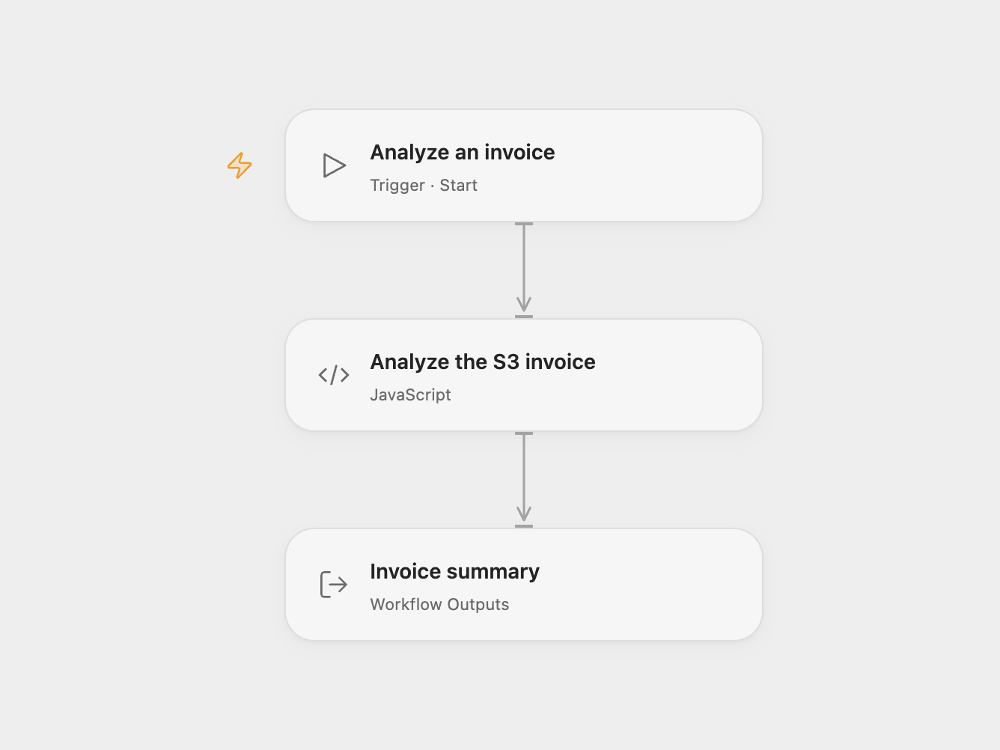

# Analyze an S3 Invoice with Textract

Extract invoice summary fields from an image stored in Amazon S3.

<picture>
  <source media="(prefers-color-scheme: dark)" srcset="preview-dark.png">
  
</picture>

[Open Flow JSON](templates/analyze-an-s3-invoice-with-textract.openflow.json) · [n8n JSON](templates/analyze-an-s3-invoice-with-textract.n8n.json)

## Setup

In **Analyze the S3 invoice**, set the S3 bucket, object key and AWS region. The bucket and Textract must use the same region. The allowed HTTP host initially covers `us-east-1`; if changing the region, update the node’s allowed host to the corresponding Textract endpoint. Bind secret Variables for the IAM access key ID and secret access key, and for the session token if using temporary credentials. Grant the principal access to the object and to Textract AnalyzeExpense. Signing uses the server clock.

In n8n, configure the S3 bucket and key, and connect AWS credentials to both S3 and Textract nodes in the same region. Run either format manually.

## Behavior

The workflow analyzes one receipt or invoice and returns summary fields keyed by their Textract type or label. If a field repeats, the last value is kept, matching the source's simplified output. Line items and geometry are not included. Recognition can be incomplete or wrong; check the original document. Restrict access to execution history and the invoice. A missing object, permission error or invalid response stops the run.

Inspiration &amp; credits

## Changes to the source

- Replace the sample bucket, object and credentials with configuration.
- Open Flow signs and sends a Textract AnalyzeExpense request inside one Code node to keep temporary credentials out of intermediate outputs; the request refers directly to the S3 object; n8n downloads the image and passes its bytes to Textract. Both return the source's simplified summary fields.

Adapted from [Amazon S3 invoice analysis with AWS Textract](https://github.com/Zie619/n8n-workflows/blob/ae8cf6dc5b873cbb4f74587aa9180ed3a9f70682/workflows/Manual/0112_Manual_Awstextract_Automate_Triggered.json) in [Zie619/n8n-workflows](https://github.com/Zie619/n8n-workflows). The source export does not identify a separate template author or license.

The collection’s [MIT notice](https://github.com/Zie619/n8n-workflows/blob/94007c1445d9258a7da116646b79473e7c7c3282/LICENSE) is pinned at a later revision. This is the collection notice at that revision; it does not establish a separate original template author's license. Our changes are listed above; see [repository licensing](../../README.md#licensing).

> MIT License
>
> Copyright (c) 2025 Zie619
>
> Permission is hereby granted, free of charge, to any person obtaining a copy
> of this software and associated documentation files (the "Software"), to deal
> in the Software without restriction, including without limitation the rights
> to use, copy, modify, merge, publish, distribute, sublicense, and/or sell
> copies of the Software, and to permit persons to whom the Software is
> furnished to do so, subject to the following conditions:
>
> The above copyright notice and this permission notice shall be included in all
> copies or substantial portions of the Software.
>
> THE SOFTWARE IS PROVIDED "AS IS", WITHOUT WARRANTY OF ANY KIND, EXPRESS OR
> IMPLIED, INCLUDING BUT NOT LIMITED TO THE WARRANTIES OF MERCHANTABILITY,
> FITNESS FOR A PARTICULAR PURPOSE AND NONINFRINGEMENT. IN NO EVENT SHALL THE
> AUTHORS OR COPYRIGHT HOLDERS BE LIABLE FOR ANY CLAIM, DAMAGES OR OTHER
> LIABILITY, WHETHER IN AN ACTION OF CONTRACT, TORT OR OTHERWISE, ARISING FROM,
> OUT OF OR IN CONNECTION WITH THE SOFTWARE OR THE USE OR OTHER DEALINGS IN THE
> SOFTWARE.

