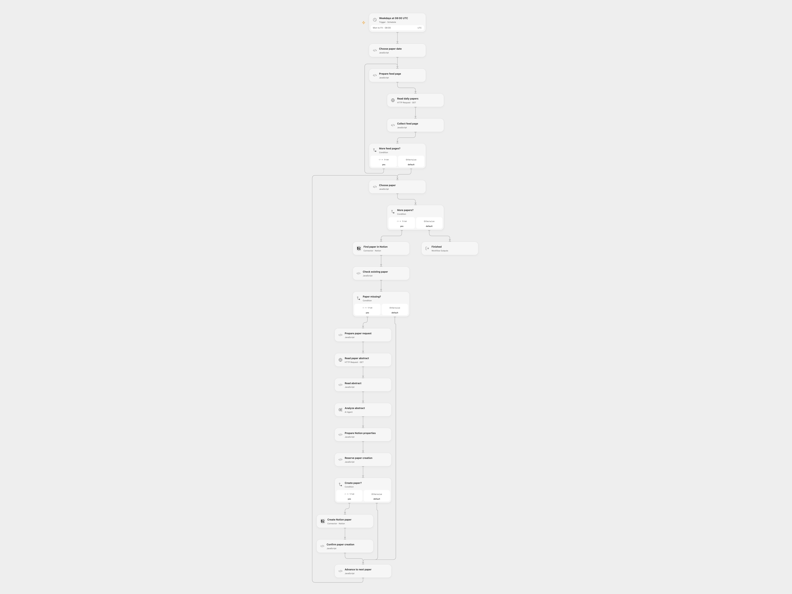

# Analyze Daily Papers in Notion

Analyze daily paper abstracts and save new papers to a Notion data source.

<!-- template-actions:start -->
 
<!-- template-actions:end -->

<picture>
  <source media="(prefers-color-scheme: dark)" srcset="preview-dark.png">
  
</picture>

## Setup

Connect Notion and configure the same data source ID in **Find paper in Notion** and **Prepare Notion properties**. Create properties URL (URL), title (title), abstract, Classification, Technical_Details, Data_and_Results, keywords and Core Introduction (rich text), and scrap-date (date). Configure the model and enable persistent State.

## Behavior

At 08:00 UTC on weekdays, read the previous calendar day's Hugging Face Daily Papers. Monday reads Sunday. Existing URLs are skipped. Each new abstract is analyzed and stored with the paper URL, title, abstract, date and analysis. Models may invent or omit details; review results. The abstract is sent to the selected model.

If a Notion creation has an unknown result, inspect the database. Resolve the pending key in **Reserve paper creation** as confirmed or absent before rerunning; do not run overlapping executions.

In n8n

In n8n configure the same database, OpenAI and a Data Table with text columns item_key and status for pending writes. In n8n, inspect the pending row and the database; mark the row done if the page exists, or delete it only after confirming that no page was created.

Inspiration &amp; credits

## Changes to the source

Use structured Hugging Face APIs, paginate daily results and track uncertain Notion creates.

Adapted from [Analyse papers from Hugging Face with AI and store them in Notion](https://github.com/enescingoz/awesome-n8n-templates/blob/827110332c21cbe000ab13f6d292d5adb1f1f8db/Notion/Analyse%20papers%20from%20Hugging%20Face%20with%20AI%20and%20store%20them%20in%20Notion.json) in [enescingoz/awesome-n8n-templates](https://github.com/enescingoz/awesome-n8n-templates).

Source collection notice: © 2024–2026 Enes Cingoz, [CC BY 4.0](https://github.com/enescingoz/awesome-n8n-templates/blob/827110332c21cbe000ab13f6d292d5adb1f1f8db/LICENSE). The source export does not identify a separate template author or license. See [repository licensing](../../README.md#licensing) for the scope of OOMOL contributions and third-party material.

