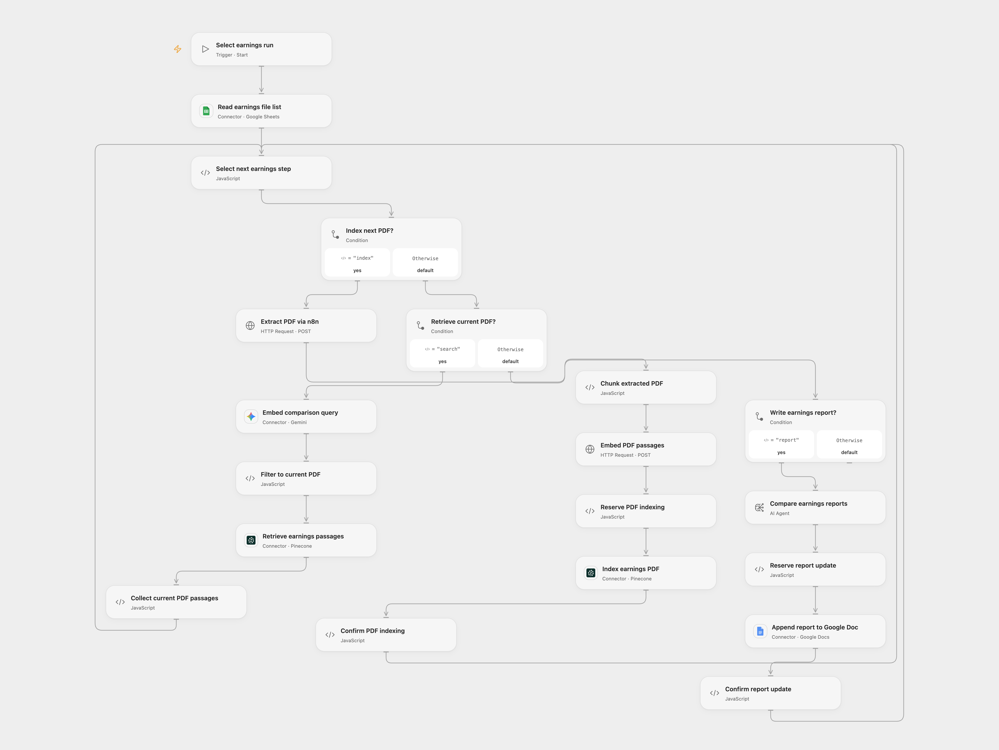

# Analyze Earnings PDFs with Pinecone

Index earnings PDFs from Drive and append a comparison to an existing Google Doc.

<!-- template-actions:start -->
 
<!-- template-actions:end -->

<picture>
  <source media="(prefers-color-scheme: dark)" srcset="preview-dark.png">
  
</picture>

## Setup

For Open Flow enable the PDF extraction webhook, configure its Header Auth as Authorization: Bearer plus a secret and bind N8N_RELAY_TOKEN. Enter its URL, the Pinecone index host in both Pinecone nodes, workbook, range and existing destination document. Bind GEMINI_API_KEY for batch embeddings, connect Gemini, Pinecone, Sheets and Docs, and enable persistent State. Configure a 3072-dimensional Pinecone index and prevent concurrent executions for a run ID. Protect both webhook endpoints at your deployment boundary.

The sheet needs File URL and 10Q columns containing Drive PDF URLs and labels. Provide at least three distinct quarterly reports. Every listed file is indexed and searched. PDFs need extractable text; scanned files require OCR. Open Flow indexes up to four text chunks at a time; each Code input/output must fit 1 MiB. A new run ID isolates its Pinecone namespace. Keep the selected PDFs and sheet rows unchanged while resuming a run; allow for Pinecone index propagation before retrying an empty search. Review the generated analysis and every number against the source PDFs before relying on the report.

The source's file-indexing chain has no incoming trigger; this version runs it before generating the report. Open Flow retrieves passages separately for each file, uses Gemini 3072-dimensional embeddings, and appends Markdown as text. If an index upsert or document update has an unknown result, inspect Pinecone or the document. In Open Flow enter the pending key and confirmed or absent in **Select next earnings step**, then clear the fields. Do not retry before checking.

In n8n

In n8n configure the Sheets, Drive, Docs, model and Pinecone credentials and select a 3072-dimensional Pinecone index. Configure a Data Table with item_key and status text columns, and use a unique run ID in **Configure earnings run**. In n8n the run namespace is shared by indexing and retrieval. In n8n inspect the matching Data Table row, mark done after confirming success or delete the pending row only after confirming absence.

Inspiration &amp; credits

Adapted from [Google Earnings Report with Pinecone](https://github.com/Zie619/n8n-workflows/blob/ae8cf6dc5b873cbb4f74587aa9180ed3a9f70682/workflows/Googledocs/1279_Googledocs_Manual_Automate_Triggered.json) in [Zie619/n8n-workflows](https://github.com/Zie619/n8n-workflows). The source export does not identify a separate template author or license.

The collection’s [MIT notice](https://github.com/Zie619/n8n-workflows/blob/94007c1445d9258a7da116646b79473e7c7c3282/LICENSE) is pinned at a later revision. This is the collection notice at that revision; it does not establish a separate original template author's license. Our changes are listed above; see [repository licensing](../../README.md#licensing).

> MIT License
>
> Copyright (c) 2025 Zie619
>
> Permission is hereby granted, free of charge, to any person obtaining a copy
> of this software and associated documentation files (the "Software"), to deal
> in the Software without restriction, including without limitation the rights
> to use, copy, modify, merge, publish, distribute, sublicense, and/or sell
> copies of the Software, and to permit persons to whom the Software is
> furnished to do so, subject to the following conditions:
>
> The above copyright notice and this permission notice shall be included in all
> copies or substantial portions of the Software.
>
> THE SOFTWARE IS PROVIDED "AS IS", WITHOUT WARRANTY OF ANY KIND, EXPRESS OR
> IMPLIED, INCLUDING BUT NOT LIMITED TO THE WARRANTIES OF MERCHANTABILITY,
> FITNESS FOR A PARTICULAR PURPOSE AND NONINFRINGEMENT. IN NO EVENT SHALL THE
> AUTHORS OR COPYRIGHT HOLDERS BE LIABLE FOR ANY CLAIM, DAMAGES OR OTHER
> LIABILITY, WHETHER IN AN ACTION OF CONTRACT, TORT OR OTHERWISE, ARISING FROM,
> OUT OF OR IN CONNECTION WITH THE SOFTWARE OR THE USE OR OTHER DEALINGS IN THE
> SOFTWARE.

