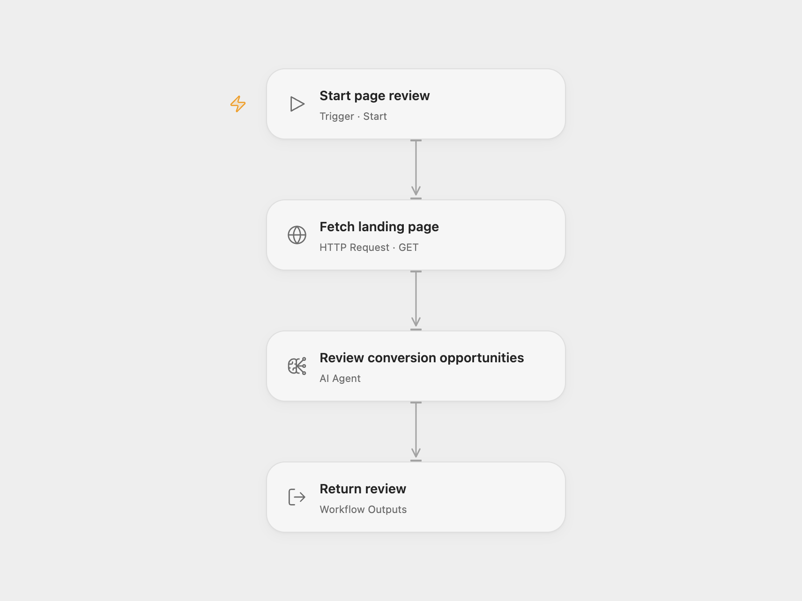

# Analyze Landing Page Conversions

Analyze a landing page and suggest ten conversion improvements.

<picture>
  <source media="(prefers-color-scheme: dark)" srcset="preview-dark.png">
  
</picture>

[Open Flow JSON](templates/analyze-landing-page-conversions.openflow.json) · [n8n JSON](templates/analyze-landing-page-conversions.n8n.json)

## Setup and use

Set a public landing page URL in **Fetch landing page**, configure the model, and run the workflow. In n8n connect an OpenAI model and submit the included form. Use one format.

## Behavior

The workflow fetches the page HTML and sends it to the model for a candid conversion review and ten tailored recommendations. The review is available in the workflow output. Model results can be inaccurate and do not inspect the rendered page or its interactive behavior. Only send content you are authorized to share with the model provider.

Inspiration &amp; credits

## Changes to the source

- Use a manual URL setting in Open Flow in place of the n8n form. Configure an available model in place of the source model.

Adapted from [Landing page conversion review](https://github.com/Zie619/n8n-workflows/blob/ae8cf6dc5b873cbb4f74587aa9180ed3a9f70682/workflows/Form/1873_Form_HTTP_Automation_Webhook.json) in [Zie619/n8n-workflows](https://github.com/Zie619/n8n-workflows). The [original n8n template](https://n8n.io/workflows/3100-analyze-landing-page-with-openai-and-get-optimization-tips/) credits Not Another Marketer as its author. The source export does not identify a separate template license.

The collection’s [MIT notice](https://github.com/Zie619/n8n-workflows/blob/94007c1445d9258a7da116646b79473e7c7c3282/LICENSE) is pinned at a later revision. This is the collection notice at that revision; it does not establish a separate original template author's license. Our changes are listed above; see [repository licensing](../../README.md#licensing).

> MIT License
>
> Copyright (c) 2025 Zie619
>
> Permission is hereby granted, free of charge, to any person obtaining a copy
> of this software and associated documentation files (the "Software"), to deal
> in the Software without restriction, including without limitation the rights
> to use, copy, modify, merge, publish, distribute, sublicense, and/or sell
> copies of the Software, and to permit persons to whom the Software is
> furnished to do so, subject to the following conditions:
>
> The above copyright notice and this permission notice shall be included in all
> copies or substantial portions of the Software.
>
> THE SOFTWARE IS PROVIDED "AS IS", WITHOUT WARRANTY OF ANY KIND, EXPRESS OR
> IMPLIED, INCLUDING BUT NOT LIMITED TO THE WARRANTIES OF MERCHANTABILITY,
> FITNESS FOR A PARTICULAR PURPOSE AND NONINFRINGEMENT. IN NO EVENT SHALL THE
> AUTHORS OR COPYRIGHT HOLDERS BE LIABLE FOR ANY CLAIM, DAMAGES OR OTHER
> LIABILITY, WHETHER IN AN ACTION OF CONTRACT, TORT OR OTHERWISE, ARISING FROM,
> OUT OF OR IN CONNECTION WITH THE SOFTWARE OR THE USE OR OTHER DEALINGS IN THE
> SOFTWARE.

