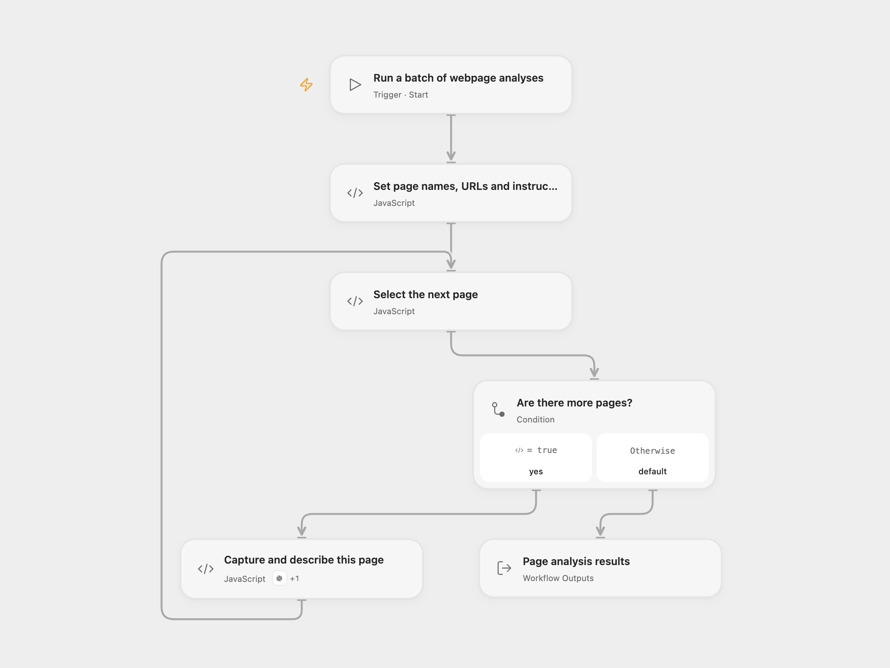

# Describe a List of Webpage Screenshots

Capture a full-page screenshot for each named URL and return a short visual description with its original name and URL.

<!-- template-actions:start -->
 
<!-- template-actions:end -->

<picture>
  <source media="(prefers-color-scheme: dark)" srcset="preview-dark.png">
  
</picture>

## Setup

1. In **Set page names, URLs and instructions**, replace the example with one to ten entries containing `website_name` and `url`. List the exact permitted hostnames in **Allowed Hosts**. Enter direct public HTTPS URLs for pages you are authorized to send to URLbox and OpenAI.
2. In **Capture and describe this page**, bind **Urlbox Token** to a `URLBOX_SECRET` secret variable and connect OpenAI. Use a URLbox project with default render storage at `renders.urlbox.com` and support for screenshot hashes.
3. Run manually and open **Page analysis results**.

## Behavior

URLbox captures a full-page PNG using its default viewport, page-load wait and no additional delay. The workflow validates the PNG and checks its SHA-256 against the URLbox receipt. GPT-4.1 mini describes what is visible on the verified image. The instruction defaults to a one-sentence description.

Each result keeps its input index, name and URL. A failed page reports an error for that row, and the workflow continues with the remaining pages. A render must finish within 30 seconds and the PNG must fit within 1 MiB. The workflow accepts only approved direct publisher or company URLs and blocks known social platform requests during rendering. URLbox hosts the screenshot and OpenAI receives its bytes. [URLbox render options](https://urlbox.com/docs/options)

In n8n

Edit the same settings in **Set page names, URLs and instructions**. Use separate Bearer Auth credentials for URLbox in **Capture the full page with URLbox** and OpenAI in **Describe these screenshot bytes**. Run manually and open **Page analysis results** for one outcome per input.

Inspiration &amp; credits

Adapted from [Analyze Screenshots with AI](https://github.com/Zie619/n8n-workflows/blob/ae8cf6dc5b873cbb4f74587aa9180ed3a9f70682/workflows/Http/1996_HTTP_Manual_Automation_Webhook.json) in [Zie619/n8n-workflows](https://github.com/Zie619/n8n-workflows). Attribution: Bela (original workflow); Zie619 (collection).

The collection’s [MIT notice](https://github.com/Zie619/n8n-workflows/blob/94007c1445d9258a7da116646b79473e7c7c3282/LICENSE) is pinned at a later revision. This is the collection notice at that revision; it does not establish a separate original template author's license. Our changes are listed above; see [repository licensing](../../README.md#licensing).

> MIT License
>
> Copyright (c) 2025 Zie619
>
> Permission is hereby granted, free of charge, to any person obtaining a copy
> of this software and associated documentation files (the "Software"), to deal
> in the Software without restriction, including without limitation the rights
> to use, copy, modify, merge, publish, distribute, sublicense, and/or sell
> copies of the Software, and to permit persons to whom the Software is
> furnished to do so, subject to the following conditions:
>
> The above copyright notice and this permission notice shall be included in all
> copies or substantial portions of the Software.
>
> THE SOFTWARE IS PROVIDED "AS IS", WITHOUT WARRANTY OF ANY KIND, EXPRESS OR
> IMPLIED, INCLUDING BUT NOT LIMITED TO THE WARRANTIES OF MERCHANTABILITY,
> FITNESS FOR A PARTICULAR PURPOSE AND NONINFRINGEMENT. IN NO EVENT SHALL THE
> AUTHORS OR COPYRIGHT HOLDERS BE LIABLE FOR ANY CLAIM, DAMAGES OR OTHER
> LIABILITY, WHETHER IN AN ACTION OF CONTRACT, TORT OR OTHERWISE, ARISING FROM,
> OUT OF OR IN CONNECTION WITH THE SOFTWARE OR THE USE OR OTHER DEALINGS IN THE
> SOFTWARE.

The [original n8n workflow](https://n8n.io/workflows/2207-automate-screenshots-with-urlbox-and-analyze-them-with-ai/) credits Bela. This workflow adds a page list and links each verified screenshot to its input.

