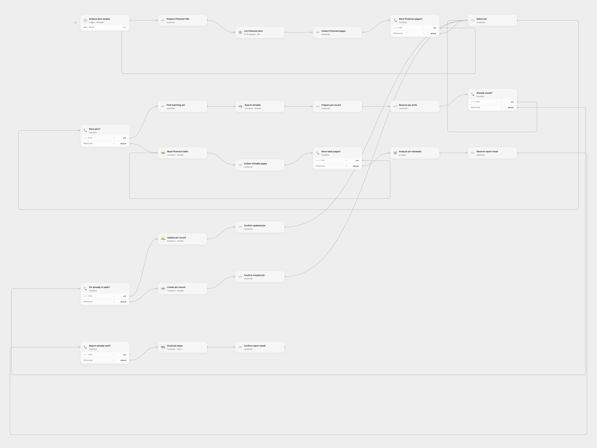

# Analyze Pinterest Pins for Content Ideas

Collect Pinterest pins in Airtable and email content ideas based on their metadata.

<!-- template-actions:start -->
[](https://openflow.run/templates/analyze-pinterest-pins-for-content-ideas/) [](templates/analyze-pinterest-pins-for-content-ideas.n8n.json)
<!-- template-actions:end -->

<picture>
  <source media="(prefers-color-scheme: dark)" srcset="preview-dark.png">
  
</picture>

## Setup

Configure the Pinterest token, Airtable base and table, Gmail recipient and model. Airtable fields: pin_id, created_at, title, description, link, type. Enable persistent State and avoid overlapping runs. In n8n configure a Data Table with item_key and status text fields, the Pinterest Header Auth credential, Airtable tool, Gmail and model.

## Behavior

Every Monday at 08:00 UTC, collect account pins, create or update records by pin_id, analyze the table and email suggestions. Pinterest metadata is sent to the model. Pin metadata does not contain performance metrics, so suggestions are ideas rather than evidence of audience or engagement trends. Inspect Airtable or Gmail before resolving a pending checkpoint after an uncertain write.

<details>
<summary>Inspiration &amp; credits</summary>

Adapted from [Automate Pinterest Analysis & AI-Powered Content Suggestions With Pinterest API](https://github.com/enescingoz/awesome-n8n-templates/blob/827110332c21cbe000ab13f6d292d5adb1f1f8db/Other_Integrations_and_Use_Cases/Automate%20Pinterest%20Analysis%20%26%20AI-Powered%20Content%20Suggestions%20With%20Pinterest%20API.json) in [enescingoz/awesome-n8n-templates](https://github.com/enescingoz/awesome-n8n-templates).

Source collection notice: © 2024–2026 Enes Cingoz, [CC BY 4.0](https://github.com/enescingoz/awesome-n8n-templates/blob/827110332c21cbe000ab13f6d292d5adb1f1f8db/LICENSE). The source export does not identify a separate template author or license. See [repository licensing](../../README.md#licensing) for the scope of OOMOL contributions and third-party material.


Changes from source: configure account and recipient, use pin_id for upserts, serialize writes before analysis, page Pinterest data and add write checkpoints. The schedule is explicitly Monday in UTC. Open Flow reads the table before analysis; n8n uses its Airtable tool and separate summarizer.

Collection license notice:

```text
Creative Commons Attribution 4.0 International License

Copyright (c) 2024-2026 Enes Cingoz

You are free to:

  Share - copy and redistribute the material in any medium or format
  Adapt - remix, transform, and build upon the material for any purpose,
  even commercially.

Under the following terms:

  Attribution - You must give appropriate credit, provide a link to the
  license, and indicate if changes were made. You may do so in any
  reasonable manner, but not in any way that suggests the licensor
  endorses you or your use.

  No additional restrictions - You may not apply legal terms or
  technological measures that legally restrict others from doing
  anything the license permits.

Notices:

  You do not have to comply with the license for elements of the
  material in the public domain or where your use is permitted by an
  applicable exception or limitation.

  No warranties are given. The license may not give you all of the
  permissions necessary for your intended use. For example, other rights
  such as publicity, privacy, or moral rights may limit how you use the
  material.

For the full license text, see:
https://creativecommons.org/licenses/by/4.0/legalcode
```

</details>
