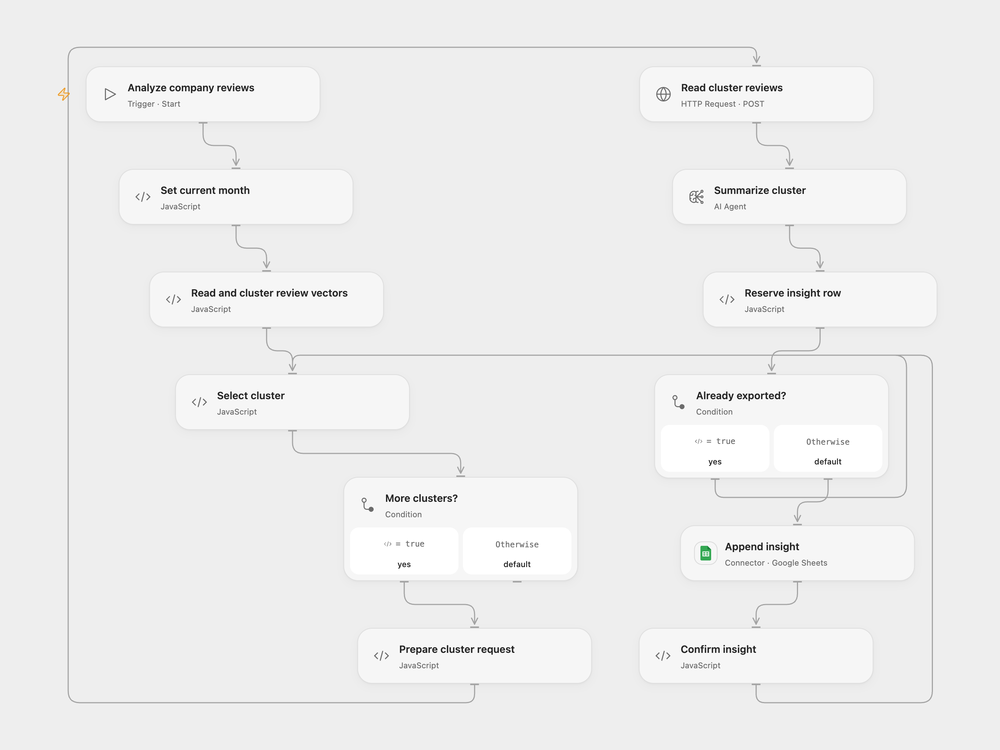

# Analyze Qdrant Review Clusters

Cluster stored review vectors and append customer insights to a spreadsheet.

<!-- template-actions:start -->
[](https://openflow.run/templates/analyze-qdrant-review-clusters/) [](templates/analyze-qdrant-review-clusters.n8n.json)
<!-- template-actions:end -->

<picture>
  <source media="(prefers-color-scheme: dark)" srcset="preview-dark.png">
  
</picture>

## Setup

Provide an existing Qdrant collection named trustpilot_reviews with vectors and payload content plus metadata company_id, review_date, review_author, review_rating and review_url. Configure the Qdrant URL and API key, model, and Google Sheets connection and spreadsheet. In Open Flow set the Qdrant host in the Code node HTTP allowlist and both Qdrant URLs. Open Flow uses persistent State; n8n requires a Data Table with item_key and status text columns. Call the n8n workflow with companyId, or run Open Flow with company.

## Behavior

The workflow retrieves up to 500 review vectors for the current UTC month, groups them into up to five clusters using deterministic JavaScript K-means and summarizes clusters with at least three reviews. It appends company, date range, insight, sentiment, suggested improvements, count and raw reviews to columns A through H. K-means grouping and model summaries need review. Review text and author information are sent to the model and stored in the sheet. This component analyzes existing records; it does not retrieve reviews from Trustpilot or populate Qdrant.

Prevent overlapping runs. If a sheet append has an uncertain outcome, inspect the sheet before clearing its pending checkpoint.

<details>
<summary>Inspiration &amp; credits</summary>

Adapted from [Customer Insights with Qdrant, Python and Information Extractor](https://github.com/enescingoz/awesome-n8n-templates/blob/827110332c21cbe000ab13f6d292d5adb1f1f8db/AI_Research_RAG_and_Data_Analysis/Customer%20Insights%20with%20Qdrant%2C%20Python%20and%20Information%20Extractor.json) in [enescingoz/awesome-n8n-templates](https://github.com/enescingoz/awesome-n8n-templates).

Source collection notice: © 2024–2026 Enes Cingoz, [CC BY 4.0](https://github.com/enescingoz/awesome-n8n-templates/blob/827110332c21cbe000ab13f6d292d5adb1f1f8db/LICENSE). The source export does not identify a separate template author or license. See [repository licensing](../../README.md#licensing) for the scope of OOMOL contributions and third-party material.


Changes from source: Publish the independently callable analysis path, read Qdrant in small pages up to the original 500-record limit, use JavaScript K-means and add sheet-write checkpoints.

Collection license notice:

```text
Creative Commons Attribution 4.0 International License

Copyright (c) 2024-2026 Enes Cingoz

You are free to:

  Share - copy and redistribute the material in any medium or format
  Adapt - remix, transform, and build upon the material for any purpose,
  even commercially.

Under the following terms:

  Attribution - You must give appropriate credit, provide a link to the
  license, and indicate if changes were made. You may do so in any
  reasonable manner, but not in any way that suggests the licensor
  endorses you or your use.

  No additional restrictions - You may not apply legal terms or
  technological measures that legally restrict others from doing
  anything the license permits.

Notices:

  You do not have to comply with the license for elements of the
  material in the public domain or where your use is permitted by an
  applicable exception or limitation.

  No warranties are given. The license may not give you all of the
  permissions necessary for your intended use. For example, other rights
  such as publicity, privacy, or moral rights may limit how you use the
  material.

For the full license text, see:
https://creativecommons.org/licenses/by/4.0/legalcode
```

</details>
