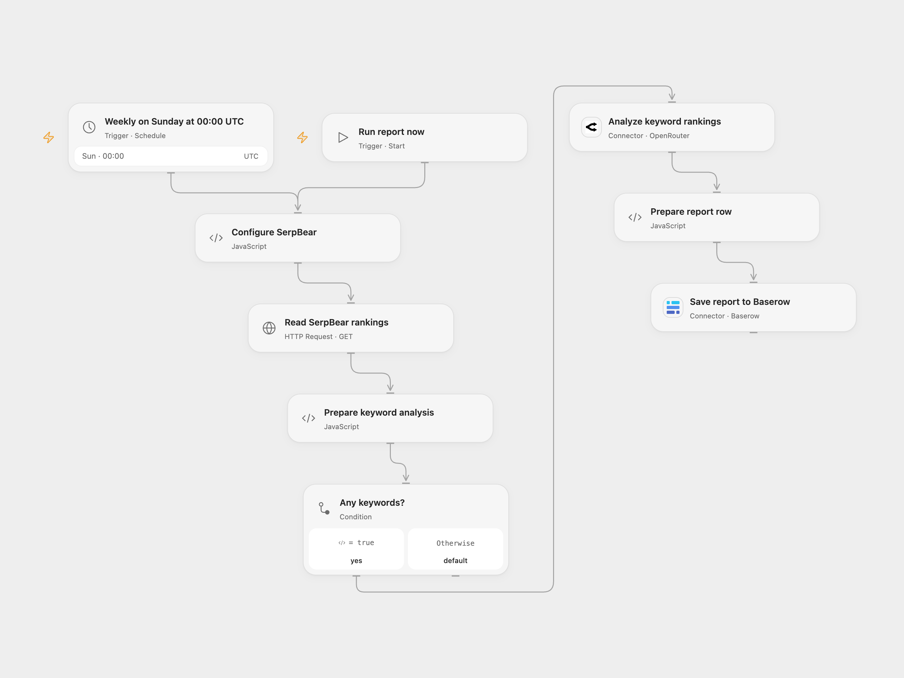

# Analyze SerpBear Rankings to Baserow

Analyze a domain’s SerpBear keyword rankings and save a report to Baserow.

<picture>
  <source media="(prefers-color-scheme: dark)" srcset="preview-dark.png">
  
</picture>

[Open Flow JSON](templates/analyze-serpbear-rankings-to-baserow.openflow.json) · [n8n JSON](templates/analyze-serpbear-rankings-to-baserow.n8n.json)

## Setup

In **Configure SerpBear**, set your public HTTPS instance URL ending in /api/keywords and the tracked domain. Create a secret Variable containing the SerpBear API key and bind it to **Auth Token**. Connect OpenRouter in **Analyze keyword rankings** and select an available model. Connect Baserow Cloud in **Save report to Baserow**, choose a table with Date, Note and Blog fields, and set the blog name in **Prepare report row**.

In n8n, set the SerpBear URL and domain in **Configure SerpBear**, configure Header Auth with name Authorization and value Bearer YOUR_SERPBEAR_API_KEY, and configure OpenRouter Header Auth with name Authorization and value Bearer YOUR_OPENROUTER_API_KEY. Select an available model in the OpenRouter request. Connect Baserow credentials and select the Date, Note and Blog fields. Activate one format.

## Behavior

A manual run or weekly schedule reads all keywords returned for the configured domain, summarizes current rank and up to seven most recent recorded history entries, and asks the configured OpenRouter model for observations and actions. Empty keyword lists produce no report. Zero history positions are excluded from the average; a keyword with no ranked history or with position zero is labeled as having insufficient ranking data. Results depend on SerpBear data and model output; review reports before acting. The workflow stores one Date, Note and Blog row in Baserow.

Read, model or write failure stops the run. A failed or uncertain row creation may already have succeeded; check Baserow before retrying. SerpBear must be reachable over HTTPS. Keep API keys and ranking data private. Open Flow uses UTC Sunday midnight; the source depended on the n8n instance timezone. n8n chooses a fixed second within the scheduled minute; Open Flow uses the minute boundary.

## Changes to the source

- Query the documented /api/keywords endpoint by domain. The source queried one keyword but attempted to read a keyword list.
- Sort dated history before choosing the latest seven recorded entries, handle absent history and zero positions, and escape the prompt as JSON instead of URL-encoding it.
- Replace personal domain and table IDs, choose an available model, validate the response and set UTC explicitly.

Source and license

Adapted from [Analyze SerpBear keyword rankings](https://github.com/Zie619/n8n-workflows/blob/ae8cf6dc5b873cbb4f74587aa9180ed3a9f70682/workflows/Code/1965_Code_Schedule_Automation_Webhook.json) in [Zie619/n8n-workflows](https://github.com/Zie619/n8n-workflows). The matching [n8n listing](https://n8n.io/workflows/2565-summarize-serpbear-data-with-ai-via-openrouter-and-save-it-to-baserow/) credits Keith Rumjahn. The original template does not state a separate license.

The collection’s [MIT notice](https://github.com/Zie619/n8n-workflows/blob/94007c1445d9258a7da116646b79473e7c7c3282/LICENSE) is pinned at a later revision. This is the collection notice at that revision; it does not establish a separate original template author's license. Our changes are listed above; see [repository licensing](../../README.md#licensing).

> MIT License
>
> Copyright (c) 2025 Zie619
>
> Permission is hereby granted, free of charge, to any person obtaining a copy
> of this software and associated documentation files (the "Software"), to deal
> in the Software without restriction, including without limitation the rights
> to use, copy, modify, merge, publish, distribute, sublicense, and/or sell
> copies of the Software, and to permit persons to whom the Software is
> furnished to do so, subject to the following conditions:
>
> The above copyright notice and this permission notice shall be included in all
> copies or substantial portions of the Software.
>
> THE SOFTWARE IS PROVIDED "AS IS", WITHOUT WARRANTY OF ANY KIND, EXPRESS OR
> IMPLIED, INCLUDING BUT NOT LIMITED TO THE WARRANTIES OF MERCHANTABILITY,
> FITNESS FOR A PARTICULAR PURPOSE AND NONINFRINGEMENT. IN NO EVENT SHALL THE
> AUTHORS OR COPYRIGHT HOLDERS BE LIABLE FOR ANY CLAIM, DAMAGES OR OTHER
> LIABILITY, WHETHER IN AN ACTION OF CONTRACT, TORT OR OTHERWISE, ARISING FROM,
> OUT OF OR IN CONNECTION WITH THE SOFTWARE OR THE USE OR OTHER DEALINGS IN THE
> SOFTWARE.

