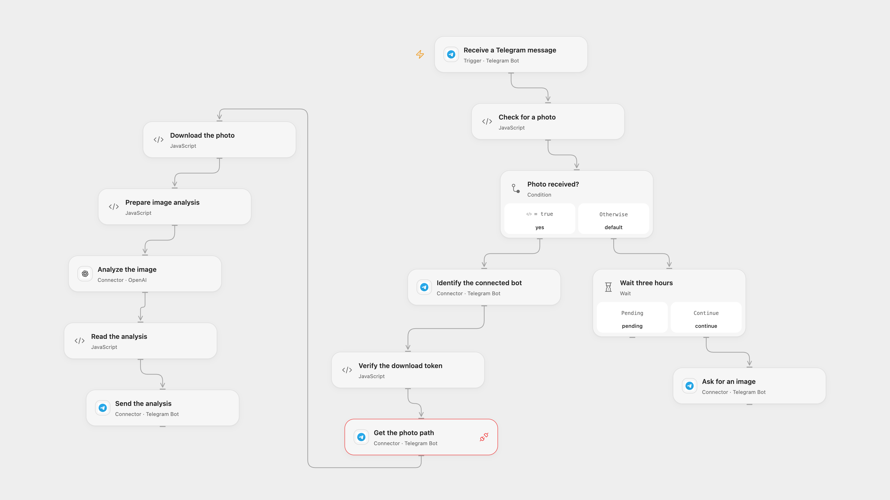

# Analyze Telegram Images with AI

Describe photos sent to a Telegram bot and reply in the same chat.

<picture>
  <source media="(prefers-color-scheme: dark)" srcset="preview-dark.png">
  
</picture>

[Open Flow JSON](templates/analyze-telegram-images-with-ai.openflow.json) · [n8n JSON](templates/analyze-telegram-images-with-ai.n8n.json)

## Setup

Connect the same Telegram bot to **Receive a Telegram message**, **Identify the connected bot**, **Get the photo path**, **Ask for an image** and **Send the analysis**. Create a secret Variable for that bot token and bind it to **Verify the download token** and **Download the photo**. Grant Telegram Provider API Request permission and HTTP access to api.telegram.org. Restrict the trigger to intended chats or users. Connect OpenAI in **Analyze the image** and choose a vision-capable model.

In n8n, connect Telegram and OpenAI and select a vision-capable model in **Analyze image**. Only one Telegram webhook can be active per bot; enable one format.

## Behavior

A Telegram photo is downloaded and analyzed with the prompt “What's in this image?”; the description goes back to the same chat. Open Flow selects the last Telegram photo variant. n8n selects the third variant when present and otherwise the first, following its trigger default. A message without a photo receives “Please Upload an Image ....” after three hours, matching the source Wait node's default unit. The delay can be adjusted in the Wait node.

Open Flow verifies that the download token identifies the connected bot. Its webhook verifies the Telegram secret; the n8n 1.1 Telegram trigger also checks its configured secret header. Open Flow accepts JPEG photos up to 700,000 bytes so the image and Base64 representation fit host limits. Oversized, invalid or failed downloads stop; n8n has its own service limits. Images and descriptions can appear in execution data; restrict access. Check Telegram before repeating an uncertain reply.

## Changes to the source

- Replace the retired vision-preview model with a configurable current vision-capable model. Open Flow uses OpenAI Responses; n8n keeps its image-analysis node.
- Preserve the source's three-hour no-photo Wait and make it explicit. Open Flow adds bot identity and image validation before analysis.

Source and license

Adapted from [Automated Image Analysis and Response via Telegram](https://github.com/Zie619/n8n-workflows/blob/ae8cf6dc5b873cbb4f74587aa9180ed3a9f70682/workflows/Telegram/0488_Telegram_Stickynote_Update_Triggered.json) in [Zie619/n8n-workflows](https://github.com/Zie619/n8n-workflows). The matching [n8n community listing](https://n8n.io/workflows/2235-automated-ai-image-analysis-and-response-via-telegram/) credits AlQaisi. The original template does not state a separate license.

The collection’s [MIT notice](https://github.com/Zie619/n8n-workflows/blob/94007c1445d9258a7da116646b79473e7c7c3282/LICENSE) is pinned at a later revision. This is the collection notice at that revision; it does not establish a separate original template author's license. Our changes are listed above; see [repository licensing](../../README.md#licensing).

> MIT License
>
> Copyright (c) 2025 Zie619
>
> Permission is hereby granted, free of charge, to any person obtaining a copy
> of this software and associated documentation files (the "Software"), to deal
> in the Software without restriction, including without limitation the rights
> to use, copy, modify, merge, publish, distribute, sublicense, and/or sell
> copies of the Software, and to permit persons to whom the Software is
> furnished to do so, subject to the following conditions:
>
> The above copyright notice and this permission notice shall be included in all
> copies or substantial portions of the Software.
>
> THE SOFTWARE IS PROVIDED "AS IS", WITHOUT WARRANTY OF ANY KIND, EXPRESS OR
> IMPLIED, INCLUDING BUT NOT LIMITED TO THE WARRANTIES OF MERCHANTABILITY,
> FITNESS FOR A PARTICULAR PURPOSE AND NONINFRINGEMENT. IN NO EVENT SHALL THE
> AUTHORS OR COPYRIGHT HOLDERS BE LIABLE FOR ANY CLAIM, DAMAGES OR OTHER
> LIABILITY, WHETHER IN AN ACTION OF CONTRACT, TORT OR OTHERWISE, ARISING FROM,
> OUT OF OR IN CONNECTION WITH THE SOFTWARE OR THE USE OR OTHER DEALINGS IN THE
> SOFTWARE.

