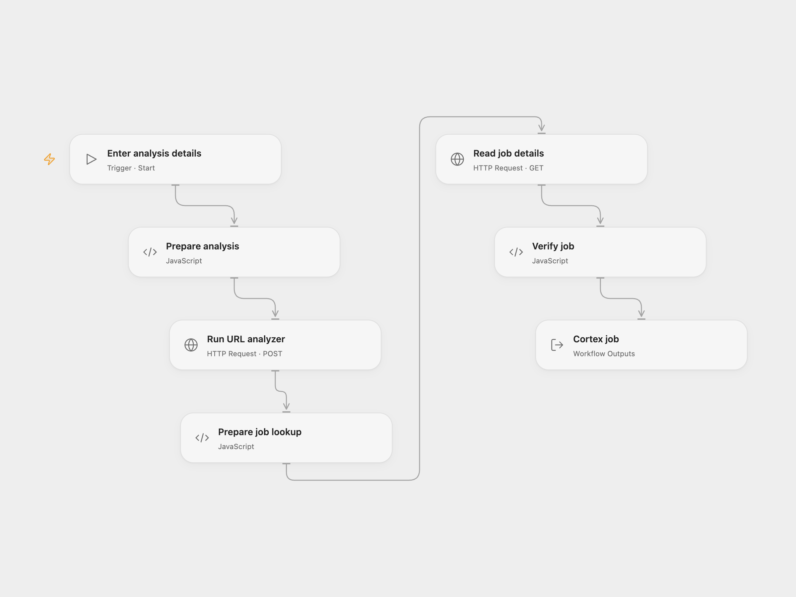

# Analyze a URL with Cortex

Submit a URL to a Cortex analyzer and read the resulting job details.

<picture>
  <source media="(prefers-color-scheme: dark)" srcset="preview-dark.png">
  
</picture>

[Open Flow JSON](templates/analyze-url-with-cortex.openflow.json) · [n8n JSON](templates/analyze-url-with-cortex.n8n.json)

## Setup

Use an HTTPS Cortex instance, an enabled analyzer that accepts URLs, and an API key with permission to run analyzers and read jobs. In Open Flow, create a secret Variable for the key and bind **Auth Token** on both HTTP nodes. Run with the instance URL, analyzer ID and URL to analyze. In n8n, connect the Cortex credential to both nodes and edit **Set analysis details**; use the same instance in the credential.

Cortex and the analyzer may send the URL to external services. Only submit URLs you are authorized to share. The request uses TLP 2 (Amber), matching the source. Configure an analyzer compatible with that TLP and the URL datatype.

## Behavior

Each run submits one analyzer job and immediately reads that job once. The returned status can still be waiting or in progress; this workflow does not wait for completion or retrieve a report. Cortex may return a cached job. A failed request stops the workflow; a lost response may mean the job was created, so inspect Cortex before retrying. There is no automatic retry or rollback.

Inspiration &amp; credits

## Changes to the source

- Replace the example URL and instance-specific analyzer with inputs. Use Cortex’s documented job ID field; the source referenced the undocumented _id field. Validate it before reading the job.
- Both formats check that the returned job matches the submitted ID. Open Flow uses the Cortex HTTP API.

Adapted from [Analyze a URL and get the job details using the Cortex node](https://github.com/Zie619/n8n-workflows/blob/ae8cf6dc5b873cbb4f74587aa9180ed3a9f70682/workflows/Manual/0202_Manual_Cortex_Import_Triggered.json) in [Zie619/n8n-workflows](https://github.com/Zie619/n8n-workflows). The matching [n8n community listing](https://n8n.io/workflows/809-get-the-job-details-using-the-cortex-node/) credits Harshil Agrawal. The original template does not state a separate license.

The collection’s [MIT notice](https://github.com/Zie619/n8n-workflows/blob/94007c1445d9258a7da116646b79473e7c7c3282/LICENSE) is pinned at a later revision. This is the collection notice at that revision; it does not establish a separate original template author's license. Our changes are listed above; see [repository licensing](../../README.md#licensing).

> MIT License
>
> Copyright (c) 2025 Zie619
>
> Permission is hereby granted, free of charge, to any person obtaining a copy
> of this software and associated documentation files (the "Software"), to deal
> in the Software without restriction, including without limitation the rights
> to use, copy, modify, merge, publish, distribute, sublicense, and/or sell
> copies of the Software, and to permit persons to whom the Software is
> furnished to do so, subject to the following conditions:
>
> The above copyright notice and this permission notice shall be included in all
> copies or substantial portions of the Software.
>
> THE SOFTWARE IS PROVIDED "AS IS", WITHOUT WARRANTY OF ANY KIND, EXPRESS OR
> IMPLIED, INCLUDING BUT NOT LIMITED TO THE WARRANTIES OF MERCHANTABILITY,
> FITNESS FOR A PARTICULAR PURPOSE AND NONINFRINGEMENT. IN NO EVENT SHALL THE
> AUTHORS OR COPYRIGHT HOLDERS BE LIABLE FOR ANY CLAIM, DAMAGES OR OTHER
> LIABILITY, WHETHER IN AN ACTION OF CONTRACT, TORT OR OTHERWISE, ARISING FROM,
> OUT OF OR IN CONNECTION WITH THE SOFTWARE OR THE USE OR OTHER DEALINGS IN THE
> SOFTWARE.

