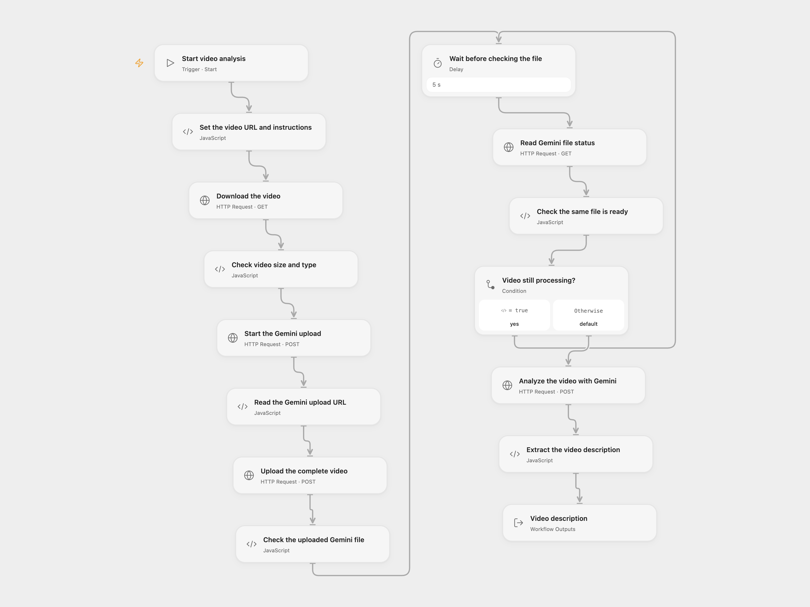

# Analyze a Video URL with Gemini

Download a video, send the full file to Gemini, and return a description based on your instructions.

<!-- template-actions:start -->
 
<!-- template-actions:end -->

<picture>
  <source media="(prefers-color-scheme: dark)" srcset="preview-dark.png">
  
</picture>

## Setup

1. In **Set the video URL and instructions**, enter a direct HTTPS URL serving your video and edit the description instructions. Use a URL that serves the file without signing in or redirecting.
2. Create a secret Variable named `GEMINI_API_KEY` with your Google AI Studio API key. Bind the same Variable in **Start the Gemini upload**, **Read Gemini file status**, and **Analyze the video with Gemini**.
3. Run the workflow manually. Open **Video description** to read `videoDescription`.

## Behavior

The workflow downloads the entire video and uploads its bytes to the Gemini Files API. It checks the same Gemini file every five seconds, up to 12 checks. Gemini 3.5 Flash-Lite receives the uploaded video and your instructions when the file reports `ACTIVE`.

Use a supported video media type such as `video/mp4` or `video/webm`, served with the matching Content-Type. The workflow accepts files up to 10 MiB, subject to the deployment's Artifact limit. Each HTTP request has a 30-second timeout. Failed downloads, uploads, file processing, or incomplete Gemini responses stop the run. Google retains uploaded files temporarily under its [Files API limits](https://aistudio.google.com/docs/file-input-methods#method-comparison).

In n8n

Edit **Set the video URL and instructions**. Create a Header Auth credential with name `x-goog-api-key` and your API key as its value. Assign it in **Start the Gemini upload**, **Read Gemini file status**, and **Analyze the video with Gemini**. Run manually, then open **Extract the video description** for the `videoDescription` output. The same 10 MiB limit applies.

Inspiration &amp; credits

## Changes to the source

- Use the current Gemini Files API resumable upload and Gemini 3.5 Flash-Lite.
- Check the uploaded file's processing state before requesting the description.
- Configure the video URL, instructions, and credential separately. [Original template by SamirLiu](https://n8n.io/workflows/3775-gemini-ai-video-analysis/).

Adapted from [Gemini AI Video Analysis](https://github.com/Zie619/n8n-workflows/blob/ae8cf6dc5b873cbb4f74587aa9180ed3a9f70682/workflows/Http/1876_HTTP_Manual_Automation_Webhook.json) in [Zie619/n8n-workflows](https://github.com/Zie619/n8n-workflows). Attribution: SamirLiu (original workflow); Zie619 / n8n-workflows (collection).

The collection’s [MIT notice](https://github.com/Zie619/n8n-workflows/blob/94007c1445d9258a7da116646b79473e7c7c3282/LICENSE) is pinned at a later revision. This is the collection notice at that revision; it does not establish a separate original template author's license. Our changes are listed above; see [repository licensing](../../README.md#licensing).

> MIT License
>
> Copyright (c) 2025 Zie619
>
> Permission is hereby granted, free of charge, to any person obtaining a copy
> of this software and associated documentation files (the "Software"), to deal
> in the Software without restriction, including without limitation the rights
> to use, copy, modify, merge, publish, distribute, sublicense, and/or sell
> copies of the Software, and to permit persons to whom the Software is
> furnished to do so, subject to the following conditions:
>
> The above copyright notice and this permission notice shall be included in all
> copies or substantial portions of the Software.
>
> THE SOFTWARE IS PROVIDED "AS IS", WITHOUT WARRANTY OF ANY KIND, EXPRESS OR
> IMPLIED, INCLUDING BUT NOT LIMITED TO THE WARRANTIES OF MERCHANTABILITY,
> FITNESS FOR A PARTICULAR PURPOSE AND NONINFRINGEMENT. IN NO EVENT SHALL THE
> AUTHORS OR COPYRIGHT HOLDERS BE LIABLE FOR ANY CLAIM, DAMAGES OR OTHER
> LIABILITY, WHETHER IN AN ACTION OF CONTRACT, TORT OR OTHERWISE, ARISING FROM,
> OUT OF OR IN CONNECTION WITH THE SOFTWARE OR THE USE OR OTHER DEALINGS IN THE
> SOFTWARE.

