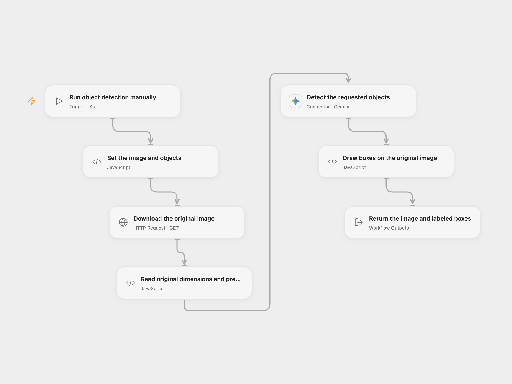

# Draw Gemini Object Detections on an Image

Find the objects you describe in a JPEG or PNG and draw the detected boxes over the original image.

<!-- template-actions:start -->
 
<!-- template-actions:end -->

<picture>
  <source media="(prefers-color-scheme: dark)" srcset="preview-dark.png">
  
</picture>

## Setup

1. Connect Gemini in **Detect the requested objects** and allow Provider API access.
2. Run manually. Supply a publicly reachable HTTPS URL for an upright JPEG or static PNG. The server must return the file directly with its matching image content type. Type an object description such as `rabbits` or `red bicycles`. The default is `rabbits`. [Gemini image understanding](https://aistudio.google.com/docs/image-understanding#object-detection)

## Behavior

Gemini receives the original image bytes and returns labeled boxes on a 0–1000 grid. The workflow scales each box to the original image width and height and draws magenta outlines. Download `object-detections.svg` (`image/svg+xml`) to see the annotations. The SVG embeds the original image at its original dimensions and opens in a browser without internet access. The run also returns labeled box coordinates in pixels. A successful response with zero detections returns the original image inside the SVG and an empty box list.

Use an upright file of at most 2 MiB and 4,096 pixels on each side. The workflow stops on invalid image data, a failed model response, or malformed boxes. Gemini sees the full image and may miss or misidentify objects. [Gemini 3.8 Flash](https://aistudio.google.com/docs/models/gemini-3.8-flash)

In n8n

Edit the image URL and object description in **Set the image and objects**. Select a Google Gemini (PaLM) API credential in **Detect the requested objects**. Run manually and download the SVG from **Return the image and labeled boxes** in the final node’s binary output. The labeled boxes are in that node’s JSON output.

Inspiration &amp; credits

Adapted from [Prompt-based Object Detection with Gemini 2.0](https://github.com/enescingoz/awesome-n8n-templates/blob/827110332c21cbe000ab13f6d292d5adb1f1f8db/OpenAI_and_LLMs/Prompt-based%20Object%20Detection%20with%20Gemini%202.0.json) in [enescingoz/awesome-n8n-templates](https://github.com/enescingoz/awesome-n8n-templates).

Source collection notice: © 2024–2026 Enes Cingoz, [CC BY 4.0](https://github.com/enescingoz/awesome-n8n-templates/blob/827110332c21cbe000ab13f6d292d5adb1f1f8db/LICENSE). The [original n8n gallery template](https://n8n.io/workflows/2649-prompt-based-object-detection-with-gemini-20/) credits Jimleuk. See [repository licensing](../../README.md#licensing) for the scope of OOMOL contributions and third-party material.

## Changes to the source

Gemini 3.8 Flash replaces the source’s experimental Gemini 2.0 model. The workflow draws the boxes returned by Gemini, including counts other than six, and preserves the labels in its output. A self-contained SVG embeds the original JPEG or PNG and uses outlines in place of the source’s filled raster overlays. [Gemini API model lifecycle](https://aistudio.google.com/docs/deprecations)

