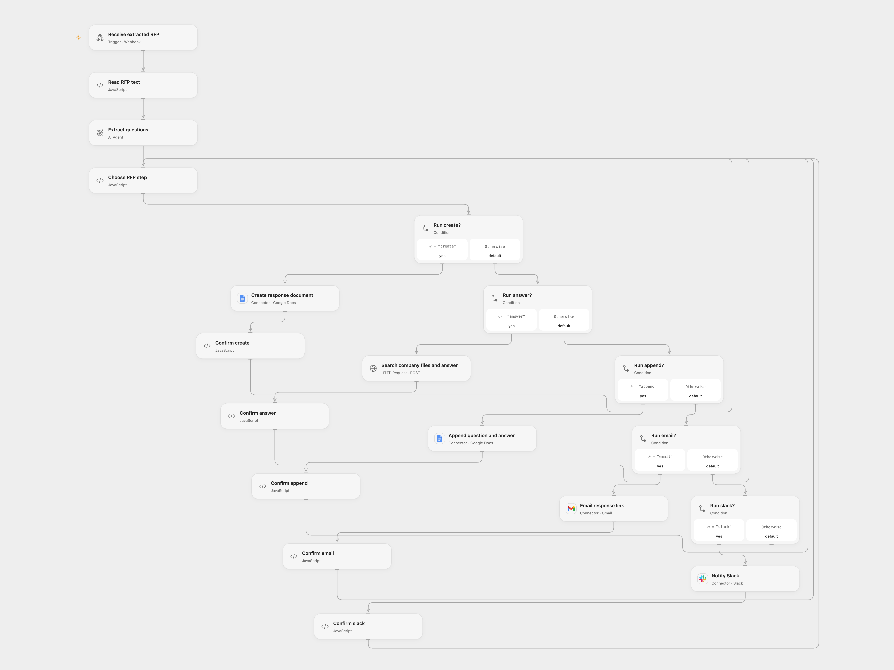

# Answer RFP Questions with Company Files

Draft a response document from RFP questions and company files.

<picture>
  <source media="(prefers-color-scheme: dark)" srcset="preview-dark.png">
  
</picture>

[Open Flow JSON](templates/answer-rfp-questions-with-company-files.openflow.json) · [n8n JSON](templates/answer-rfp-questions-with-company-files.n8n.json)

## Setup and use

Import n8n and configure Google Docs, Gmail, Slack and OpenAI Header Auth credentials. Create a Data Table with text columns item_key, stage and payload, choose it on each Data Table node, set the document folder and Slack channel, and enter the OpenAI vector store ID in **Search company files and answer**. Upload company marketing and sales documents to that vector store. In **Normalize RFP**, choose direct for n8n, or relay and set the Open Flow webhook URL. For Open Flow also enter the vector store ID and Slack channel in **Choose RFP step**, bind OPENAI_API_KEY, connect Google Docs, Gmail and Slack, and enable persistent State. Configure trusted access and prevent concurrent runs for the same request ID. Submit multipart id, title, reply_to and data PDF to n8n. PDFs must contain extractable text; scans require OCR. Each Open Flow Code input and output must fit 1 MiB.

Each request creates a new document and appends each extracted question with an answer using OpenAI file search over the configured company files. The response is a draft requiring human review. The email and Slack message include its link. Inspect the run for completion. The source Assistant API is retired, so Responses file search replaces it; configure the company files yourself. Open Flow creates the document in the connection's default location rather than the original private folder.

Each create, append, email and Slack write is recorded as pending before it runs. If its result is unknown, inspect the service. In **Choose RFP step**, enter the pending key and confirmed or absent; for confirmed creation also provide its document ID. Clear these fields after recovery. For n8n, inspect the matching Data Table row. For an absent operation set its stage back to ready-create, ready-append, ready-email or ready-slack. For a confirmed creation set payload.docId and stage ready-answer. For a confirmed append increment payload.index, clear payload.answer and set stage to ready-answer when questions remain or ready-email otherwise. For confirmed email set ready-slack; for confirmed Slack set done. Do not retry until the outcome is checked. State contains the RFP and draft answers, so restrict access to it and workflow execution history.

Inspiration &amp; credits

Adapted from [AutoRFP](https://github.com/Zie619/n8n-workflows/blob/ae8cf6dc5b873cbb4f74587aa9180ed3a9f70682/workflows/Googledocs/0524_Googledocs_Webhook_Create_Webhook.json) in [Zie619/n8n-workflows](https://github.com/Zie619/n8n-workflows). The source export does not identify a separate template author or license.

The collection’s [MIT notice](https://github.com/Zie619/n8n-workflows/blob/94007c1445d9258a7da116646b79473e7c7c3282/LICENSE) is pinned at a later revision. This is the collection notice at that revision; it does not establish a separate original template author's license. Our changes are listed above; see [repository licensing](../../README.md#licensing).

> MIT License
>
> Copyright (c) 2025 Zie619
>
> Permission is hereby granted, free of charge, to any person obtaining a copy
> of this software and associated documentation files (the "Software"), to deal
> in the Software without restriction, including without limitation the rights
> to use, copy, modify, merge, publish, distribute, sublicense, and/or sell
> copies of the Software, and to permit persons to whom the Software is
> furnished to do so, subject to the following conditions:
>
> The above copyright notice and this permission notice shall be included in all
> copies or substantial portions of the Software.
>
> THE SOFTWARE IS PROVIDED "AS IS", WITHOUT WARRANTY OF ANY KIND, EXPRESS OR
> IMPLIED, INCLUDING BUT NOT LIMITED TO THE WARRANTIES OF MERCHANTABILITY,
> FITNESS FOR A PARTICULAR PURPOSE AND NONINFRINGEMENT. IN NO EVENT SHALL THE
> AUTHORS OR COPYRIGHT HOLDERS BE LIABLE FOR ANY CLAIM, DAMAGES OR OTHER
> LIABILITY, WHETHER IN AN ACTION OF CONTRACT, TORT OR OTHERWISE, ARISING FROM,
> OUT OF OR IN CONNECTION WITH THE SOFTWARE OR THE USE OR OTHER DEALINGS IN THE
> SOFTWARE.

