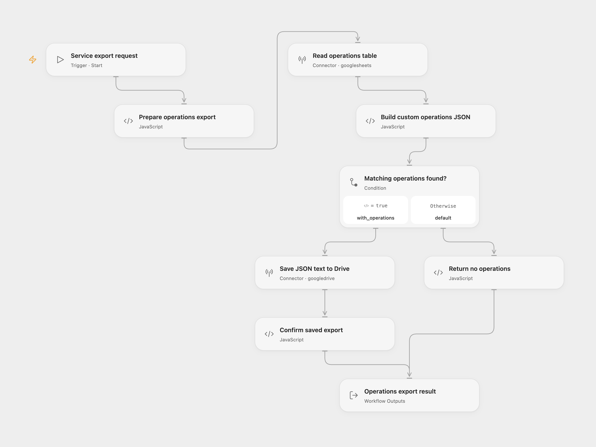

# API Operations Schema Export

Group one service's API operation rows from Google Sheets into a custom JSON catalog and save the export in Google Drive.

<picture>
  <source media="(prefers-color-scheme: dark)" srcset="preview-dark.png">
  
</picture>

[Open Flow JSON](templates/api-operations-schema-export.openflow.json) · [n8n JSON](templates/api-operations-schema-export.n8n.json)

## Setup and use

Connect Google Sheets in **Read operations table** and Google Drive in **Save JSON text to Drive**. In **Prepare operations export**, set your spreadsheet ID and the complete tab as a quoted A1 sheet name, such as `'Operations'`. The account needs read access to the table and permission to create Drive files.

The first nonempty table row must contain unique text headers with these exact column names:

| Column | Content |
| --- | --- |
| `service` | Service name to match exactly |
| `resource` | Resource or endpoint group, such as `Users API` |
| `operation` | Operation name, such as `list users` |
| `description` | Description text; its first sentence is used |
| `url` | API endpoint URL or path |
| `method` | HTTP method, such as `get` |
| `documentation_url` | Optional documentation link for that operation |

In Open Flow, use Run with:

```json
{"service":"Example Service","url":"https://example.com/docs"}
```

For n8n, select Google Sheets OAuth2 and Google Drive credentials on their request/upload nodes. Configure **Operations Sheet Settings** and edit **Service To Export**, then run **Run Operations Export**. The callable trigger accepts the same flat input or the source's `{"eventType":"generate","data":{"service":"Example Service","url":"https://example.com/docs"}}` shape.

## Result

The exported JSON retains the source's custom structure:

```json
{
    "documentation_url": "https://example.com/docs",
    "endpoints": [
        {
            "resource": "Users",
            "operations": [
                {
                    "operation": "List users",
                    "description": "List users.",
                    "ApiUrl": "/v1/users",
                    "method": "GET",
                    "method_documentation_url": ""
                }
            ]
        }
    ]
}
```

This is a custom operations catalog. It does not implement the OpenAPI specification or the JSON Schema vocabulary. The workflow exports existing operation rows; it does not discover APIs or generate missing operations.

Service matching is case-sensitive. Resource grouping ignores case, trims surrounding whitespace and removes the standalone word `API`; it keeps words such as `Capital` intact. Groups and operations retain their first-seen sheet order. Descriptions keep their first sentence, and methods become uppercase. Duplicate operation rows remain in the export.

Files use a sanitized service prefix, a UTC run-start timestamp and the `.json` extension. The JSON text is stored with `text/plain`, matching the source. The default destination is My Drive's root; choose a parent folder on the upload node to change it. A successful result is `{"exported":true,"response":{"id":"...","filename":"...json"}}`.

No matching operations return `exported: false` with null `id` and `filename`, without creating a file. Empty tables also return that result. Invalid matching rows, invalid headers, generated JSON text above 5,000,000 UTF-8 bytes, failed reads/uploads or a missing Drive acknowledgment stop the run. The complete configured tab is read without a fixed row cutoff. Blank rows are skipped and missing trailing cells become empty strings.

Each successful run creates a new Drive file. There is no overwrite, duplicate-export check or workflow-level retry. Native n8n Create from Text performs the upload and a metadata update; failure after upload can leave a file behind. Check Drive before repeating an interrupted run.

## Changes to the source

- Extract the independently callable `generate` branch and remove source spreadsheet/folder identities and credentials.
- Keep the custom JSON keys and grouping order, while preserving every matching operation from the complete tab.
- Handle no matches explicitly and validate table headers and required operation fields before uploading.
- Keep `API` removal to complete words, support blank descriptions and sanitize the full filename prefix.
- Merge groups after resource-name normalization, so `Users` and `Users API` share one endpoint group.
- Use an explicit UTC timestamp and add a manual n8n entry while accepting the original generate-request shape.

## Source and license

Adapted from Stage 3's generate sub-workflow in [API Schema Extractor](https://github.com/enescingoz/awesome-n8n-templates/blob/827110332c21cbe000ab13f6d292d5adb1f1f8db/Other_Integrations_and_Use_Cases/API%20Schema%20Extractor.json) in [enescingoz/awesome-n8n-templates](https://github.com/enescingoz/awesome-n8n-templates). This template publishes the operations-export component. The source's research, scraping, embedding and extraction stages are separate.

Source collection notice: © 2024–2026 Enes Cingoz, [CC BY 4.0](https://github.com/enescingoz/awesome-n8n-templates/blob/827110332c21cbe000ab13f6d292d5adb1f1f8db/LICENSE). The source export does not identify a separate template author or license. This adaptation includes the changes above; see [repository licensing](../../README.md#licensing) for OOMOL contributions and third-party material.
