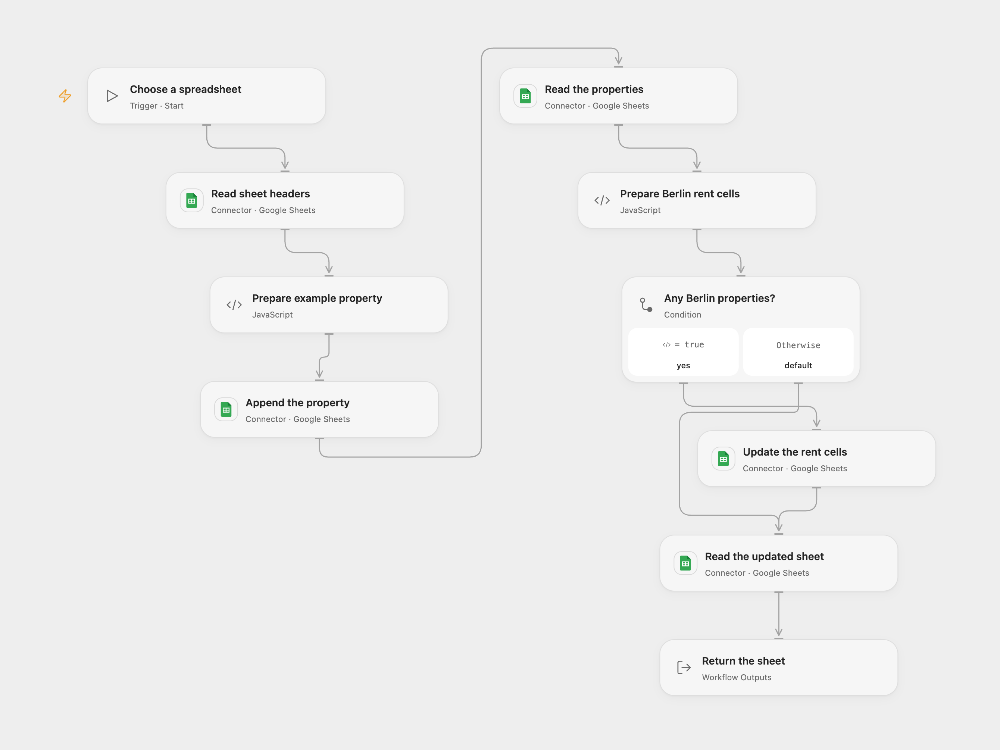

# Append and Adjust Berlin Rent in Google Sheets

Append an example property and increase rent for matching Berlin rows.

<picture>
  <source media="(prefers-color-scheme: dark)" srcset="preview-dark.png">
  
</picture>

[Open Flow JSON](templates/append-and-adjust-berlin-rent-in-sheets.openflow.json) · [n8n JSON](templates/append-and-adjust-berlin-rent-in-sheets.n8n.json)

## Setup

Create a Google Sheet whose first worksheet has the unique headers `ID`, `Name`, `Rent` and `City` in columns A:D. Rent must be numeric. Connect Google Sheets with edit permission. In Open Flow enter the spreadsheet ID when starting. In n8n configure the spreadsheet in **Google Sheets** and connect the same credential to each Google Sheets or HTTP node.

## Behavior

A run appends an example Berlin property with an integer ID, then adds 100 to the rent of every Berlin row and reads the updated sheet. Open Flow returns formatted cell values. Duplicate matching IDs or nonnumeric rents stop the update. An earlier append or update may already have succeeded. Keep the sheet stable while the run is active. Check the sheet before retrying an uncertain write.

Inspiration &amp; credits

## Changes to the source

- Use a numeric starting rent and replace the private spreadsheet ID with configuration. Both formats update only Rent cells so unrelated values and formulas are preserved. Both formats submit the matching cells in one batch.

Adapted from [Append, lookup, update, and read data from a Google Sheets spreadsheet](https://github.com/Zie619/n8n-workflows/blob/ae8cf6dc5b873cbb4f74587aa9180ed3a9f70682/workflows/Manual/1062_Manual_GoogleSheets_Update_Triggered.json) in [Zie619/n8n-workflows](https://github.com/Zie619/n8n-workflows). The source export does not identify a separate template author or license.

The collection’s [MIT notice](https://github.com/Zie619/n8n-workflows/blob/94007c1445d9258a7da116646b79473e7c7c3282/LICENSE) is pinned at a later revision. This is the collection notice at that revision; it does not establish a separate original template author's license. Our changes are listed above; see [repository licensing](../../README.md#licensing).

> MIT License
>
> Copyright (c) 2025 Zie619
>
> Permission is hereby granted, free of charge, to any person obtaining a copy
> of this software and associated documentation files (the "Software"), to deal
> in the Software without restriction, including without limitation the rights
> to use, copy, modify, merge, publish, distribute, sublicense, and/or sell
> copies of the Software, and to permit persons to whom the Software is
> furnished to do so, subject to the following conditions:
>
> The above copyright notice and this permission notice shall be included in all
> copies or substantial portions of the Software.
>
> THE SOFTWARE IS PROVIDED "AS IS", WITHOUT WARRANTY OF ANY KIND, EXPRESS OR
> IMPLIED, INCLUDING BUT NOT LIMITED TO THE WARRANTIES OF MERCHANTABILITY,
> FITNESS FOR A PARTICULAR PURPOSE AND NONINFRINGEMENT. IN NO EVENT SHALL THE
> AUTHORS OR COPYRIGHT HOLDERS BE LIABLE FOR ANY CLAIM, DAMAGES OR OTHER
> LIABILITY, WHETHER IN AN ACTION OF CONTRACT, TORT OR OTHERWISE, ARISING FROM,
> OUT OF OR IN CONNECTION WITH THE SOFTWARE OR THE USE OR OTHER DEALINGS IN THE
> SOFTWARE.

