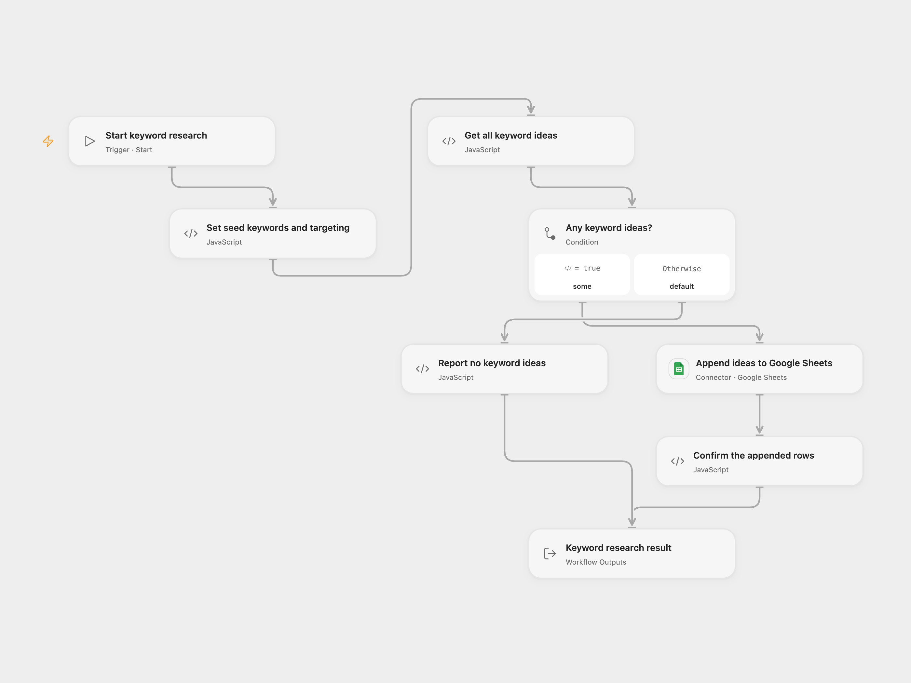

# Append Google Ads Keyword Ideas to Sheets

Find keyword ideas in Google Ads and append search volume, competition, and bid estimates to Google Sheets.

<!-- template-actions:start -->
 
<!-- template-actions:end -->

<picture>
  <source media="(prefers-color-scheme: dark)" srcset="preview-dark.png">
  
</picture>

## Setup

1. Use your own OAuth client from a Google Cloud project with Basic or Standard Google Ads API access and permission for keyword research. Enable the Ads API in that project and authorize with the `https://www.googleapis.com/auth/adwords` scope and offline access. Bind secret variables named `GOOGLE_ADS_CLIENT_ID`, `GOOGLE_ADS_CLIENT_SECRET`, and `GOOGLE_ADS_REFRESH_TOKEN` to the corresponding inputs in **Get all keyword ideas**. Google Ads v26 uses that project's approved access level. Developer tokens have been retired. [Google Ads access levels](https://developers.google.com/google-ads/api/docs/api-policy/access-levels) · [Offline OAuth setup](https://developers.google.com/google-ads/api/docs/oauth/user-authentication)
2. In **Set seed keywords and targeting**, enter up to 20 seed keywords, your 10-digit client ID, and the target spreadsheet ID and tab name. Enter the 10-digit manager ID only when accessing the client through a manager. The example targets US English on Google Search. Use `geoTargetConstants/<id>` and `languageConstants/<id>` for other targets, and select `GOOGLE_SEARCH` or `GOOGLE_SEARCH_AND_PARTNERS`.
3. Use a Google Sheets connection with edit access in **Append ideas to Google Sheets**. Create the destination tab and add these headers to A1:F1 in order.

`keyword`, `competition`, `avgMonthlySearches`, `competitionIndex`, `lowTopOfPageBidMicros`, `highTopOfPageBidMicros`

## Behavior

The workflow runs on demand and appends all confirmed ideas after every Google Ads page has been collected. It leaves an empty result unwritten. The collection stops before appending if it exceeds 20 pages or 5,000 ideas. If it reaches a limit, use a narrower search. Run one search at a time per Ads client account to stay within the Keyword Planner rate limit.

Average monthly searches are written as exact text. A missing metric stays blank and a reported zero stays `0`. The last two columns retain the source headers and contain Google's low and high top-of-page bid estimates in the Ads account's currency, converted from micros to two decimal places.

Each completed run adds new rows. If the append outcome is uncertain, check the tab before running the same search again.

In n8n

Set the same inputs in **Set seed keywords and targeting**. Attach a generic **OAuth2 API** credential to **Get all keyword ideas** using your approved Google OAuth client. Select **Authorization Code**, use `https://accounts.google.com/o/oauth2/v2/auth` and `https://oauth2.googleapis.com/token`, enter the `https://www.googleapis.com/auth/adwords` scope and `access_type=offline&prompt=consent` as the authorization query parameters, and use body authentication. Register the credential's redirect URL in your Google Cloud project. Attach a **Google Sheets OAuth2 API** credential to **Append ideas to Google Sheets** and run manually.

Inspiration &amp; credits

Adapted from [Generate New Keywords with Search Volumes](https://github.com/Zie619/n8n-workflows/blob/ae8cf6dc5b873cbb4f74587aa9180ed3a9f70682/workflows/Splitout/1660_Splitout_HTTP_Create_Webhook.json) in [Zie619/n8n-workflows](https://github.com/Zie619/n8n-workflows). Attribution: Zacharia Kimotho (original workflow) / Zie619 (collection). See the [original n8n gallery template](https://n8n.io/workflows/2695-generating-new-keywords-and-their-search-volumes-using-the-google-ads-api/).

The collection’s [MIT notice](https://github.com/Zie619/n8n-workflows/blob/94007c1445d9258a7da116646b79473e7c7c3282/LICENSE) is pinned at a later revision. This is the collection notice at that revision; it does not establish a separate original template author's license. Our changes are listed above; see [repository licensing](../../README.md#licensing).

> MIT License
>
> Copyright (c) 2025 Zie619
>
> Permission is hereby granted, free of charge, to any person obtaining a copy
> of this software and associated documentation files (the "Software"), to deal
> in the Software without restriction, including without limitation the rights
> to use, copy, modify, merge, publish, distribute, sublicense, and/or sell
> copies of the Software, and to permit persons to whom the Software is
> furnished to do so, subject to the following conditions:
>
> The above copyright notice and this permission notice shall be included in all
> copies or substantial portions of the Software.
>
> THE SOFTWARE IS PROVIDED "AS IS", WITHOUT WARRANTY OF ANY KIND, EXPRESS OR
> IMPLIED, INCLUDING BUT NOT LIMITED TO THE WARRANTIES OF MERCHANTABILITY,
> FITNESS FOR A PARTICULAR PURPOSE AND NONINFRINGEMENT. IN NO EVENT SHALL THE
> AUTHORS OR COPYRIGHT HOLDERS BE LIABLE FOR ANY CLAIM, DAMAGES OR OTHER
> LIABILITY, WHETHER IN AN ACTION OF CONTRACT, TORT OR OTHERWISE, ARISING FROM,
> OUT OF OR IN CONNECTION WITH THE SOFTWARE OR THE USE OR OTHER DEALINGS IN THE
> SOFTWARE.

