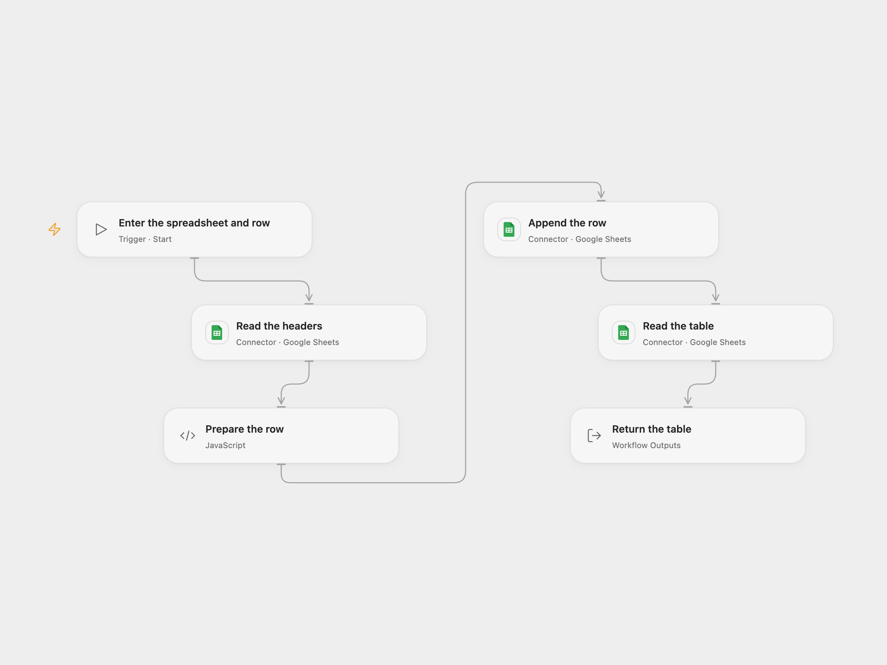

# Append an ID and Name to Google Sheets

Append an ID and name to a Google Sheet and read the table.

<picture>
  <source media="(prefers-color-scheme: dark)" srcset="preview-dark.png">
  
</picture>

[Open Flow JSON](templates/append-id-and-name-to-google-sheets.openflow.json) · [n8n JSON](templates/append-id-and-name-to-google-sheets.n8n.json)

## Setup

Create a Google Sheet with unique `id` and `name` headers in columns A:B of the first worksheet. Connect Google Sheets with edit access. In Open Flow provide the spreadsheet ID, numeric ID and name when starting. In n8n configure the spreadsheet on **Google Sheets**, connect both Sheets nodes and edit the values in **Set**.

## Behavior

The workflow appends one row and returns the table. It writes the ID as text, as the original n8n Sheets V1 append does with RAW input. An unknown append may have succeeded; inspect the sheet before retrying. The workflow does not retry or deduplicate.

Inspiration &amp; credits

## Changes to the source

- Replace the private spreadsheet ID with configuration and make the row values configurable. The source's omitted numeric value defaults to 0; n8n now states this value explicitly.
- Open Flow returns the raw rows including the header; n8n returns structured rows keyed by the header.

Adapted from [Append and read a row in Google Sheets](https://github.com/Zie619/n8n-workflows/blob/ae8cf6dc5b873cbb4f74587aa9180ed3a9f70682/workflows/Manual/1073_Manual_GoogleSheets_Automate_Triggered.json) in [Zie619/n8n-workflows](https://github.com/Zie619/n8n-workflows). The source export does not identify a separate template author or license.

The collection’s [MIT notice](https://github.com/Zie619/n8n-workflows/blob/94007c1445d9258a7da116646b79473e7c7c3282/LICENSE) is pinned at a later revision. This is the collection notice at that revision; it does not establish a separate original template author's license. Our changes are listed above; see [repository licensing](../../README.md#licensing).

> MIT License
>
> Copyright (c) 2025 Zie619
>
> Permission is hereby granted, free of charge, to any person obtaining a copy
> of this software and associated documentation files (the "Software"), to deal
> in the Software without restriction, including without limitation the rights
> to use, copy, modify, merge, publish, distribute, sublicense, and/or sell
> copies of the Software, and to permit persons to whom the Software is
> furnished to do so, subject to the following conditions:
>
> The above copyright notice and this permission notice shall be included in all
> copies or substantial portions of the Software.
>
> THE SOFTWARE IS PROVIDED "AS IS", WITHOUT WARRANTY OF ANY KIND, EXPRESS OR
> IMPLIED, INCLUDING BUT NOT LIMITED TO THE WARRANTIES OF MERCHANTABILITY,
> FITNESS FOR A PARTICULAR PURPOSE AND NONINFRINGEMENT. IN NO EVENT SHALL THE
> AUTHORS OR COPYRIGHT HOLDERS BE LIABLE FOR ANY CLAIM, DAMAGES OR OTHER
> LIABILITY, WHETHER IN AN ACTION OF CONTRACT, TORT OR OTHERWISE, ARISING FROM,
> OUT OF OR IN CONNECTION WITH THE SOFTWARE OR THE USE OR OTHER DEALINGS IN THE
> SOFTWARE.

