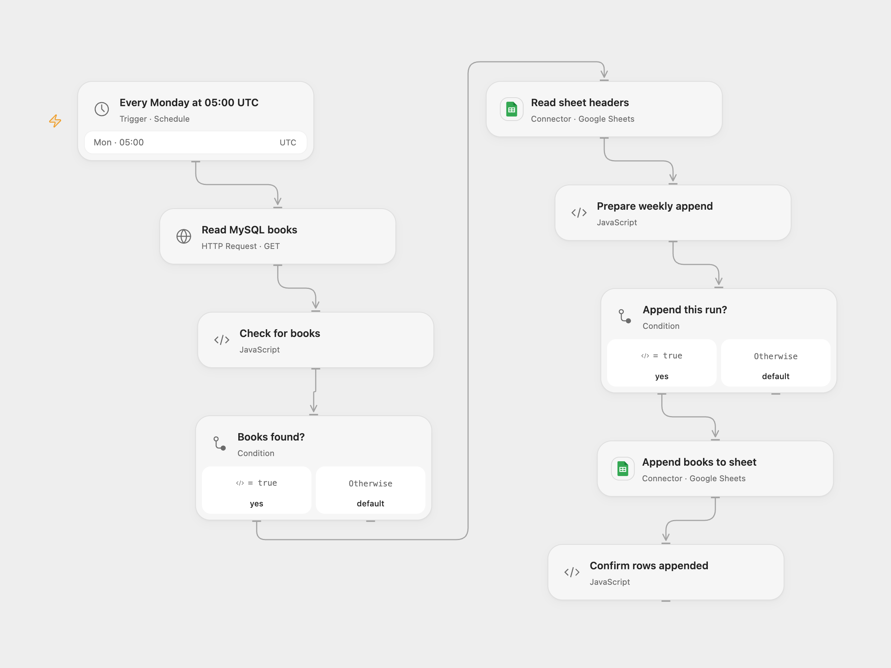

# Append MySQL Books to Google Sheets Weekly

Read the books table from MySQL each week and append matching columns to Google Sheets.

<!-- template-actions:start -->
 
<!-- template-actions:end -->

<picture>
  <source media="(prefers-color-scheme: dark)" srcset="preview-dark.png">
  
</picture>

## Setup

Connect Google Sheets and set the same spreadsheet ID in **Read sheet headers** and **Prepare weekly append**. Set matching header and append ranges for the same sheet. The default ranges use the first six columns, matching the source; the first row contains case-sensitive MySQL column names.

Connect MySQL and set **Read MySQL books** to its production URL. Configure the relay Header Auth credential as Authorization: Bearer followed by a secret, and bind that same secret as MYSQL_RELAY_TOKEN in Open Flow. Enable persistent State and prevent overlapping runs.

## Behavior

At 05:00 UTC each Monday, run SELECT * FROM books and append every returned row using exact sheet header matches. Null or absent values become empty cells and other values are converted to strings, as in the source. An empty table does not append rows. Each weekly run appends the full table again.

If the sheet append outcome is unknown, inspect the sheet before retrying. Enter the pending key in **Prepare weekly append**, set resolution to confirmed if appended or absent if not, rerun, then clear the fields. Protect the relay and execution histories, which can contain book records.

In n8n

Import the bundled n8n workflow, connect MySQL to the read relay, enable **MySQL read webhook**, and set **Read MySQL books** to its production URL. Disable the direct n8n Cron when using Open Flow. For direct n8n, configure MySQL, Google Sheets and one Data Table with item_key and status text columns, and leave the relay disabled. In n8n inspect the pending run row; mark it done if the full append succeeded or delete it only if none occurred.

Inspiration &amp; credits

Added an authenticated MySQL read relay and an append checkpoint; made the weekly timezone explicit.

Adapted from [Export MySQL books to Google Sheets](https://github.com/Zie619/n8n-workflows/blob/ae8cf6dc5b873cbb4f74587aa9180ed3a9f70682/workflows/Googlesheets/0235_GoogleSheets_Cron_Automation_Scheduled.json) in [Zie619/n8n-workflows](https://github.com/Zie619/n8n-workflows). The source export does not identify a separate template author or license.

The collection’s [MIT notice](https://github.com/Zie619/n8n-workflows/blob/94007c1445d9258a7da116646b79473e7c7c3282/LICENSE) is pinned at a later revision. This is the collection notice at that revision; it does not establish a separate original template author's license. Our changes are listed above; see [repository licensing](../../README.md#licensing).

> MIT License
>
> Copyright (c) 2025 Zie619
>
> Permission is hereby granted, free of charge, to any person obtaining a copy
> of this software and associated documentation files (the "Software"), to deal
> in the Software without restriction, including without limitation the rights
> to use, copy, modify, merge, publish, distribute, sublicense, and/or sell
> copies of the Software, and to permit persons to whom the Software is
> furnished to do so, subject to the following conditions:
>
> The above copyright notice and this permission notice shall be included in all
> copies or substantial portions of the Software.
>
> THE SOFTWARE IS PROVIDED "AS IS", WITHOUT WARRANTY OF ANY KIND, EXPRESS OR
> IMPLIED, INCLUDING BUT NOT LIMITED TO THE WARRANTIES OF MERCHANTABILITY,
> FITNESS FOR A PARTICULAR PURPOSE AND NONINFRINGEMENT. IN NO EVENT SHALL THE
> AUTHORS OR COPYRIGHT HOLDERS BE LIABLE FOR ANY CLAIM, DAMAGES OR OTHER
> LIABILITY, WHETHER IN AN ACTION OF CONTRACT, TORT OR OTHERWISE, ARISING FROM,
> OUT OF OR IN CONNECTION WITH THE SOFTWARE OR THE USE OR OTHER DEALINGS IN THE
> SOFTWARE.

