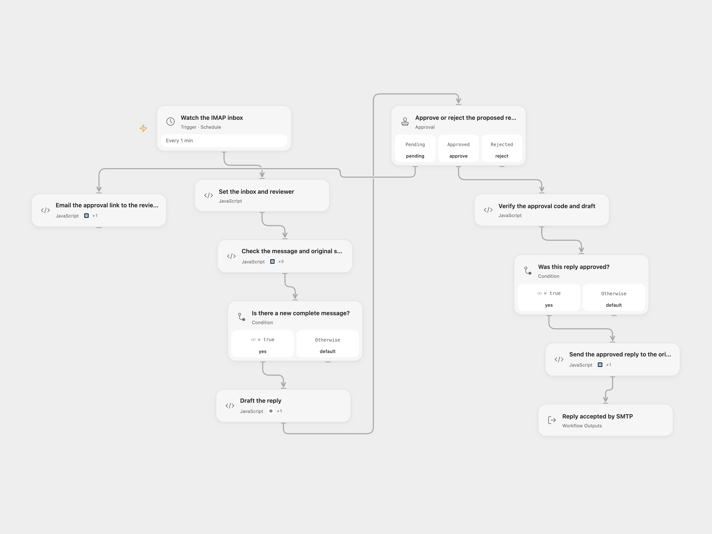

# Approve AI-Drafted Email Replies

Summarize an incoming IMAP email, draft a reply, and ask for approval before sending it to the original sender.

<!-- template-actions:start -->
 
<!-- template-actions:end -->

<picture>
  <source media="(prefers-color-scheme: dark)" srcset="preview-dark.png">
  
</picture>

## Setup

1. In **Set the inbox and reviewer**, set the mailbox folder, sending mailbox and one reviewer address. Bind the same Generic IMAP connection with SMTP enabled in **Check the message and original sender**, **Email the approval link to the reviewer**, and **Send the approved reply to the original sender**. Bind the OpenAI connection in **Draft the reply**.
2. Publish and enable the workflow. Make sure the hosted approval page can be reached by the reviewer. On a self-hosted server, set its public HTTPS origin.
3. The first poll records the next IMAP UID without processing existing mail. Send a new test message after that run completes.

## Behavior

The workflow checks for a new unread message every minute and prepares one complete text or HTML email per poll. It sends the original text, summary and proposed reply to the configured reviewer. The reviewer opens the approval page and enters the code from that message in **Comment** when approving. The link expires after seven days. Keep it and the code in the reviewer’s mailbox. Opening or previewing the page has no effect. Rejection, expiration, and an incorrect code stop the reply.

The workflow sends plain text only to the single original From address. SMTP acceptance is reported in the run. If the SMTP result is unknown, check your mail logs before considering another send. Use a new workflow state if you deliberately switch mailboxes. If the IMAP identity changes or there are more than 500 unread messages ahead of the cursor, review the mailbox and cursor before resuming.

In n8n

In **Set the inbox and reviewer**, set the sender and reviewer addresses. Configure the IMAP trigger, both SMTP nodes, and the OpenAI credential in **Summarize the original email** and **Draft the reply**. Use an HTTPS webhook base URL so the reviewer can reach the signed form. Open the link, select **Approve** or **Reject**, and enter the code from the review email. Reviews expire after 24 hours.

Use one production execution slot and a dedicated Data Table with text columns `request_key`, `status`, and `receipt`. Select it in **Check for an earlier send**, **Reserve the approved reply**, and **Record the SMTP acceptance**. The IMAP trigger marks selected messages as read. After an interrupted batch, check the inbox and execution to see which messages still need review. Check SMTP before clearing any pending send record.

Inspiration &amp; credits

Adapted from [A Very Simple "Human in the Loop" Email Response System Using AI and IMAP](https://github.com/enescingoz/awesome-n8n-templates/blob/827110332c21cbe000ab13f6d292d5adb1f1f8db/Gmail_and_Email_Automation/A%20Very%20Simple%20_Human%20in%20the%20Loop_%20Email%20Response%20System%20Using%20AI%20and%20IMAP.json) in [enescingoz/awesome-n8n-templates](https://github.com/enescingoz/awesome-n8n-templates).

Source collection notice: © 2024–2026 Enes Cingoz, [CC BY 4.0](https://github.com/enescingoz/awesome-n8n-templates/blob/827110332c21cbe000ab13f6d292d5adb1f1f8db/LICENSE). The original workflow is credited to Davide Boizza. The collection notice does not establish a separate license for the original workflow. See [repository licensing](../../README.md#licensing) for the scope of OOMOL contributions and third-party material.

[Original n8n workflow by Davide Boizza](https://n8n.io/workflows/2907-a-very-simple-human-in-the-loop-email-response-system-using-ai-and-imap/).

## Changes to the source

Require an explicit form submission with a per-message code and bind it to the reviewed reply. Treat inbound HTML and model output as text. Record SMTP attempts before sending.

