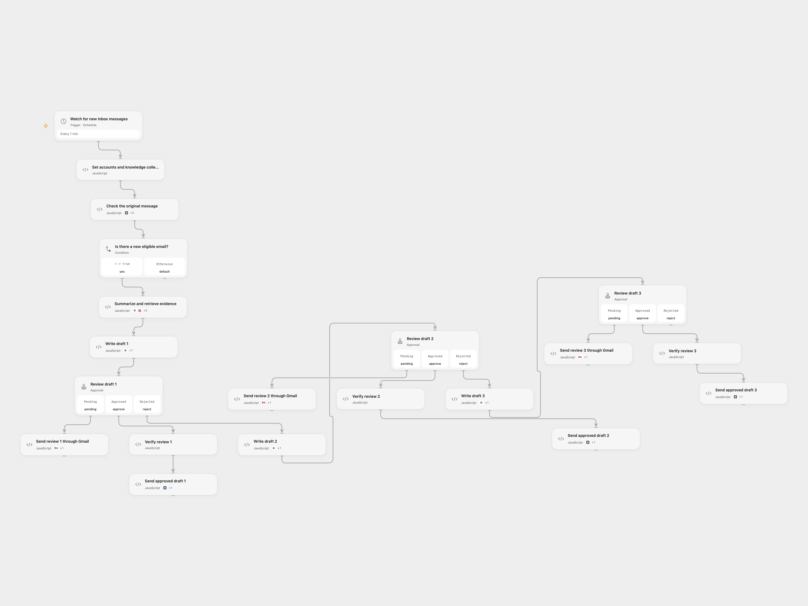

# Approve Knowledge-Based Email Replies

Summarize incoming IMAP mail, draft a reply using Qdrant evidence, and send the exact approved revision by SMTP.

<!-- template-actions:start -->
 
<!-- template-actions:end -->

<picture>
  <source media="(prefers-color-scheme: dark)" srcset="preview-dark.png">
  
</picture>

## Setup

1. Set **Set accounts and knowledge collection** to the inbox folder, sender mailbox, trusted Gmail reviewer, and Qdrant collection. Set the payload field that contains the document text, such as `content`. The collection must use unnamed dense vectors and the same OpenAI embedding model and default dimensions configured in this node.
2. Connect Generic IMAP in **Check the original message**. Bind OpenAI and Qdrant Cloud in **Summarize and retrieve evidence**, OpenAI in each **Write draft** step, Gmail in each **Send review** step, and Generic IMAP with SMTP enabled in each **Send approved draft** step. Use a Qdrant key scoped to reading the collection. The connection uses the official Qdrant Cloud HTTPS endpoint.
3. Publish and enable the workflow. The reviewer needs the HTTPS approval page and the code in each review email. The first minute poll saves an inbox baseline. Send a new test email after that poll completes.

## Behavior

The workflow polls one new unread message per minute, leaves its read status unchanged, and uses the IMAP mailbox identity and UID to track intake. It summarizes the message and searches the configured Qdrant collection for up to four relevant excerpts. If the search returns no excerpts, the model can say what it cannot confirm. Check the draft against your current business information before approving.

Use only a mailbox, documents, and reviewer authorized for this workflow. Workflow operators with run access can see the processed mail and drafts. The review email includes the original text, summary, draft, and review code. Keep the link and the code private. Opening the page leaves the review pending. To decide, enter the current code in **Comment** and submit **Approve** or **Reject**. Each review expires after seven days. A rejection requests a new draft for the same email and sends a fresh review. After two revisions, a final rejection ends the run for manual follow-up.

The workflow sends the approved draft to the original From address and records SMTP acceptance. Check your SMTP server before recovering a pending or unconfirmed attempt. If the mailbox identity changes or more than 500 unread messages accumulate ahead of the cursor, inspect the mailbox and cursor before resuming.

In n8n

Edit **Set accounts and knowledge collection** with the sender mailbox, reviewer and Qdrant settings, including the Qdrant HTTPS origin. Set `imapAccount` to a stable label for the connected IMAP account. Choose the folder in the IMAP trigger. Connect the IMAP trigger, OpenAI HTTP nodes, the Qdrant HTTP node, each Gmail **Review draft** node, and **Send the approved reply to the original sender**. The trigger marks fetched mail read and can include unread messages from the day you activate it. Messages in a trigger batch are processed serially.

Use a public HTTPS webhook origin. Open the latest Gmail link for that draft, enter the current code, select **Yes** or **No**, and submit the form. A wrong code ends that review without sending a reply. Each review expires after 24 hours. Use one production execution slot and create a dedicated Data Table with text columns `request_key`, `status`, and `receipt`. Select it in **Check previous SMTP attempt**, **Reserve the SMTP attempt**, and **Record SMTP acceptance**. The send log uses the IMAP account label, folder and UID. Keep the account label and log stable while the folder retains its UIDVALIDITY. If your IMAP server rebuilds the folder or reports a new UIDVALIDITY, pause the workflow and check pending SMTP attempts. Import a fresh copy with a new dedicated Data Table for the rebuilt folder before processing its new UIDs. Retain the previous table for reconciliation. The trigger does not expose UIDVALIDITY in its output. After an interrupted batch check its run and the mailbox for unreviewed messages.

Inspiration &amp; credits

Adapted from [AI-powered email processing autoresponder and response approval (Yes/No)](https://github.com/enescingoz/awesome-n8n-templates/blob/827110332c21cbe000ab13f6d292d5adb1f1f8db/Gmail_and_Email_Automation/AI-powered%20email%20processing%20autoresponder%20and%20response%20approval%20(Yes_No).json) in [enescingoz/awesome-n8n-templates](https://github.com/enescingoz/awesome-n8n-templates).

Source collection notice: © 2024–2026 Enes Cingoz, [CC BY 4.0](https://github.com/enescingoz/awesome-n8n-templates/blob/827110332c21cbe000ab13f6d292d5adb1f1f8db/LICENSE). The original workflow is credited to Davide Boizza. The collection notice does not establish a separate license for the original workflow. See [repository licensing](../../README.md#licensing) for the scope of OOMOL contributions and third-party material.

[Original n8n workflow by Davide Boizza](https://n8n.io/workflows/2861-ai-powered-email-processing-autoresponder-and-response-approval-yesno/).

## Changes to the source

Retrieve document excerpts before drafting, keep the previous draft available when rewriting, and require a submitted review tied to each individual revision. Convert inbound HTML to text and escape the reply before sending it as HTML.

