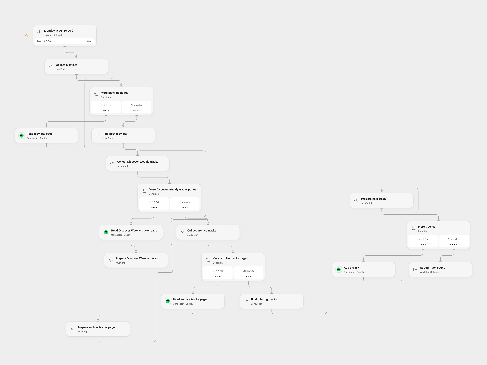

# Archive Discover Weekly Tracks

Add tracks missing from an archive playlist from Spotify Discover Weekly.

<picture>
  <source media="(prefers-color-scheme: dark)" srcset="preview-dark.png">
  
</picture>

[Open Flow JSON](templates/archive-discover-weekly-tracks.openflow.json) · [n8n JSON](templates/archive-discover-weekly-tracks.n8n.json)

## Setup

Both the Open Flow Spotify Connection and n8n Spotify client need Spotify Extended Quota Mode, where the legacy playlist tracks API remains available. Development Mode has different endpoints and restricts access to playlists the user does not own or collaborate on. Connect Spotify with playlist read and write permissions. Save exactly one playlist named `Discover Weekly` and create exactly one editable playlist named `Discover Weekly Archive`. To use a different archive name, set **Archive Name** in **Find both playlists** in Open Flow, or edit the archive rule in **Switch** in n8n. Use one format at a time.

## Behavior

Every Monday at 08:30 UTC, read all playlists and both track lists, compare track URIs and append each missing Discover Weekly track to the archive. The source used the n8n instance timezone; review the explicit UTC schedule.

Open Flow checks for unique playlist names and valid track URIs before writes, reads all pages, and can add to an empty archive. The original n8n path may stop on an empty input before comparing. Duplicate new track URIs are each appended; an already archived URI is skipped. Playlist data must fit workflow execution limits. Concurrent playlist edits can change the comparison. Earlier additions remain if a later request fails, and an uncertain response may mean a track was added. Check Spotify before retrying; no automatic retry or rollback is configured.

## Changes to the source

- Use an explicit UTC schedule and require the legacy Spotify endpoint contract available to Extended Quota Mode apps.
- Open Flow validates playlist names and track URIs and supports an empty archive; the n8n graph retains the source flow.

Source and license

Adapted from [Archive Discover Weekly tracks](https://github.com/Zie619/n8n-workflows/blob/ae8cf6dc5b873cbb4f74587aa9180ed3a9f70682/workflows/Schedule/0382_Schedule_Spotify_Create_Scheduled.json) in [Zie619/n8n-workflows](https://github.com/Zie619/n8n-workflows). The matching [n8n community listing](https://n8n.io/workflows/2044-spotify-discover-weekly-archive/) credits JYLN and acknowledges Trey’s earlier workflow. The original template does not state a separate license.

The collection’s [MIT notice](https://github.com/Zie619/n8n-workflows/blob/94007c1445d9258a7da116646b79473e7c7c3282/LICENSE) is pinned at a later revision. This is the collection notice at that revision; it does not establish a separate original template author's license. Our changes are listed above; see [repository licensing](../../README.md#licensing).

> MIT License
>
> Copyright (c) 2025 Zie619
>
> Permission is hereby granted, free of charge, to any person obtaining a copy
> of this software and associated documentation files (the "Software"), to deal
> in the Software without restriction, including without limitation the rights
> to use, copy, modify, merge, publish, distribute, sublicense, and/or sell
> copies of the Software, and to permit persons to whom the Software is
> furnished to do so, subject to the following conditions:
>
> The above copyright notice and this permission notice shall be included in all
> copies or substantial portions of the Software.
>
> THE SOFTWARE IS PROVIDED "AS IS", WITHOUT WARRANTY OF ANY KIND, EXPRESS OR
> IMPLIED, INCLUDING BUT NOT LIMITED TO THE WARRANTIES OF MERCHANTABILITY,
> FITNESS FOR A PARTICULAR PURPOSE AND NONINFRINGEMENT. IN NO EVENT SHALL THE
> AUTHORS OR COPYRIGHT HOLDERS BE LIABLE FOR ANY CLAIM, DAMAGES OR OTHER
> LIABILITY, WHETHER IN AN ACTION OF CONTRACT, TORT OR OTHERWISE, ARISING FROM,
> OUT OF OR IN CONNECTION WITH THE SOFTWARE OR THE USE OR OTHER DEALINGS IN THE
> SOFTWARE.

