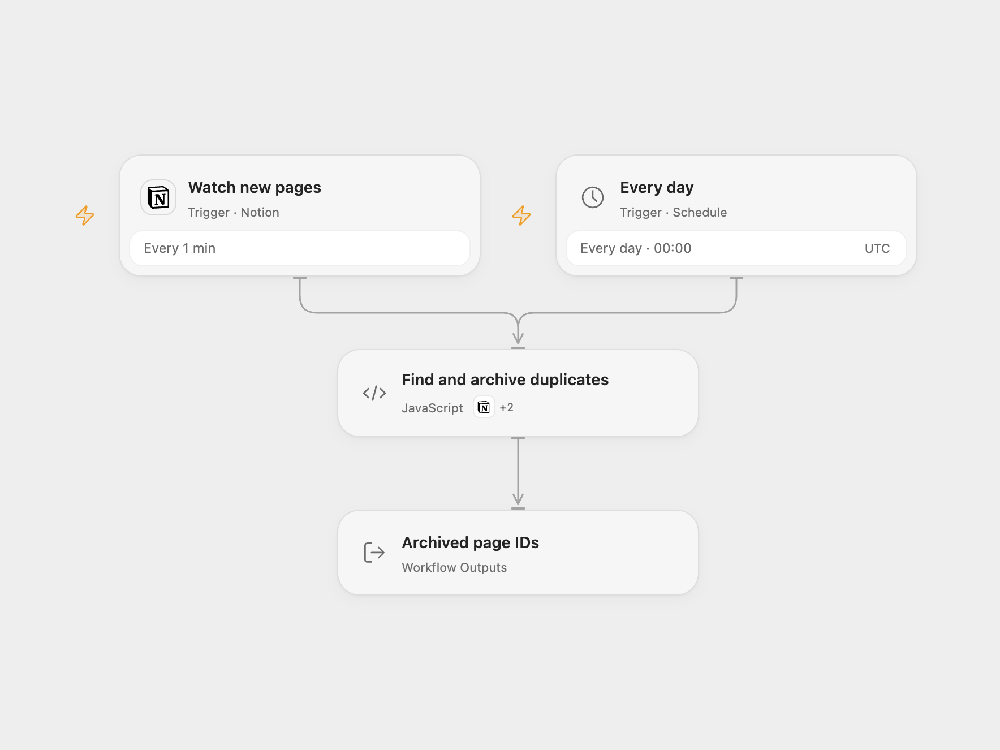

# Archive Duplicate Notion Pages

Archive extra Notion database pages with the same text property.

<picture>
  <source media="(prefers-color-scheme: dark)" srcset="preview-dark.png">
  
</picture>

[Open Flow JSON](templates/archive-duplicate-notion-pages.openflow.json) · [n8n JSON](templates/archive-duplicate-notion-pages.n8n.json)

## Setup

Connect Notion with access to read and update the database. Set the database ID in **Watch new pages** and its data source ID and exact text property name in **Find and archive duplicates**. Use a title or rich-text property. Enable persistent State and prevent overlapping runs. In n8n select Notion credentials, database ID in the trigger, data source ID and property in **Configure database**, and create a Data Table with text columns page_id and status for the checkpoint nodes. Enable the desired triggers and use one format.

## Behavior

A daily run or a new page checks the entire data source. For each nonempty identical text value, keep the earliest created page, breaking ties by page ID, and move later pages to Notion trash. Values compare exactly, including case and whitespace. Empty values are skipped. A text property returned with 25 or more fragments is rejected because it may be truncated; choose a shorter property. The source database can change while it is read and the query is not a snapshot. Review the property and database before enabling, and prevent concurrent runs or edits during cleanup.

An archive failure or unknown response leaves a pending checkpoint. Inspect Notion before proceeding. In Open Flow set **acknowledgePageId** to the pending page ID after inspection, run once, then clear it. That page remains skipped until its checkpoint is deliberately cleared. In n8n mark the pending Data Table row done if archived, or delete it only when retry is safe. Confirmed n8n checkpoint rows prevent re-archiving restored pages until deliberately removed.

Inspiration &amp; credits

## Changes to the source

- Replace the property placeholder with a configured title or rich-text property, retain the earliest page, and handle every duplicate in a group.
- Use the current Notion data source API, follow all pages, and checkpoint archive requests before writing. The daily run uses UTC.

Adapted from [Archive duplicate Notion database pages](https://github.com/Zie619/n8n-workflows/blob/ae8cf6dc5b873cbb4f74587aa9180ed3a9f70682/workflows/Code/1317_Code_Schedule_Export_Scheduled.json) in [Zie619/n8n-workflows](https://github.com/Zie619/n8n-workflows). The source export does not identify a separate template author or license.

The collection’s [MIT notice](https://github.com/Zie619/n8n-workflows/blob/94007c1445d9258a7da116646b79473e7c7c3282/LICENSE) is pinned at a later revision. This is the collection notice at that revision; it does not establish a separate original template author's license. Our changes are listed above; see [repository licensing](../../README.md#licensing).

> MIT License
>
> Copyright (c) 2025 Zie619
>
> Permission is hereby granted, free of charge, to any person obtaining a copy
> of this software and associated documentation files (the "Software"), to deal
> in the Software without restriction, including without limitation the rights
> to use, copy, modify, merge, publish, distribute, sublicense, and/or sell
> copies of the Software, and to permit persons to whom the Software is
> furnished to do so, subject to the following conditions:
>
> The above copyright notice and this permission notice shall be included in all
> copies or substantial portions of the Software.
>
> THE SOFTWARE IS PROVIDED "AS IS", WITHOUT WARRANTY OF ANY KIND, EXPRESS OR
> IMPLIED, INCLUDING BUT NOT LIMITED TO THE WARRANTIES OF MERCHANTABILITY,
> FITNESS FOR A PARTICULAR PURPOSE AND NONINFRINGEMENT. IN NO EVENT SHALL THE
> AUTHORS OR COPYRIGHT HOLDERS BE LIABLE FOR ANY CLAIM, DAMAGES OR OTHER
> LIABILITY, WHETHER IN AN ACTION OF CONTRACT, TORT OR OTHERWISE, ARISING FROM,
> OUT OF OR IN CONNECTION WITH THE SOFTWARE OR THE USE OR OTHER DEALINGS IN THE
> SOFTWARE.

