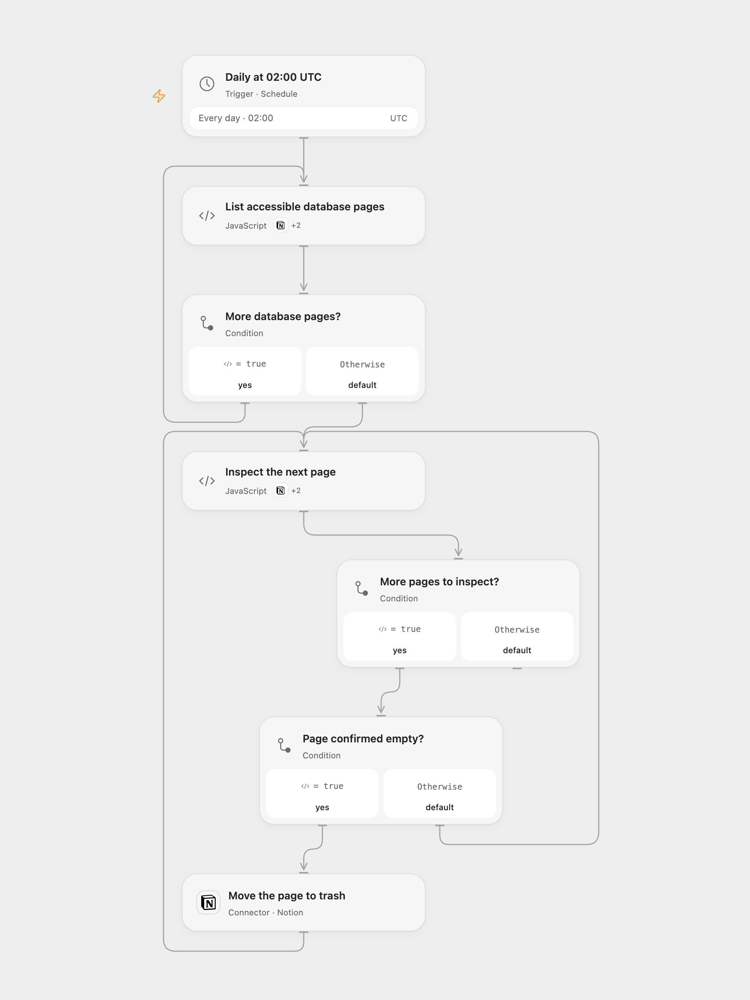

# Archive Empty Notion Database Pages

Find database pages with empty properties and empty paragraph content and move them to the Notion trash.

<picture>
  <source media="(prefers-color-scheme: dark)" srcset="preview-dark.png">
  
</picture>

[Open Flow JSON](templates/archive-empty-notion-database-pages.openflow.json) · [n8n JSON](templates/archive-empty-notion-database-pages.n8n.json)

## Setup

Connect Notion with read and update access only to the databases you want to clean. The workflow scans all data sources visible to that connection and can move pages to trash. Review access and run during a maintenance window without concurrent edits. Enable one format.

## Behavior

At 02:00 UTC each day, inspect database pages and move a page to the Notion trash only if its supported properties are empty and its blocks are absent or consist solely of empty paragraphs without children. A page with a populated property, other property type, other block type or nested block is preserved. Search covers data sources visible to the connection and is subject to Notion's indexing and permission limits. Large runs must fit platform execution limits.

Open Flow rereads each page before checking its blocks. The read and trash operations are not atomic; avoid concurrent edits or runs. A failed or uncertain archive may have succeeded; inspect Notion before retrying. Earlier archived pages remain if a later operation fails. No workflow-level write retry is added. Open Flow runs at the minute boundary; n8n uses a fixed second within the minute.

## Changes to the source

- Treat unsupported property and block types as non-empty to avoid archiving content; the source assumes every block has a text array. Preserve pages with no properties.
- Use the current Notion data-source API in Open Flow, and UTC rather than the original instance timezone. Open Flow verifies each archive response before continuing.

Source and license

Adapted from [Archive empty pages in Notion Database](https://github.com/Zie619/n8n-workflows/blob/ae8cf6dc5b873cbb4f74587aa9180ed3a9f70682/workflows/Splitinbatches/0070_Splitinbatches_Notion_Export_Scheduled.json) in [Zie619/n8n-workflows](https://github.com/Zie619/n8n-workflows). The matching [n8n listing](https://n8n.io/workflows/1478-archive-empty-pages-in-notion-database/) credits Jonathan. No separate original template license is stated.

The collection’s [MIT notice](https://github.com/Zie619/n8n-workflows/blob/94007c1445d9258a7da116646b79473e7c7c3282/LICENSE) is pinned at a later revision. This is the collection notice at that revision; it does not establish a separate original template author's license. Our changes are listed above; see [repository licensing](../../README.md#licensing).

> MIT License
>
> Copyright (c) 2025 Zie619
>
> Permission is hereby granted, free of charge, to any person obtaining a copy
> of this software and associated documentation files (the "Software"), to deal
> in the Software without restriction, including without limitation the rights
> to use, copy, modify, merge, publish, distribute, sublicense, and/or sell
> copies of the Software, and to permit persons to whom the Software is
> furnished to do so, subject to the following conditions:
>
> The above copyright notice and this permission notice shall be included in all
> copies or substantial portions of the Software.
>
> THE SOFTWARE IS PROVIDED "AS IS", WITHOUT WARRANTY OF ANY KIND, EXPRESS OR
> IMPLIED, INCLUDING BUT NOT LIMITED TO THE WARRANTIES OF MERCHANTABILITY,
> FITNESS FOR A PARTICULAR PURPOSE AND NONINFRINGEMENT. IN NO EVENT SHALL THE
> AUTHORS OR COPYRIGHT HOLDERS BE LIABLE FOR ANY CLAIM, DAMAGES OR OTHER
> LIABILITY, WHETHER IN AN ACTION OF CONTRACT, TORT OR OTHERWISE, ARISING FROM,
> OUT OF OR IN CONNECTION WITH THE SOFTWARE OR THE USE OR OTHER DEALINGS IN THE
> SOFTWARE.

