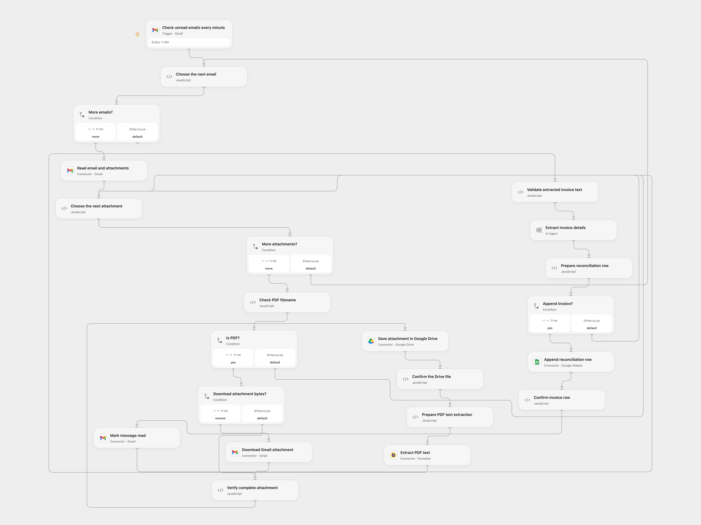

# Archive Gmail Invoices in Drive and Sheets

Save unread email PDF invoices to Drive and append extracted invoice details to a reconciliation sheet.

<!-- template-actions:start -->
 
<!-- template-actions:end -->

<picture>
  <source media="(prefers-color-scheme: dark)" srcset="preview-dark.png">
  
</picture>

## Setup

Connect Gmail, Encodian, Google Drive, Google Sheets and the AI model. Set the destination Drive folder ID in **Choose the next attachment**, configure your transit hostname in **Verify complete attachment**, and set the target `spreadsheetId` and `range` in **Prepare reconciliation row**. Enable persistent State.

## Behavior

The workflow polls unread Gmail messages every minute, downloads each PDF attachment, uploads the original file to Google Drive, extracts its text layer via Encodian, uses the AI model to extract the invoice date and total, appends the reconciliation row to Google Sheets, and marks the message read. Non-PDF attachments are skipped.

Review extracted values; model output can be wrong, and scanned PDFs without a text layer require OCR. Extracted PDF text must fit within 15,800 characters and the 1 MiB Code execution limit.

In n8n

Import the n8n workflow and connect Gmail, Google Drive, OpenAI and Google Sheets. Set the destination folder ID in **Save invoice PDF** and the target spreadsheet ID in **Append to Reconciliation Sheet**.

Inspiration &amp; credits

Save the original PDF into the configured folder directly, keep its Drive link and message association, and mark read only after processing succeeds.

Adapted from [Attachments Gmail to drive and google sheets](https://github.com/Zie619/n8n-workflows/blob/ae8cf6dc5b873cbb4f74587aa9180ed3a9f70682/workflows/Extractfromfile/1764_Extractfromfile_HTTP_Automation_Webhook.json) in [Zie619/n8n-workflows](https://github.com/Zie619/n8n-workflows). The source export does not identify a separate template author or license.

The collection’s [MIT notice](https://github.com/Zie619/n8n-workflows/blob/94007c1445d9258a7da116646b79473e7c7c3282/LICENSE) is pinned at a later revision. This is the collection notice at that revision; it does not establish a separate original template author's license. Our changes are listed above; see [repository licensing](../../README.md#licensing).

> MIT License
>
> Copyright (c) 2025 Zie619
>
> Permission is hereby granted, free of charge, to any person obtaining a copy
> of this software and associated documentation files (the "Software"), to deal
> in the Software without restriction, including without limitation the rights
> to use, copy, modify, merge, publish, distribute, sublicense, and/or sell
> copies of the Software, and to permit persons to whom the Software is
> furnished to do so, subject to the following conditions:
>
> The above copyright notice and this permission notice shall be included in all
> copies or substantial portions of the Software.
>
> THE SOFTWARE IS PROVIDED "AS IS", WITHOUT WARRANTY OF ANY KIND, EXPRESS OR
> IMPLIED, INCLUDING BUT NOT LIMITED TO THE WARRANTIES OF MERCHANTABILITY,
> FITNESS FOR A PARTICULAR PURPOSE AND NONINFRINGEMENT. IN NO EVENT SHALL THE
> AUTHORS OR COPYRIGHT HOLDERS BE LIABLE FOR ANY CLAIM, DAMAGES OR OTHER
> LIABILITY, WHETHER IN AN ACTION OF CONTRACT, TORT OR OTHERWISE, ARISING FROM,
> OUT OF OR IN CONNECTION WITH THE SOFTWARE OR THE USE OR OTHER DEALINGS IN THE
> SOFTWARE.

