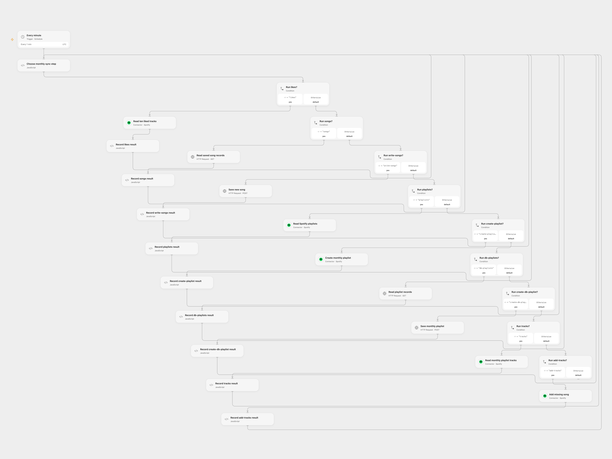

# Archive Liked Songs in Monthly Spotify Playlists

Save recently liked songs in NocoDB and add them to a matching monthly Spotify playlist.

<picture>
  <source media="(prefers-color-scheme: dark)" srcset="preview-dark.png">
  
</picture>

[Open Flow JSON](templates/archive-liked-songs-in-monthly-spotify-playlists.openflow.json) · [n8n JSON](templates/archive-liked-songs-in-monthly-spotify-playlists.n8n.json)

## Setup

Connect Spotify and store the NocoDB API token as Secret Variable `NOCODB_TOKEN`. Spotify requires saved-track and playlist permissions and Extended Quota Mode for playlist tracks. In **Choose monthly sync step**, enter the public HTTPS NocoDB URL, base ID, song table ID, playlist table ID, and Spotify user ID. Create song fields `uri`, `added_at`, and `playlistName`, and playlist fields `uri`, `name`, and `description`. Enable persistent State and prevent overlapping runs. The schedule uses UTC.

In n8n, connect Spotify and NocoDB and replace the base and table IDs in every NocoDB node. Set the workflow timezone. Run one format only.

## Behavior

Every minute, inspect the ten latest liked tracks, save previously unseen URIs in the songs table, find or create a playlist named for the current month, and add missing songs assigned to that month. Open Flow reads pages and stops if matching playlist names or database records are ambiguous.

If an Open Flow write has an unknown result, inspect Spotify or NocoDB and enter the pending key in **Choose monthly sync step** after resolving it. For an uncertain playlist creation, provide its confirmed Spotify playlist ID. The acknowledgement treats the write as completed.

Inspiration &amp; credits

## Changes to the source

- Replace private NocoDB identifiers with configuration and make UTC explicit in Open Flow.
- Preserve pending writes and paginate Spotify and NocoDB reads in Open Flow.

Adapted from [Spotify monthly playlist archive](https://github.com/Zie619/n8n-workflows/blob/ae8cf6dc5b873cbb4f74587aa9180ed3a9f70682/workflows/Code/0034_Code_Filter_Create_Scheduled.json) in [Zie619/n8n-workflows](https://github.com/Zie619/n8n-workflows). The source export does not identify a separate template author or license.

The collection’s [MIT notice](https://github.com/Zie619/n8n-workflows/blob/94007c1445d9258a7da116646b79473e7c7c3282/LICENSE) is pinned at a later revision. This is the collection notice at that revision; it does not establish a separate original template author's license. Our changes are listed above; see [repository licensing](../../README.md#licensing).

> MIT License
>
> Copyright (c) 2025 Zie619
>
> Permission is hereby granted, free of charge, to any person obtaining a copy
> of this software and associated documentation files (the "Software"), to deal
> in the Software without restriction, including without limitation the rights
> to use, copy, modify, merge, publish, distribute, sublicense, and/or sell
> copies of the Software, and to permit persons to whom the Software is
> furnished to do so, subject to the following conditions:
>
> The above copyright notice and this permission notice shall be included in all
> copies or substantial portions of the Software.
>
> THE SOFTWARE IS PROVIDED "AS IS", WITHOUT WARRANTY OF ANY KIND, EXPRESS OR
> IMPLIED, INCLUDING BUT NOT LIMITED TO THE WARRANTIES OF MERCHANTABILITY,
> FITNESS FOR A PARTICULAR PURPOSE AND NONINFRINGEMENT. IN NO EVENT SHALL THE
> AUTHORS OR COPYRIGHT HOLDERS BE LIABLE FOR ANY CLAIM, DAMAGES OR OTHER
> LIABILITY, WHETHER IN AN ACTION OF CONTRACT, TORT OR OTHERWISE, ARISING FROM,
> OUT OF OR IN CONNECTION WITH THE SOFTWARE OR THE USE OR OTHER DEALINGS IN THE
> SOFTWARE.

