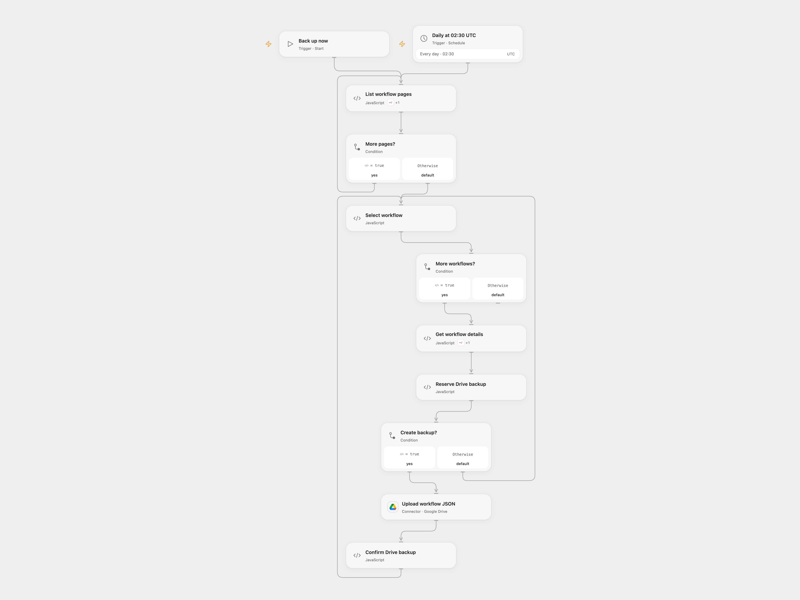

# Archive n8n Workflow JSON to Drive

Back up n8n workflows as JSON files in a Google Drive folder.

<picture>
  <source media="(prefers-color-scheme: dark)" srcset="preview-dark.png">
  
</picture>

[Open Flow JSON](templates/archive-n8n-workflow-json-to-drive.openflow.json) · [n8n JSON](templates/archive-n8n-workflow-json-to-drive.n8n.json)

## Setup

Connect n8n's public API and Google Drive, set the existing folder ID in **Reserve Drive backup**, and enable persistent State. In n8n connect its API and Drive set the folder ID in **Google Drive**, and select a Data Table with item_key and status text columns. Enable one format and prevent overlapping executions.

## Behavior

The manual trigger or daily 02:30 UTC schedule lists all workflow pages, reads each workflow by ID, and uploads its JSON to the selected Drive folder. Each file is named using its workflow name and ID to distinguish duplicate names. Open Flow creates at most one backup per workflow per UTC day. Configure the schedule timezone for your environment. Workflow exports can contain private configuration, pinned data and credential references; restrict folder and execution-history access. Open Flow Code input/output and the accumulated workflow list must each fit 1 MiB.

If a Drive upload result is unknown, inspect the folder before retrying. In Open Flow enter the pending key and confirmed or absent in **Reserve Drive backup**, rerun that UTC day, then clear the fields. In n8n inspect the pending Data Table row, complete missing work manually, mark done only after confirmation, or delete only if no upload occurred. Earlier uploads remain.

Inspiration &amp; credits

Use n8n public API pagination, add workflow IDs to filenames and checkpoint uploads.

Adapted from [Production Workflow](https://github.com/Zie619/n8n-workflows/blob/ae8cf6dc5b873cbb4f74587aa9180ed3a9f70682/workflows/Functionitem/0068_Functionitem_Manual_Import_Scheduled.json) in [Zie619/n8n-workflows](https://github.com/Zie619/n8n-workflows). The source export does not identify a separate template author or license.

The collection’s [MIT notice](https://github.com/Zie619/n8n-workflows/blob/94007c1445d9258a7da116646b79473e7c7c3282/LICENSE) is pinned at a later revision. This is the collection notice at that revision; it does not establish a separate original template author's license. Our changes are listed above; see [repository licensing](../../README.md#licensing).

> MIT License
>
> Copyright (c) 2025 Zie619
>
> Permission is hereby granted, free of charge, to any person obtaining a copy
> of this software and associated documentation files (the "Software"), to deal
> in the Software without restriction, including without limitation the rights
> to use, copy, modify, merge, publish, distribute, sublicense, and/or sell
> copies of the Software, and to permit persons to whom the Software is
> furnished to do so, subject to the following conditions:
>
> The above copyright notice and this permission notice shall be included in all
> copies or substantial portions of the Software.
>
> THE SOFTWARE IS PROVIDED "AS IS", WITHOUT WARRANTY OF ANY KIND, EXPRESS OR
> IMPLIED, INCLUDING BUT NOT LIMITED TO THE WARRANTIES OF MERCHANTABILITY,
> FITNESS FOR A PARTICULAR PURPOSE AND NONINFRINGEMENT. IN NO EVENT SHALL THE
> AUTHORS OR COPYRIGHT HOLDERS BE LIABLE FOR ANY CLAIM, DAMAGES OR OTHER
> LIABILITY, WHETHER IN AN ACTION OF CONTRACT, TORT OR OTHERWISE, ARISING FROM,
> OUT OF OR IN CONNECTION WITH THE SOFTWARE OR THE USE OR OTHER DEALINGS IN THE
> SOFTWARE.

